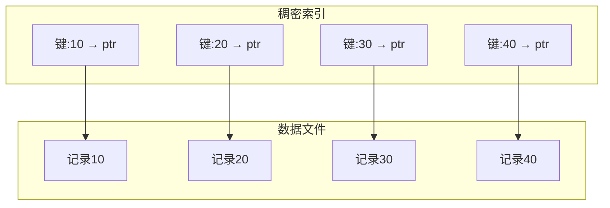
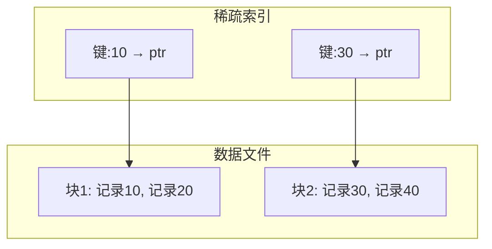

# 顺序文件上的稠密索引与稀疏索引的区别及示例

## 顺序文件上的稠密索引与稀疏索引

要理解这个问题，不妨先问自己一个问题：**如果数据文件里的记录是按主键顺序存放的，我们怎么才能快速找到某一条记录？** 直接顺序扫描整个数据文件当然可以，但代价太大。于是，==索引== 出现了——它就像书的目录，用更少的空间换取更快的查找速度。

### 稠密索引：每条记录都有“名片”

**稠密索引** 为数据文件中的 **每一条记录** 都维护一个索引项。每个索引项包含记录的键值和一个指向该记录实际存储位置的指针。

> [!IMPORTANT]
> 如果索引是**主索引**（即决定数据文件物理排序的那个索引），那么索引块中的键顺序与数据文件中记录的键顺序完全一致。

### 稀疏索引：一个块只给一把“钥匙”

**稀疏索引** 并不为每条记录建索引，而是为一个数据存储块（通常包含多条记录）建一个索引项。索引项中的键值通常取该数据块的第一个记录（即最小键值），指针则指向该数据块的起始位置。

查询时，先在稀疏索引上**二分查找**小于或等于目标键值 K 的最大键，然后再到对应的数据块内顺序搜索。

> [!TIP]
> **记忆口诀**：稠密见“人”（记录），稀疏见“块”。

### 区别与权衡：什么时候用哪种？

| 对比维度 | 稠密索引 | 稀疏索引 |
| :--- | :--- | :--- |
| **索引项数量** | 等于记录数 | 等于数据块数 |
| **索引文件大小** | 较大 | ==远小于稠密索引== |
| **能否直接回答“是否存在”** | ==可以（无需读数据文件）== | 不能，必须检索对应的数据块 |
| **指针精度** | 指向具体记录 | 指向数据块开头 |
| **更新代价** | 每条记录增删都需更新索引 | 仅当数据块的首记录变更时才更新索引 |

> [!WARNING]
> 常见的坑：**辅助索引必须是稠密的**。因为辅助索引不决定数据的物理排序，数据文件不是按其键值顺序排列的。如果对辅助索引用稀疏索引，一个“块索引项”指向的数据块里，记录键值可能毫无关联，完全无法定位目标记录。

### 一个算对了的例子

假设一个关系有 $1,000,000$ 个元组，存储块大小 $4096$ 字节。每个块可存放 $10$ 个元组，则数据文件共有：
$$ \frac{1,000,000}{10} = 100,000 \text{ 个存储块} $$
数据文件大小约 $400\text{MB}$。键占 $30$ 字节，指针占 $8$ 字节，加上块头开销，一个索引块可存放 $100$ 个键-指针对。

- **稠密索引**：需为所有 $1,000,000$ 条记录建索引项。
  - 索引项占用块数：$\frac{1,000,000}{100} = 10,000$ 个块。
  - 索引大小：$10,000 \times 4096\text{B} \approx 40\text{MB}$。
  - 磁盘二分查找 I/O 次数：$\log_2 10000 \approx 14$ 次。

- **稀疏索引**：只需为每个数据块建一个索引项，共 $100,000$ 个索引项。
  - 索引项占用块数：$\frac{100,000}{100} = 1,000$ 个块。
  - 索引大小：$1,000 \times 4096\text{B} \approx 4\text{MB}$。
  - ==这个 $4\text{MB}$ 的索引文件完全可以一次性装入主存！== 此时查找记录仅需 $1$ 次 I/O（读取目标数据块）。

> [!IMPORTANT]
> **核心结论**：稀疏索引以小得多的空间开销，换取了近似甚至更优的查询性能（因为整个索引常驻内存成为可能）。而稠密索引的独有价值在于，不用访问数据文件就能直接判定某键值是否存在。
