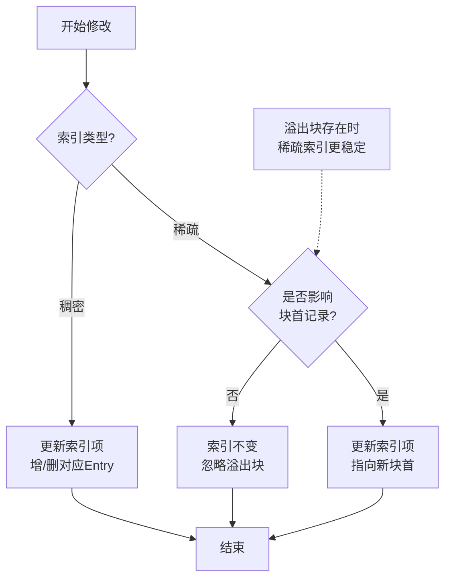

# 数据修改期间的索引维护（插入与删除对稠密/稀疏索引的影响）

# 数据修改期间的索引维护（插入与删除）

在数据库运行过程中，数据的增删改是常态。若每次修改都重建索引，代价极高。因此，我们需要一种机制，在**不重构整个索引结构**的前提下，动态维护索引与数据文件的一致性。

## 核心原则：稠密 vs 稀疏

维护策略取决于索引类型及底层存储结构（是否使用溢出块）。

| 索引类型 | 索引项指向 | 插入/删除影响范围 | 维护代价 |
| :--- | :--- | :--- | :--- |
| **稠密索引** | 每条记录 | **所有**涉及记录的变动 | 高（需增删索引项） |
| **稀疏索引** | 每个基本块 | 仅当**块首记录**变化时 | 低（通常无需操作） |

> [!IMPORTANT]
> ==核心结论==：稀疏索引只关心“基本块”的第一个记录（锚点）。若操作未改变块内最小键值或块首记录位置，稀疏索引**完全不受影响**。

## 基于溢出块的维护机制

为减少记录移动带来的开销，常采用**溢出块（Overflow Block）**链式存储。此时，基本块保持有序，新记录放入溢出块。

### 1. 插入操作
- **稠密索引**：必须在索引中为新记录添加一个新条目，指向其物理地址（可能在溢出块中）。
- **稀疏索引**：
    - 若新记录键值 $K_{new}$ **大于**当前块最大键值：不影响块首，索引不变。
    - 若 $K_{new}$ **小于**当前块最小键值：它将成为新的块首（逻辑上），但物理上通常在溢出链中。*注意：若严格遵循“稀疏索引指向基本块首记录”，且基本块内容未变（仅溢出块增加），则稀疏索引通常**不需更新**，除非实现要求索引始终指向全局最小。但在南邮课件语境下，通常强调**溢出块视为基本块的扩充，不影响稀疏索引项**。*

### 2. 删除操作
- **稠密索引**：直接删除对应的索引项。
- **稀疏索引**：
    - 若删除的不是块首记录：索引不变。
    - 若删除的是块首记录：需将索引项更新为该块中**下一个最小键值**的记录地址。

## 典型场景推演

假设某基本块包含记录 $\{10, 20, 30\}$，稀疏索引项指向 $10$。

1. **插入 15**：
   - 若有溢出块，15 放入溢出块。
   - 基本块首仍为 10。
   - ==稀疏索引不变==。
   - 稠密索引需新增指向 15 的项。

2. **删除 10**：
   - 基本块首变为 20。
   - ==稀疏索引必须更新==，指向 20。

> [!WARNING]
> **常见坑**：混淆“块内排序”与“索引更新”。在溢出块机制下，不要试图去调整基本块内的记录顺序来容纳新记录，这会引发昂贵的记录移动和连锁索引更新。**利用溢出块的核心目的就是隔离这种影响。**

## 碎片化问题

频繁的插入和删除（尤其是使用溢出块时）会导致**存储碎片化**。溢出链过长会降低查询效率（需多次I/O）。因此，系统需定期执行**重组（Reorganization）**，将溢出记录合并回基本块，并重建索引以恢复性能。
