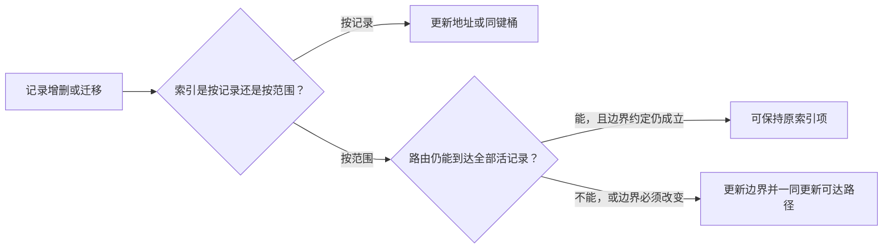

# 索引维护：记录移走之后，搜索还能到达它吗？

记录插入、删除或迁移后，索引必须兑现同一件事：==搜索沿索引走到的地方，仍然能找到所有满足条件的记录==。稠密和稀疏索引的差别，不是一个要更新、一个永远不用更新，而是它们分别保存了哪些承诺。

| 布局 | 索引承诺 | 什么变化需要更新 |
|---|---|---|
| 逐记录的稠密索引 | 每条记录有可解析的地址 | 增删记录或稳定地址发生变化 |
| 按键汇集的稠密索引 | 每个出现过的键有入口，可枚举其全部记录 | 增删键入口，或修改该键的记录地址桶 |
| 按块的稀疏索引 | 依据排序或键范围选块，再在该块及其溢出链找值 | 由索引使用的边界约定决定，分裂或重组时要匹配新的范围 |

## 为什么块首页变了，也不能只看物理上的第一条记录？

假设索引记录每个基本块的**逻辑最小键**，用「小于或等于查询键的最大索引键」找到要扫描的块。两个块的索引键分别是 0 和 10，第二块的基本页内有 10、20、30。这时插入 15，放进第二块的溢出页：第二块的逻辑最小值仍是 10，索引不必改。可是随后删掉 10，虽然基本页的首条变成 20，该块及溢出链的最小值是 **15**，并非 20。

**参考解答（自编算例）。** 若误把第二项改为 20，搜索 15 会按规则走到第一块，而且在那里找不到这条记录；这已经违反索引的路由承诺。可以把第二项更新为 15，或者采用另一种设计：索引项保存仍然有效的**范围下界** 10，而不承诺该下界等于某条活记录的键。此时第二块是「从 10 起的范围」，删掉 10 不必改索引。两种设计都能成立，却不能用一套设计的搜索规则和另一套设计的更新规则混搭。

> [!TIP]
> 遇到「插入或删除块首后要不要改索引」，先读题目定义：键值取的是基本页首、整条链的最小值，还是稳定范围下界？然后拿边界附近的键走一遍搜索。题目若指定按基本页首路由，溢出页的记录也必须留在该路由能覆盖的范围内。

溢出链拉长会增加页读取。重组能重新聚集记录、压短链，但迁移时必须保持旧地址可解析或同步更新引用；有无必要重组取决于访问代价，而不是每次插入都要重建索引。参见[块和记录的地址](块与记录地址.md)与[记录的修改](记录的修改.md)。
