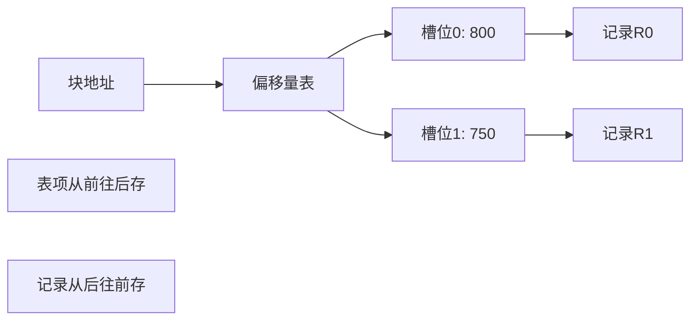

# 结构地址实现技术（服务器数据地址空间与指针混写）

## 为什么需要结构地址？

在 DBMS 存储管理中，如果直接使用“物理地址”（柱面+扇区+块内偏移）定位记录，一旦块内发生插入、删除导致记录移动，所有指向该记录的指针都必须更新，代价极高。而纯“逻辑地址”（表名+记录ID）虽然稳定，但每次访问都需要查表转换，效率不足。

> [!IMPORTANT]
> 结构地址是==物理地址与逻辑地址的折中方案==，既保留了块级物理定位的高效性，又通过间接映射屏蔽了块内记录移动的影响。

## 核心实现机制

结构地址的核心思想是在每个数据块内部维护一张**偏移量表（Offset Table）**，将“记录ID”映射为“块内偏移量”。

- **偏移量表**：位于块头部，按槽位顺序==从前往后==增长，每项存储对应记录相对于块起始位置的字节偏移量。
- **记录数据**：位于块尾部，==从后往前==分配空间，避免与偏移量表冲突。
- **结构地址组成**：$$ \text{结构地址} = (\text{块地址}, \text{偏移量表项索引}) $$

> [!TIP]
> 记忆口诀：==表正序，记录逆序，地址=块号+槽位号==。查找时先由块地址读入内存块，再用槽位号查偏移量表得到实际偏移，最后定位记录。

## 与相近概念的区别

| 地址类型 | 组成形式 | 块内记录移动时 | 访问开销 |
| :--- | :--- | :--- | :--- |
| 物理地址 | 块地址 + 块内绝对偏移 | ==必须批量更新指针== | 低（直接定位） |
| 逻辑地址 | 表名 + 全局记录ID | 无需更新 | 高（需全局索引） |
| 结构地址 | 块地址 + 槽位索引 | ==仅修改偏移量表项== | 中（一次间接寻址） |

## 计算示例与易错点

假设某块大小为 4KB，偏移量表项占 2B。当前偏移量表有 3 项：`[800, 750, 700]`，分别对应槽位 0、1、2。现要访问结构地址 `(Block#105, 1)`：

1. 读取 Block#105 到内存；
2. 取槽位索引 `1`，查偏移量表第 1 项得偏移量 `750`；
3. 从块起始位置向后偏移 750 字节，即为记录 R1 的实际位置。

> [!WARNING]
> 常见坑：误将==槽位索引当作字节偏移==直接使用。结构地址的第二部分是“表项下标”，不是“记录偏移量”，必须经过查表转换！

> [!CAUTION]
> 删除记录时，==不要移动其他记录==，只需将对应偏移量表项标记为无效（如置为 -1），否则破坏“从后往前”的紧凑布局，引发连锁修改。

## 设计本质再思考

为什么偏移量表要从前往后、记录从后往前？这种==双向生长==设计使得新增记录时无需移动已有数据，只需在表尾追加一项、在数据区前端分配空间，两者互不干扰，最大化减少了块内碎片整理频率。这正是结构地址能在保证稳定性的同时维持高性能的关键所在。
