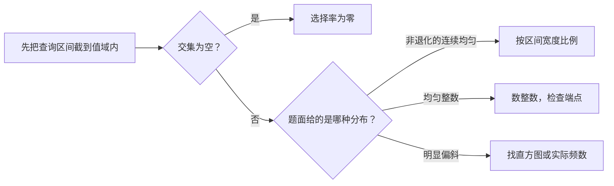

# 估计结果及中间结果的大小（乘积、投影、选择基数、区间选择的估计假设）

## 为什么要分别估计行数和行宽

查询优化器需要比较两条等价计划的工作量。中间结果可能很宽，却只有几行；也可能每行只有几个字节，却要处理数百万行。**基数**是元组数，**行宽**是每行的字节数，二者相乘只能粗估结果数据量。若要估算实际页数，还需要页容量、页头、槽目录、变长字段与填充率；流水线也可能根本不把中间结果写到磁盘。

## 乘积与投影

若关系 $R$ 有 $N_R$ 个元组、$S$ 有 $N_S$ 个元组，笛卡尔积枚举所有左右配对，因此

$$
|R\times S|=N_RN_S.
$$

例如 $R$ 有 1000 行、$S$ 有 200 行，$R\times S$ 有 200000 行。若两边按每行净宽 20 B、12 B 估计，则结果净数据量约 $200000\times32=6400000$ B，不含页开销。==笛卡尔积的行数可以直接相乘，带条件的连接不能机械地相乘==。

取列会改变行宽，但行数取决于是否去重：

| 语义 | 投影后的行数 |
|---|---|
| SQL 普通 `SELECT`（包语义） | 若该步骤只取列，保留每一行；有 $N$ 行、新行宽 $w'$ 时，净数据量约为 $Nw'$ |
| 集合关系代数的投影，或 SQL `SELECT DISTINCT` | 相同的所选属性组合合并为一项；行数是保留列上的不同组合数，而非输入行数 |

例如有两行不同的记录 $(1,\text{南京})$、$(2,\text{南京})$。SQL 只取城市会返回两条“南京”；集合投影或 `SELECT DISTINCT` 只返回一条。若物理计划用包投影表示取列，可再显式加去重算子 $\delta$；不要给已经是集合投影的表达式再用“行数不变”的规则。

## 等值选择

设 $N_R$ 是 $R$ 的总行数，谓词 $P$ 的选择率 $s$ 是能通过该谓词的行的比例，估计结果行数为 $sN_R$。对 $A=a$，在非空值近似均匀且常量 $a$ 属于这些观测值的模型下，设非空行数为 $N_{\mathrm{nonnull}}$，不同非空值数为 $V(R,A)$，可估为 $N_{\mathrm{nonnull}}/V(R,A)$。

例如一张 10000 行且城市列无空值的关系有 100 个不同城市，近似均匀时，城市为南京约有 $10000/100=100$ 行。若已知南京是热点、实际有 2800 行，就应用其观测频数，而非拿平均值覆盖已有信息；空值也不能算作普通等值匹配。

## 区间宽度不是离散值数

假设非空值总体支撑在 $[L,U]$，先把查询区间与 $[L,U]$ 取交：交集为空时选择率为零。若 $L=U$，只要检查这个唯一值是否满足谓词；其余情形再选模型。

| 题面给出的模型 | 对截取后的区间 $[a,b]$，如何估 |
|---|---|
| 连续均匀，且 $L<U$ | 取宽度之比 $(b-a)/(U-L)$；单个端点是零测度 |
| 各整数等可能 | 数满足条件的整数；当 $L,U,a,b$ 都是整数且包含端点时，用 $(b-a+1)/(U-L+1)$；若有严格不等式，排除对应的整数边界 |

同样是 1000 条非空记录、范围 $[0,100]$、查询 $10\le A\le20$：连续模型估得 $1000\times10/100=100$ 行；整数模型则是 $1000\times11/101\approx109$ 行。查询把 $20$ 改成严格排除时，整数模型少数一个值，连续模型不变。若存在大量重复热点，连续均匀模型当然不适用。

> [!TIP]
> 看到==含端点的整数区间==，先数值，不要只减端点；看到明显偏斜、跳跃集中的数据，优先使用直方图或频数。含空值时，先以非空行数为估算基数。

## 用估算比较等价改写

对内连接，如果 $P$ 只引用 $R$，可以把连接后的筛选下推到输入侧：

$$
\sigma_P(R\bowtie S)
\quad\longrightarrow\quad
(\sigma_P(R))\bowtie S.
$$

例如假设能在连接前把 $R$ 从 10000 行筛至约 100 行，后续算子处理的左输入会缩小；物理计划是否更省，还要看索引、访问顺序、缓存和中间结果是否物化。估算不能替代对等价条件的证明，也不能把投影节省的**字节**误当成筛选掉的**行**。
