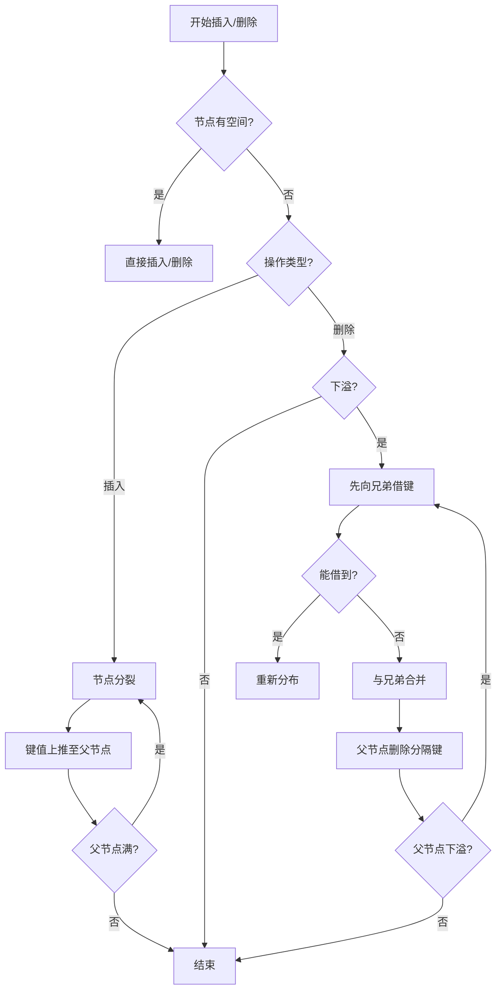

# 记录的修改（插入、删除、更新操作）

# 记录的修改（插入、删除、更新操作）

在 DBMS 存储层，记录并非静止不变。频繁的增删改会导致==存储碎片化==，降低 I/O 效率。理解不同文件组织方式下的修改机制，是掌握索引维护和事务恢复的基础。

## 堆文件与有序文件的修改差异

**堆文件（Heap File）**：记录按插入顺序存储，无特定排序。
*   **插入**：若当前块有空闲，直接写入并更新偏移量表；若空间不足，创建==溢出块==（Overflow Block）。注意：溢出块不影响稠密/稀疏索引的对应项（视为“空气”）。
*   **删除**：通常只打删除标记，或移动邻近记录填补空洞。

**有序文件（Sorted File）**：记录按主键排序。
*   **代价**：插入/删除可能引发大量记录移动以维持顺序，代价高昂。
*   **策略**：常采用“邻近块方式”，数据移动导致元组位置变化，进而触发索引更新。

## 索引的维护机制

索引必须随数据同步更新，但稠密索引与稀疏索引的规则截然不同。

| 特性 | 稠密索引 (Dense) | 稀疏索引 (Sparse) |
| :--- | :--- | :--- |
| **索引项数量** | 每个记录一个索引项 | 每个块一个索引项（指向块首记录） |
| **删除影响** | 索引项需移动合并（索引本身是顺序文件） | 仅当==块内第一个记录==被删或整个块被删时，才需修改索引 |
| **插入影响** | 新增索引项，可能需移动后续项 | 仅当新记录成为==块内第一个记录==时，才需修改索引 |

> [!IMPORTANT]
> 核心结论：稀疏索引的维护成本远低于稠密索引，因为它只在“块边界”发生变化时才动作。

## B+ 树的动态平衡

B+ 树通过分裂与合并保持平衡，确保查找效率稳定。

> [!TIP]
> 记忆口诀：B+ 树删除遵循==“先借后合并”==原则。只有当兄弟节点也无法提供键值时，才进行合并，并可能向上递归。

## 常见误区与示例

**误区**：认为删除记录后，稀疏索引的所有相关项都要更新。
**正解**：只有当被删记录是所在块的==第一条记录==时，稀疏索引项才需要更新为块内的新首记录。

**示例分析**：
假设某块包含记录 `[30, 40, 50]`，稀疏索引指向 `30`。
1.  删除 `40`：块内变为 `[30, 50]`，首记录仍为 `30`，==索引无需修改==。
2.  删除 `30`：块内变为 `[40, 50]`，首记录变为 `40`，==索引需更新==为指向 `40`。

> [!WARNING]
> 在事务恢复中，若采用“后像提交前写入”策略，系统故障时需根据 ATL/CTL 表决定 Undo 或 Redo。务必注意 TID 从 ATL 移除和加入 CTL 的顺序，以防状态丢失。
