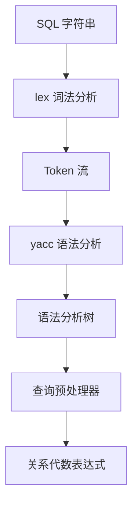

# SQL语句的词法分析与语法分析（BNF范式、解析语法树、lex与parser）

当数据库收到一条 `SELECT * FROM R WHERE A>1` 字符串时，系统如何“读懂”它？这需要将线性文本转化为结构化的内部表示。在南邮《数据库管理系统实现》中，这一过程由查询分析器完成，核心依赖 ==lex 词法分析== 与 ==yacc 语法分析== 两个工具链。

## 从文本到树的转化机制

为什么不能直接执行 SQL 字符串？因为计算机无法理解自然语言式的指令，必须将其转换为具有层次结构的语法分析树（Parse Tree）。该树的每个节点对应一个语法类（用尖括号表示，如 `<SFW>`、`<condition>`），叶子节点则是具体的 Token。

> [!IMPORTANT]
> 语法分析树仅是==纯语法结构==的体现，不包含语义合法性验证。真正的表名存在性、类型匹配等检查由后续的“查询预处理器”负责，并将语法树转换为关系代数表达式树。

## lex 与 yacc 的分工协作

在课程实验代码 `lex_db.py` 和 `parser_db.py` 中，两者各司其职：

| 组件 | 输入 | 输出 | 核心依据 | 课程文件 |
| :--- | :--- | :--- | :--- | :--- |
| lex | SQL 字符流 | Token 序列 | 正则表达式 | `lex_db.py` |
| yacc | Token 序列 | 语法分析树 | BNF 范式 | `parser_db.py` |

`common_db.py` 定义了四个全局变量：lex 解析器、yacc 解析器、全局语法树、逻辑查询计划，并在 `main_db.py` 中被统一调用。这种模块化设计使得词法、语法分析与后续优化解耦。

> [!TIP]
> BNF 范式中 `<SFW>` 代表 Select-From-Where 块的整体结构，而非三个独立关键字。编写 yacc 规则时务必区分==终结符==（具体单词）与==非终结符==（语法类）。

## 正确解析示例与常见陷阱

以 `SELECT a FROM R WHERE a > 1` 为例，正确的语法树根节点为 `<SFW>`，其子节点依次为 `<sel_list>`、`<from_list>`、`<condition>`。其中 `<condition>` 进一步展开为左操作数、比较符、右操作数。

> [!WARNING]
> 常见错误是将 `WHERE a > 1 AND b = 2` 解析为扁平结构。正确做法是 `<condition>` 节点递归嵌套，即 AND 作为父节点，左右子树分别为两个原子条件。忽略==运算符优先级==会导致生成的语法树语义错误。

> [!CAUTION]
> 语法分析成功 ≠ 查询合法。若表 `R` 不存在或字段 `a` 类型为字符串却与整数比较，yacc 仍会生成语法树。这类错误必须在==查询预处理器阶段==捕获，切勿混淆语法分析与语义分析的边界。

掌握 lex/yacc 的关键在于理解：词法解决“是什么词”，语法解决“词如何组合”。只有构建出正确的语法分析树，后续的查询优化与物理执行才具备可靠基础。
