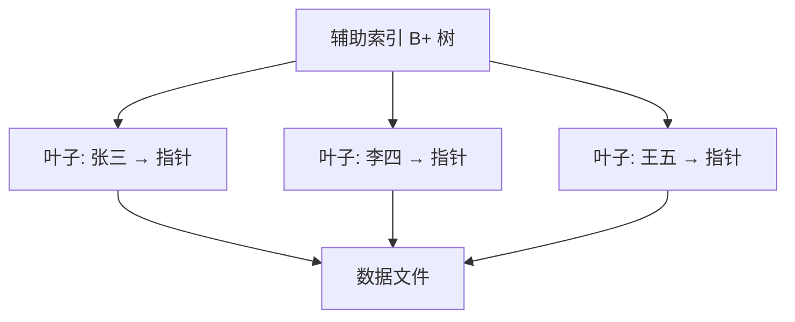
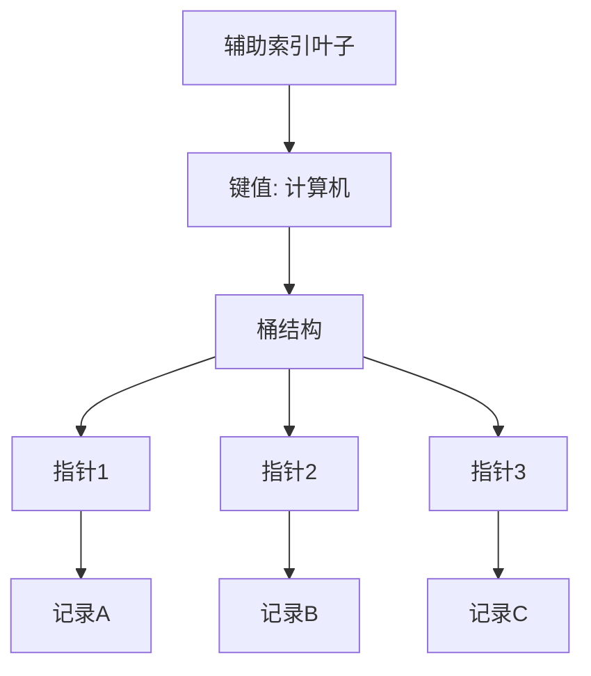

# 辅助索引及其应用（聚集文件应用、索引中的间接与桶的作用）

## 为什么需要辅助索引

主索引只能有一个，它决定了数据文件中记录的物理排列顺序。但如果查询条件不是主键呢？比如学生表按学号建了主索引，现在想按"姓名"或"专业"查询——数据文件并不会按这些字段排序。

这时就需要**辅助索引**：它不改变数据文件的存放方式，只是额外维护一份"键值 → 记录位置"的对照表，告诉系统某个记录在哪里。

> [!IMPORTANT]
> 一个关系上只能有一个主索引，但可以有多个辅助索引。主索引决定记录的排列顺序，辅助索引不影响记录存放位置，只提供查找入口。

## 辅助索引的结构

辅助索引通常也是 B+ 树，但叶子节点存的不是记录本身，而是**指向记录的指针**（间接层）。多个叶子项可能指向同一个数据块。

## 必须是稠密的

> [!WARNING]
> 直接建立在数据文件上的稀疏辅助索引没有意义。

为什么？稀疏索引要求数据文件按索引键有序排列，才能用"每个块只存一项"来定位。但辅助索引的键值（如姓名、专业）对应的记录分散在数据文件各处，根本没有按这个键排序。如果做稀疏索引，每个索引项指向的块里可能根本没有目标记录，或者目标记录在其他块里——索引就失效了。

因此：**辅助索引必须是稠密的**，即为数据文件中的每一条记录都建立一个索引项。同时，由于多个记录可能有相同的辅助键值（比如同一个专业有很多学生），辅助索引通常有大量重复的键值项。

## 间接与桶：处理重复键值

当辅助索引键有大量重复值时，如果每个索引项直接存记录指针，会浪费空间。更好的做法是引入**间接层**：

**桶（Bucket）** 是一个指针数组，所有具有相同键值的记录指针集中存放在一个桶里。索引叶子节点只需存一个指向桶的指针，而不是存多个重复键值加多个指针。这样：

- 减少索引叶子节点的空间开销
- 查询某个键值时，先找到桶，再遍历桶内指针

## 聚集文件应用

辅助索引还可以配合**聚集文件（Clustered File）**使用：将多个相关表按某个共同字段物理地存储在一起，减少连接查询时的磁盘 I/O。辅助索引帮助定位聚集文件中的记录位置。

## 对比与常见误区

| 特性 | 主索引 | 辅助索引 |
|------|--------|----------|
| 数量 | 只能有一个 | 可以有多个 |
| 是否决定记录顺序 | 是 | 否 |
| 稠密/稀疏 | 可稀疏 | 必须稠密 |
| 键值是否重复 | 通常不重复 | 通常有重复 |

> [!TIP]
> 判断题常考："辅助索引可以是稀疏的"——**错**。记住：辅助索引键不决定文件顺序，稀疏索引的前提是按索引键有序，两者矛盾。

> [!CAUTION]
> 另一个常见错误是认为"辅助索引改变记录存放位置"。辅助索引只提供查找入口，数据文件本身的排列由主索引（或堆文件组织）决定，两者互不影响。
