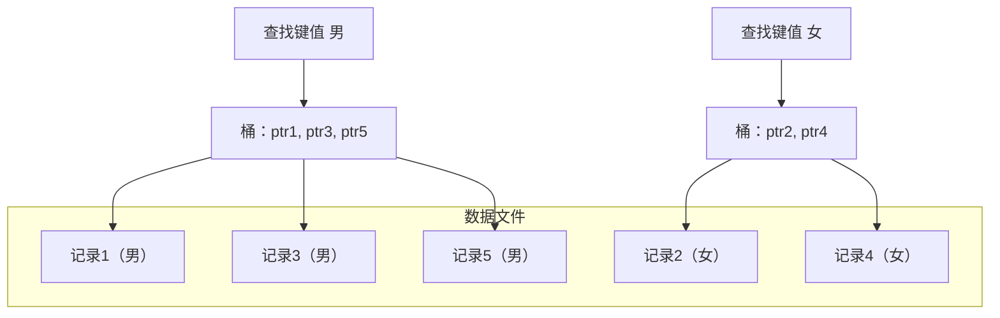

# 重复查找键的索引及其查找方法

好的，我们来看“重复查找键的索引及其查找方法”。

---

## 从数据入口到数据指针

一个索引项最基本的构成是 `(查找键, 指针)`。当不同的记录具有相同的查找键值时，就会出现重复查找键。

这在辅助索引中极为常见——例如学生表中，“性别”或“所在班级”作为辅助索引的查找键，必然有大量重复值。

## 为什么需要关注重复键

即使查找键不唯一，辅助索引也必须能准确定位到**所有**满足条件的记录。

> [!IMPORTANT]
> ==辅助索引必须是稠密索引==，也就是数据文件中每个记录的查找键值都在索引文件中有一个对应的索引项（或同值项的指针链表）。否则，若采用稀疏索引，对于不唯一的辅助查找键，就会漏掉部分记录。

## 两种实现方案

处理重复查找键的辅助索引，常见有两种组织方式。

### 方案一：每个键值带一个指针桶

索引文件只保留不同的查找键值，每个键值对应一个桶，桶中存放指向**所有**具有该键值的数据记录指针。



- **查找方法**：在索引中二分（或 B+ 树搜索）找到键值，然后遍历其指针桶即可得到所有目标记录的物理位置。
- **优点**：索引文件体积小，键值不重复。
- **缺点**：桶大小不定，可能跨块存储，需要额外 I/O 管理。

### 方案二：每个记录留一个索引项

索引文件中，数据文件的每一条记录都生成一个索引项，哪怕查找键值重复。多个索引项连续存放时，形成同键值序列。

```mermaid
flowchart TD
    subgraph 索引文件（稠密）
    idx1["（男, ptr1）"]
    idx2["（男, ptr3）"]
    idx3["（男, ptr5）"]
    idx4["（女, ptr2）"]
    idx5["（女, ptr4）"]
    end

    subgraph 数据文件
    D1["记录1"]
    D3["记录3"]
    D5["记录5"]
    D2["记录2"]
    D4["记录4"]
    end

    idx1 --> D1
    idx2 --> D3
    idx3 --> D5
    idx4 --> D2
    idx5 --> D4
```

- **查找方法**：在索引上二分或 B+ 树搜索，定位到**键值的第一个索引项**，然后沿着索引顺序向后扫描，直到键值变化为止。因为索引有序，所有重复键会物理聚拢在一块儿。
- **优点**：结构规整，每个索引项定长，管理简单。
- **缺点**：索引项数量与数据记录数相等，占用空间比方案一大。

> [!NOTE]
> 方案二的内存管理更简单，是多数 DBMS 实现（如 MySQL InnoDB 的辅助索引）的首选。在 B+ 树叶节点中，就是按 `(键值, 主键值)` 有序存放的。

## 主索引 vs 辅助索引中的重复键

| 类型 | 是否允许重复键 | 索引密度 | 说明 |
| :--- | :---: | :---: | :--- |
| 主索引 | 通常不强调 | 稀疏 | 建立在排序键上，键值唯一或不唯一，但索引项只指向每个块的首记录。 |
| 辅助索引 | ==允许大量重复== | 必须稠密 | 建立在非排序属性上，必须能定位到每条记录。 |

> [!WARNING]
> 建立在数据文件上的**稀疏**辅助索引没有意义，因为数据文件不是按辅助键排序的，一个索引项只能覆盖一段物理区域，但它不能保证该区域内所有记录都满足该辅助键值。因此辅助索引必须是稠密的。

## 算对了的例子

假设学生的“年龄”作为辅助查找键，数据文件未按年龄排序。

**索引组织（方案二，部分）：**

| 年龄 | 指针 |
| :--- | :--- |
| 20 | → ptr_record_A |
| 20 | → ptr_record_E |
| 20 | → ptr_record_K |
| 21 | → ptr_record_B |
| 21 | → ptr_record_H |

**查询：找出年龄=20的所有学生。**

1. 在索引上二分查找，到达年龄=20的第一个条目（指向 A）。
2. 顺序向后扫描：E、K，直到遇到年龄=21，停止。
3. 通过 ptr_record_A、ptr_record_E、ptr_record_K 读取数据记录，合并得到结果集。
4. 总共需要 3 次数据文件 I/O（假设每个指针需要一次取数据），索引扫描成本由连续 I/O 决定。

## 常见的坑

> [!CAUTION]
> 在辅助索引中，==不要误认为索引项是稀疏的==。学生常见的错误是拿主索引的结构直接套用到辅助索引上，给非排序列建了一个稀疏索引文件，结果查询时漏掉大量符合条件的数据行。

> [!TIP]
> 记忆要领：**主索引→排序键→稀疏可用；辅助索引→非排序键→必须稠密。**

---

现在，你应该能清楚地分辨：辅助索引为什么必须稠密、重复键在这两类索引中的处理差异，以及两种常见实现方案各自如何完成查找。
