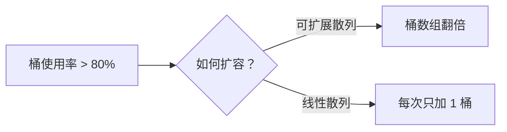

# 散列表（哈希函数、两种实现方式、插入与删除操作、溢出处理经验规则）

## 散列表：把键直接“算”成位置

先想一个问题：如果记录很多，又不想在索引树里一层层比较，能不能**根据键直接算出存储位置**？散列表（Hash Table）就是按这个思路设计的。

设桶的数目为 $B$，散列函数 $h$ 把任意查找键 $K$ 映射到桶号：

$$
h(K) \in \{0, 1, \dots, B-1\}
$$

桶号相同的记录放在同一个桶里。桶的物理载体是**存储块**。这一条是与主存散列表最大的区别：主存里桶用链表结点串起来即可；辅助存储器上桶是磁盘块，块内可以放多条记录。

> [!IMPORTANT]
> 辅助存储器上的散列表：桶由存储块组成；若一个块放满，通过**溢出块链**追加空间。需要能由桶号找到该桶第一个存储块的位置。

---

## 哈希函数与两种桶组织方式

哈希函数的目标是**把键尽量均匀地撒到各桶**。例如 $B=4$ 时，可取：

$$
h(K) = K \bmod 4
$$

键 $17$ 进入桶 $1$，键 $22$ 进入桶 $2$。哈希函数设计得不好，大量键挤进少数桶，溢出会非常严重。

桶的组织有两种典型实现方式：

| 方式 | 思路 |
|---|---|
| **定址式（按桶号直接分配块）** | 桶 $i$ 就是一个或连续几个磁盘块，溢出时链接溢出块 |
| **目录式（桶数组 + 指针）** | 内存中维护一个桶数组，每项指向某个数据块；动态散列常用这种方式 |

可扩展散列与线性散列都属于**目录式**，桶数组项指向存储块。

---

## 插入与删除

### 基本插入

给定查找键为 $K$ 的记录：

1. 计算 $h(K)$ 得到桶号；
2. 对应桶（块）还有空闲空间，直接在块内滑动记录、更新偏移量表、加新表项；
3. 若桶已满，==分配一个溢出块==，链到该桶上，把记录插入溢出块。

溢出块本质是基本存储块的扩充。**对稠密/稀疏索引来说，溢出块里的记录算“空气”**——插入删除到溢出块并不改变原索引项，这在考试里经常作为干扰项出现。

### 删除

删除记录后若某个溢出块不再需要，应把它从链上摘掉并释放。频繁的插入、删除会留下**碎片化**：块内空隙分散，后续插入即使总空间够，也要频繁滑动记录。

> [!WARNING]
> 堆文件按“先来后到”存储，不按键排序。散列表插入不是“找到合适位置插入”，而是**先哈希、再处理溢出**。别把堆文件的“先来后到”与散列表的“桶内放置”混为一谈。

---

## 溢出处理的经验规则

实践证明有一条非常实用的经验规则：

> [!TIP]
> 如果桶的使用率超过 **80%**，溢出就会显著增加。此时主要矛盾是哈希函数的质量——均匀的哈希函数可以显著减少溢出块链长度。

因此实际系统会监控 $r/B$（记录总数与桶数之比），超过阈值就**重组**（重新分配更多桶、重新哈希），或使用下面两种动态散列：

---

## 动态散列：可扩展散列

哈希函数产生 $b$ 位输出，但**只取前 $i$ 位**决定桶号，$i$ 可随时间增长。

- 维护一个桶数组，大小为 $2^i$。
- 插入时取 $h(K)$ 的前 $i$ 位，找到对应桶数组项，沿指针找到存储块；有空间就插入，没有则**分裂该块**。
- 当 $B$ 太小时，把桶数组**翻倍**，$i$ 加 1。

例如 $i=1$ 时桶数组只有两项：`0` 和 `1`。插入 `1010` 和 `0000` 后，再插入 `0111`，若该桶块已满，桶数组翻倍为 4 项，$i=2$，重新按前两位映射。

> [!NOTE]
> 优点：桶数组小到能放入内存时，一次寻址即可定位记录所在块。
> 缺点：翻倍时桶数组可能大到无法全部进内存，I/O 突增；某些块可能提前分裂，浪费空间。

---

## 动态散列：线性散列

线性散列不是翻倍，而是**每次只增加一个桶**。

设当前桶数为 $n$，使用 $h(K)$ 的**最右侧 $i$ 位**编号。把 $h(K)$ 的后 $i$ 位看成二进制整数 $m$：

- 若 $m < n$：插入到编号为 $m$ 的桶；
- 若 $m \ge n$：插入到编号 $m - 2^{i-1}$ 的桶（即把最高位从 1 改 0）。

每次插入后计算比值 $r/n$（$r$ 是记录总数）。若超过设定阈值，比如 **1.7**，就**新增一个桶**，并分裂当前“待分裂”桶。

> [!IMPORTANT]
> 可扩展散列是“翻倍地长”，线性散列是“一次长一个桶”。考题常让你算：插入后 $r/n$ 是否超过阈值？若超过，触发分裂。

---

## 一个算对了的例子

设桶数组初始 $n=3$，已存记录数 $r=5$，阈值 1.7：

$$
r/n = 5/3 \approx 1.67 < 1.7
$$

不分裂。再插入一条记录，$r=6$：

$$
r/n = 6/3 = 2 > 1.7
$$

触发线性散列的桶分裂：增加一个桶，$n$ 变为 4，并处理一次桶分裂，把原桶中部分记录按新的 $i$ 位重新映射到新桶。

---

## 易错点速查

| 常见混淆 | 正解 |
|---|---|
| 散列表插入到“合适位置” | 散列表先哈希再放桶，不按键排序 |
| 溢出块影响索引项 | 溢出块只是块的延伸，不改变既有稠密/稀疏索引项 |
| 动态散列只有可扩展一种 | 还有线性散列，每次只加一个桶 |
| 桶使用率到 100% 才处理 | 经验规则是超过 80% 就该重视哈希函数与扩容 |
