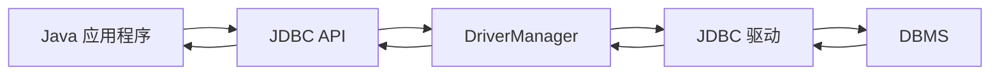
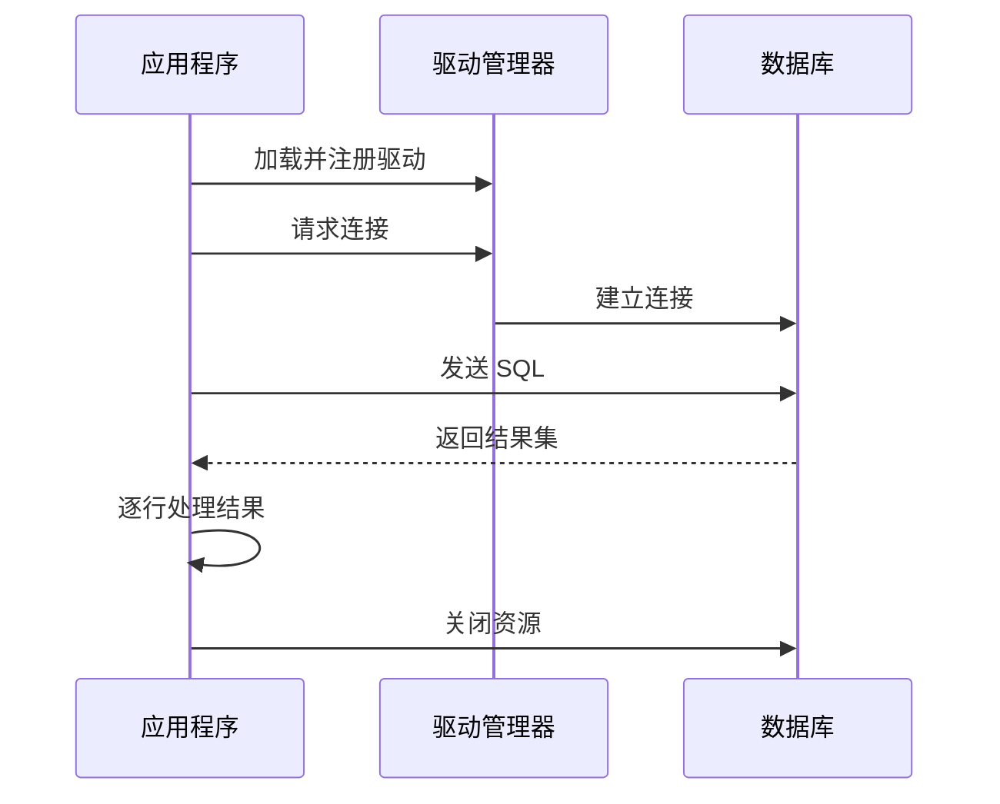

# JDBC工作原理与API基础

## JDBC 是什么

JDBC（Java Database Connectivity）是 Java 访问数据库的==标准 API==。它只规定接口，不直接实现具体数据库操作；Oracle、MySQL、SQL Server 等厂商提供各自的 JDBC 驱动。这样，应用程序主要面向统一接口编程，更换数据库时通常只需调整驱动和连接参数，而不必重写全部数据访问代码。

> [!IMPORTANT]
> JDBC 的核心作用是：==用统一的 Java 接口屏蔽不同数据库的差异==。SQL 仍由数据库执行，JDBC 负责连接、传语句、取结果。

## 工作原理与执行流程

JDBC 应用通常分为四层：Java 应用程序调用 JDBC API，驱动管理器选择合适驱动，驱动把调用转换为数据库可理解的通信请求，最后由 DBMS 执行 SQL 并返回结果。



一次典型查询可按下面顺序理解：



## JDBC API 基础

| 接口或类 | 主要作用 | 常用方法 |
|---|---|---|
| `DriverManager` | 管理驱动、建立连接 | `getConnection()` |
| `Connection` | 表示一次数据库连接 | `createStatement()`、`prepareStatement()` |
| `Statement` | 执行静态 SQL | `executeQuery()`、`executeUpdate()` |
| `PreparedStatement` | 执行带参数的预编译 SQL | `setXxx()`、`executeQuery()` |
| `ResultSet` | 保存查询结果，按行读取 | `next()`、`getXxx()` |

连接 URL 的一般形式为：

```text
jdbc:子协议:数据库定位信息
```

例如 MySQL 可写为：

```text
jdbc:mysql://localhost:3306/sxn
```

其中 `sxn` 是数据库名；实际使用时还要提供用户名和口令。

## 一个完整且正确的查询例子

```java
String url = "jdbc:mysql://localhost:3306/sxn";
String sql = "select * from flight where id = ?";

try (Connection conn =
         DriverManager.getConnection(url, "scott", "tiger");
     PreparedStatement ps = conn.prepareStatement(sql)) {

    ps.setInt(1, 1001);       // 参数编号从 1 开始
    try (ResultSet rs = ps.executeQuery()) {
        while (rs.next()) {   // 先移动游标，再读取当前行
            System.out.println(rs.getString("flight_no"));
        }
    }
}
```

这里 `?` 是参数占位符，`setInt(1, 1001)` 给第一个参数赋值。`executeQuery()` 用于查询并返回 `ResultSet`；插入、删除、修改通常用 `executeUpdate()`，返回受影响行数。

> [!TIP]
> 记忆顺序：==加载驱动 → 获得连接 → 创建语句 → 执行 SQL → 处理结果 → 关闭资源==。

## 相近概念与常见坑

| 对比项 | 区别 |
|---|---|
| JDBC 与 ODBC | JDBC 面向 Java；ODBC 是较通用的开放式数据库连接接口 |
| JDBC 与 SQL | JDBC 是调用接口；SQL 是操作数据库的语言 |
| `Statement` 与 `PreparedStatement` | 后者支持参数、预编译，并能降低 SQL 注入风险 |
| JDBC 与 Delphi ADO | 都用于访问数据库；ADO 常配合 `DataSource`、`DBGrid` 等组件显示数据 |

> [!WARNING]
> `ResultSet` 初始位于第一行之前，必须先调用 `next()`；列索引和参数索引都从 **1** 开始。连接、语句和结果集用后应关闭，否则可能耗尽数据库资源。现代 JDBC 常可自动加载驱动，但考试写基本流程时仍应知道 `Class.forName()` 的作用。
