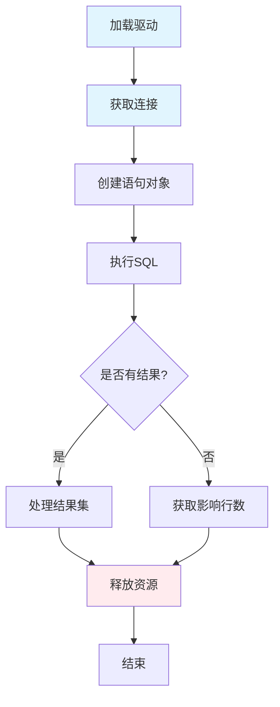

# 使用JDBC操纵数据库的工作流程

# 使用JDBC操纵数据库的工作流程

JDBC（Java Database Connectivity）是 Java 语言中用于规范客户端程序如何访问数据库的应用程序接口。在南邮《数据库系统》课程中，掌握其标准工作流程是进行数据库编程的基础。

## 核心工作流程

JDBC 操作数据库并非直接连接，而是遵循一套严格的“六步法”。你可以将其想象为一次完整的“拨号通话”过程：先找电话线（驱动），再拨号建立连接（Connection），然后说话（Statement/SQL），听对方回应（ResultSet），最后挂断（Close）。



具体步骤如下：

1.  **加载驱动程序**：使用 `Class.forName()` 加载特定数据库的 JDBC 驱动类。
2.  **建立连接**：通过 `DriverManager.getConnection()` 获取 `Connection` 对象。这是与数据库通信的桥梁。
3.  **创建 Statement 对象**：利用连接对象创建 `Statement` 或 `PreparedStatement`。
4.  **执行 SQL 语句**：调用 `executeQuery()`（查询）或 `executeUpdate()`（增删改）。
5.  **处理结果**：如果是查询，遍历 `ResultSet`；如果是更新，检查返回的影响行数。
6.  **释放资源**：==必须按相反顺序关闭== `ResultSet`、`Statement` 和 `Connection`。

> [!IMPORTANT]
> 资源释放是考试高频考点。务必在 `finally` 块中关闭资源，防止内存泄漏和数据库连接耗尽。

## 关键对象辨析

初学者常混淆 `Statement` 与 `PreparedStatement`，二者区别如下：

| 特性 | Statement | PreparedStatement |
| :--- | :--- | :--- |
| **SQL 编译** | 每次执行都编译 | 预编译，效率高 |
| **安全性** | 易受 SQL 注入攻击 | ==有效防止 SQL 注入== |
| **参数处理** | 字符串拼接，繁琐 | 使用 `?` 占位符，简洁 |

> [!TIP]
> 在实际开发和考试中，除非有特殊理由，否则**优先推荐使用 `PreparedStatement`**。它不仅性能更好，还能通过类型安全的参数绑定避免常见的语法错误。

## 常见陷阱与示例

**陷阱 1：忘记关闭资源**
很多同学在代码正常执行时忽略了关闭连接。一旦程序异常退出，连接可能未被释放，导致数据库连接池满载。

**陷阱 2：SQL 注入风险**
使用 `Statement` 拼接用户输入（如 `"SELECT * FROM users WHERE name='" + name + "'"`）极其危险。

**正确示例：**

```java
// 1. 加载驱动 (JDBC 4.0+ 可自动加载，但建议显式写出以符合考点)
Class.forName("com.mysql.cj.jdbc.Driver");

// 2. 获取连接
String url = "jdbc:mysql://localhost:3306/njupt_db";
Connection conn = DriverManager.getConnection(url, "user", "pwd");

// 3. 创建预编译语句
String sql = "SELECT name, age FROM students WHERE id = ?";
PreparedStatement pstmt = conn.prepareStatement(sql);
pstmt.setInt(1, 1001); // 设置参数

// 4. 执行查询
ResultSet rs = pstmt.executeQuery();

// 5. 处理结果
while (rs.next()) {
    System.out.println(rs.getString("name"));
}

// 6. 释放资源 (逆序关闭)
rs.close();
pstmt.close();
conn.close();
```

> [!WARNING]
> 注意 `ResultSet` 的光标初始位置在第一行之前，必须先调用 `next()` 才能获取数据。若直接调用 `getString` 会抛出异常。
