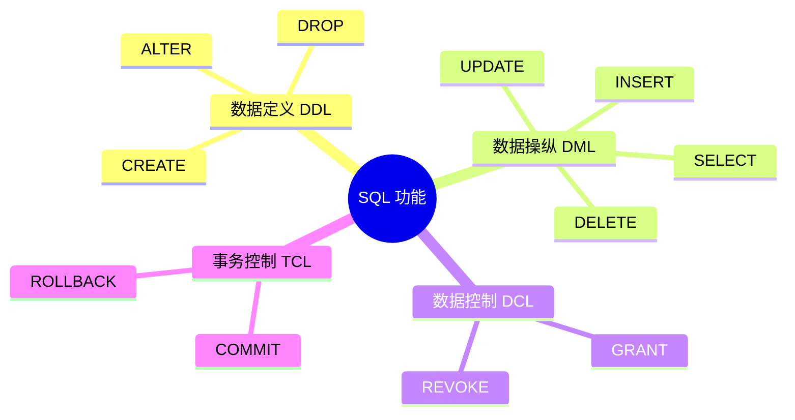

# SQL的特点与基本概念

## SQL 是什么

SQL（Structured Query Language，结构化查询语言）是关系数据库的标准语言。它不是某个特定数据库的私有工具，而是==几乎所有关系数据库管理系统（RDBMS）都支持的统一接口==。

学习 SQL 时，一个常见的困惑是：SQL 到底能干什么？其实可以把它分成四大功能块：



> [!IMPORTANT]
> SQL 的核心定位是**非过程化语言**——你只需要说"要什么"，不需要告诉数据库"怎么取"。至于用什么索引、走什么路径，全由系统自动决定。

## 为什么需要 SQL：SQL 的主要特点

在 SQL 出现之前，每种数据库有自己的查询语言，换数据库就要重新学。SQL 解决了这个问题。它的几个关键特点决定了它成为标准：

**1. 综合统一**
SQL 集数据定义、数据操纵、数据控制于一体。一个语言完成建表、查数据、授权等所有操作，不需要在多个工具之间切换。

**2. 高度非过程化**
这是 SQL 和一般编程语言最本质的区别。用 Java 或 Python 查数据，你得写循环、判断、指针操作；用 SQL，一个 `SELECT ... FROM ... WHERE` 就完成了。==系统负责选择最优执行路径，用户无需操心物理存取细节。==

**3. 面向集合的操作方式**
SQL 操作的基本单位不是一行，而是==记录的集合==。一条 `SELECT` 语句返回多行，一条 `UPDATE` 语句修改多条记录。这让 SQL 天然适合处理批量数据。

**4. 两种使用方式**
SQL 可以作为**交互式命令**直接在终端输入（如 MySQL 命令行），也可以**嵌入高级语言**（如 Java 通过 JDBC 执行 SQL）。两种方式的语法几乎一样，学习成本低。

> [!TIP]
> 记忆口诀：**"统一非过集，交互嵌入"**——统一、非过程化、面向集合、两种使用方式。

**5. 语言结构简洁**
核心动词只有 9 个：

| 功能 | 动词 |
|------|------|
| 数据定义 | `CREATE` `DROP` `ALTER` |
| 数据操纵 | `SELECT` `INSERT` `UPDATE` `DELETE` |
| 数据控制 | `GRANT` `REVOKE` |

## SQL 的核心概念：表、视图与权限

学 SQL 有三个绕不开的概念：

**基本表**：实际存储数据的关系表。比如 `CREATE TABLE P (...)` 创建的零件表，数据持久存储在磁盘上。

**视图**：==虚拟表==，只存定义不存数据。从基本表动态导出，可以像基本表一样被查询。它对数据安全和简化复杂查询有重要意义。

**权限**：数据库通过 `GRANT` 和 `REVOKE` 控制谁可以对什么表做什么操作。例如：

```sql
GRANT SELECT ON TABLE 班级 TO PUBLIC;   -- 所有人可查班级表
REVOKE SELECT ON TABLE 班级 FROM PUBLIC; -- 收回所有人的查询权限
```

> [!WARNING]
> 视图不是基本表的副本。对视图的查询每次都要从其依赖的基本表中重新计算，因此定义过于复杂的视图可能导致查询变慢，但优点是视图总能反映最新数据。

## 相近概念辨析

| 概念 | 本质 | 存数据吗 | 典型场景 |
|------|------|----------|----------|
| 基本表 | 物理存储单元 | 是 | 持久记录零件、学生信息 |
| 视图 | 逻辑定义 | 否 | 为不同用户定制可见数据 |
| 临时表 | 物理暂存 | 是（会话结束自动删） | 复杂查询中间结果 |
| 派生表（子查询） | 查询中的虚拟表 | 否 | `FROM (SELECT ...) AS T` |

## 一个算对了的例子

> **问题**：创建零件表 P，要求 PNO 为主键。

正确写法：

```sql
CREATE TABLE P (
    PNO CHAR(2) PRIMARY KEY,
    PNAME VARCHAR(10),
    COLOR CHAR(2),
    WEIGHT INT
);
```

> [!CAUTION]
> 常见错误：忘记 `PRIMARY KEY` 约束，导致后面可以插入重复零件号；或者把 `CHAR` 和 `VARCHAR` 混用——`CHAR(2)` 固定长度，存 "AB" 就占 2 字节；`VARCHAR(10)` 变长，存 "AB" 只占约 2 字节加一个长度标记。

**验证**：此时往里插入 `('P1', '螺栓', '红', 20)` 和 `('P1', '螺母', '蓝', 15)`，第二条语句会因主键冲突报错，这正是 `PRIMARY KEY` 发挥的作用——==实体完整性在数据库层面被强制执行==。
