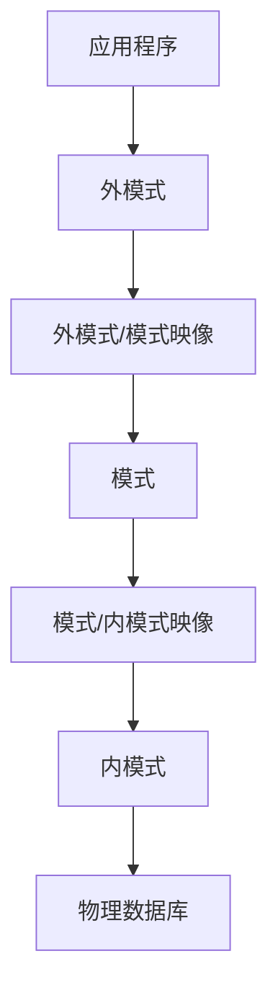

# 数据库系统的三级模式结构（模式、外模式、内模式）

数据库系统的三级模式结构是数据库系统内部的体系结构，它把数据抽象为三个层次，并通过两级映像实现数据独立性。

## 三级模式

| 层次 | 别名 | 描述对象 | 数量 | SQL 中的体现 |
|---|---|---|---|---|
| 外模式 | 子模式、用户模式 | 用户可见的局部数据逻辑结构 | 一个模式可对应多个外模式 | 视图 `view` |
| 模式 | 逻辑模式、概念模式 | 数据库全体数据的逻辑结构和特征 | 通常一个数据库一个模式 | 基本表 `table` |
| 内模式 | 存储模式 | 数据的物理结构和存储方式 | 一个数据库只有一个 | 索引、存储文件等 |

例如，学生关系模式可写为：

$$Student(Sno,Sname,Ssex,Sbirthdate,Smajor)$$

它描述关系的结构，属于模式层。面向成绩查询用户，可以只提供外模式：

$$SC1(Sno,Sname,Cname,Grade)$$

用户无需看到其他无关属性。至于数据采用何种文件组织、是否建立索引，则属于内模式。

> [!IMPORTANT]
> ==模式是三级模式结构的中心==：外模式通常是模式的子集，内模式描述模式的物理存储实现。

## 为什么需要两级映像

**外模式/模式映像**定义每个外模式与模式的对应关系，通常包含在外模式描述中。当模式改变，如增加关系或属性时，DBA 修改该映像，使外模式保持不变。应用程序依据外模式编写，因此不必修改，这保证了**数据的逻辑独立性**。

**模式/内模式映像**定义模式与内模式的对应关系，且是唯一的。当存储结构改变，如更换文件组织或调整索引时，DBA 修改该映像，使模式保持不变，从而外模式和应用程序也不变，这保证了**数据的物理独立性**。

> [!TIP]
> 记忆方法：**外/模映像保外模式，对应逻辑独立性；模/内映像保模式，对应物理独立性。**

## 一个答对了的简答示例

题目：试述数据库的三级模式结构及其带来的好处。

可答：三级模式包括外模式、模式和内模式。外模式是用户能够看见和使用的局部数据的逻辑描述；模式是数据库中全体数据的逻辑结构和特征的描述，是所有用户的公共数据视图；内模式是数据物理结构和存储方式的描述。系统通过外模式/模式映像和模式/内模式映像，分别保证逻辑独立性和物理独立性，使用户能够逻辑、抽象地处理数据，不必关心具体存储方式，同时方便数据库的设计、实现与维护。

## 常见易混点

> [!WARNING]
> **关系模式不等于关系实例。**关系模式是相对稳定的结构描述；关系是某一时刻的具体二维表，会随插入、删除、修改而变化。同一模式可以有很多实例。

> [!NOTE]
> 三级模式不要与数据模型的三个层次混淆：概念模型、逻辑模型、物理模型是数据建模的不同抽象层次；外模式、模式、内模式是数据库系统的内部体系结构。数据库逻辑设计主要形成逻辑模式和外模式，物理设计主要设计内模式。
