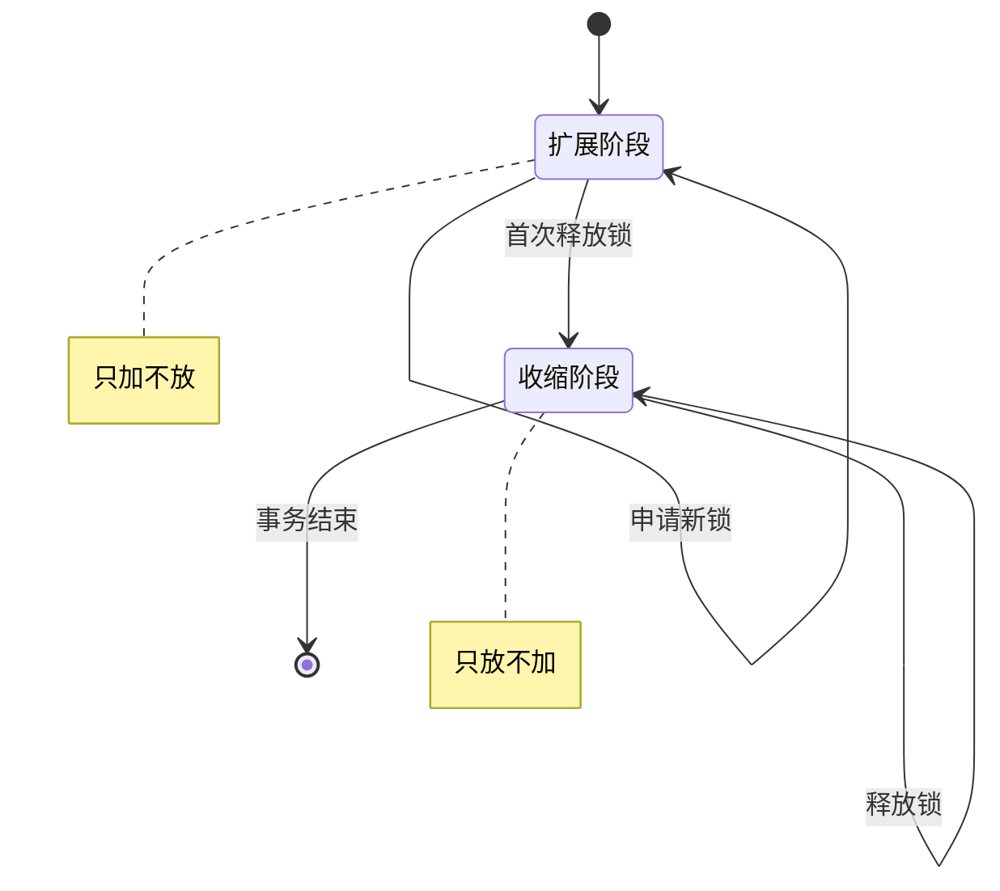

# 两段锁协议（2PL）

## 什么是两段锁协议

在并发控制中，仅仅对数据加锁就能保证调度正确吗？如果事务随意地“加锁-解锁-再加锁”，即使每个操作都合法，最终结果仍可能不可串行化。为解决这一问题，数据库管理系统普遍采用==两段锁协议（Two-Phase Locking, 2PL）==来保证并发调度的可串行性。

> [!IMPORTANT]
> 两段锁协议是指所有事务必须分两个阶段对数据项加锁和解锁：
> - **扩展阶段**：可获得新锁，但不能释放任何锁；
> - **收缩阶段**：可释放锁，但不能再申请任何新锁。

简言之，==一旦释放一个封锁，事务就不再申请和获得任何其他封锁==。这是南邮《数据库系统》课程及历年填空题的高频考点。

## 为什么需要两段锁协议

三级封锁协议解决了丢失修改、读脏数据和不可重复读问题，但并未从理论上保证调度的可串行化。2PL 通过限制锁的申请与释放顺序，从根本上约束了事务的并发行为。

> [!NOTE]
> 遵守两段锁协议是可串行化调度的==充分条件，而非必要条件==。即：所有事务遵守 2PL ⇒ 调度一定可串行化；但调度可串行化 ⇏ 所有事务都遵守 2PL。

## 如何执行两段锁协议

以事务 $T$ 为例，其合法封锁序列为：$\text{lock}(A) \to \text{lock}(B) \to \text{unlock}(A) \to \text{unlock}(B)$。而序列 $\text{lock}(A) \to \text{unlock}(A) \to \text{lock}(B)$ 违反 2PL，因为在释放 $A$ 后又申请了 $B$ 的锁。

## 与一次封锁法的区别

| 对比维度 | 一次封锁法 | 两段锁协议 |
| :--- | :--- | :--- |
| 加锁时机 | 事务开始时一次性全部加锁 | 按需逐步加锁 |
| 是否遵守2PL | 是（特例） | 是（一般形式） |
| 死锁风险 | 无 | ==可能发生死锁== |
| 并发度 | 低 | 较高 |

> [!WARNING]
> 遵守两段锁协议的事务==仍可能发生死锁==。例如 $T_1$: $\text{lock}(A)\to\text{lock}(B)$，$T_2$: $\text{lock}(B)\to\text{lock}(A)$，两者均符合 2PL，但若交错执行至各自持有第一个锁并请求第二个锁时，即形成死锁。因此 2PL 保证可串行化，但不保证无死锁。

## 常见误区与应试要点

> [!CAUTION]
> 切勿将“两段锁协议”与“三级封锁协议”混淆。前者关注==锁的申请/释放时序==以保证可串行化；后者关注==锁的类型与持有时长==以避免具体不一致现象。两者维度不同，可同时使用。

> [!TIP]
> 简答题答题模板：先定义两阶段，再分别说明扩展阶段“只加不放”、收缩阶段“只放不加”，最后点明“释放后不再申请”这一核心约束。填空题若出现“在释放一个锁之后，事务不______获得任何其它锁”，答案必为“再申请和”。
