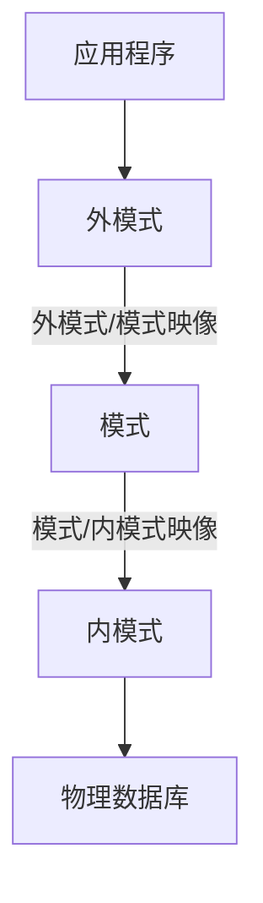

# 数据库的两级映像与数据独立性（逻辑独立性与物理独立性）

## 两级映像与数据独立性

先想一个问题：你写了一个查询学生成绩的程序，第二年学校把成绩表的存储结构从“按学号顺序堆文件”改成了“按课程建索引的 B+ 树”，你的程序要不要重写？直觉上要，但数据库系统阶段之所以区别于文件系统阶段，核心就在于——**不必重写**。

这个“不必重写”的能力，就是**数据独立性**。

### 为什么需要两级映像

数据库系统采用三级模式结构：外模式、模式、内模式。三级之间有两条“翻译通道”：

`模式/内模式映像`定义逻辑结构与物理存储之间的对应关系；`外模式/模式映像`定义用户视图与全局逻辑结构之间的对应关系。正是这两级映像承担了“翻译”工作，使得某一层变了，只需调整对应映像，不必波及上层。

### 逻辑独立性与物理独立性

> [!IMPORTANT]
> `物理独立性`：内模式变了（换存储结构、加索引、挪文件），==模式不变，则应用程序不变==。`逻辑独立性`：模式变了（加表、加字段、改关系），==外模式不变，则应用程序不变==。

| 对比项 | 物理独立性 | 逻辑独立性 |
|---|---|---|
| 变化的层级 | 内模式 | 模式 |
| 调整的映像 | 模式/内模式映像 | 外模式/模式映像 |
| 保持不变的是 | 模式 → 外模式 → 应用程序 | 外模式 → 应用程序 |
| 典型场景 | 加索引、换存储结构 | 增加关系、扩展属性 |

注意：逻辑独立性只能做到“一定的”程度——如果模式变动已经触及外模式必须暴露给用户的那部分结构，外模式就不得不变，应用程序也难免要改。

> [!WARNING]
> 常见误区：认为“逻辑独立性比物理独立性更强”或“两者都由同一个映像保证”。实际上两者由**不同的映像**分别保证，且物理独立性在数据库系统中几乎完全实现，而逻辑独立性只是**一定限度内**的。

### 一个算对了的判断例子

**简答**：数据库的三级模式结构带来什么好处？

先写三级模式：外模式（用户局部逻辑视图）、模式（全体数据逻辑结构）、内模式（物理存储描述）。再写两级映像：外模式/模式映像、模式/内模式映像。最后落到好处：

1. **保证数据独立性**——应用程序依据外模式编写，内模式或模式的合理变化经由映像层被吸收，应用程序不必修改；
2. **方便数据库设计与实现**——三级抽象把“用户怎么看数据”和“机器怎么存数据”解耦，设计者可以分层独立决策。

> [!TIP]
> 考试简答题按“三级是什么 → 两级映像是什么 → 分别保证哪种独立性 → 带来的好处”四步作答，层次最清晰。

再看数据管理三阶段的对比：文件系统阶段“独立性差”，因为程序直接按文件组织方式访问数据；数据库系统阶段“具有高度的物理独立性和一定的逻辑独立性”，这个表述本身就是高频填空题和判断题的出处，务必一字不差地记住。

### 补充辨析

- **外模式依赖模式，内模式依赖模式**，但内模式与外模式相互独立，模式是连接两级对立的中间观点。
- 特定应用程序仅依赖于特定的外模式，所以一个数据库可以有多个外模式，服务于不同用户视图。
- 三级模式的定义都存放在==数据字典==中，动态变化的是数据实例，静态稳定的是模式——关系模式是静态的，关系（实例）随时间变化。
