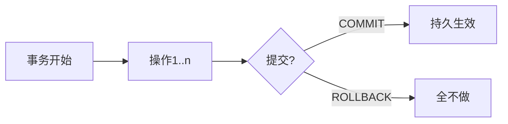

# 事务的基本概念与ACID特性（原子性、一致性、隔离性、持续性）

## 它是什么

在南京邮电大学《数据库系统》第11章“数据库恢复技术”里，**事务（Transaction）**是 DBMS 执行的工作单位，由有限的数据库操作序列组成，是一组不可分割的数据操作序列的一次单独执行过程。事务通常以 `COMMIT` 提交或 `ROLLBACK` 回滚结束。

> [!IMPORTANT]
> 事务的 ==ACID 特性== 是原子性（Atomicity）、一致性（Consistency）、隔离性（Isolation）、持续性（Durability，也称永久性）。

## 为什么需要

如果一个业务逻辑（如银行转账）只做了一半：账户 A 扣款成功，账户 B 未加款，那么“少了这一万元”，数据库就处于**不一致性状态**。因此必须由事务把多个操作绑成一个整体。

## 四个特性怎么理解

先思考：若转账只执行扣款不执行加款，用户逻辑上会发生什么？答案是数据库不再正确——这正引出一致性要求。

用表格对比 ACID 与实现机制：

| 特性 | 定义 | 谁来负责 / 实现机制 |
|---|---|---|
| 原子性 A | 诸操作要么都做，要么都不做 | DBMS 事务管理子系统（日志 REDO+UNDO） |
| 一致性 C | 结果使 DB 从一个一致性状态变到另一个一致性状态 | 应用程序员 + DBMS 完整性子系统 |
| 隔离性 I | 一个事务执行不被其他事务干扰 | DBMS 并发控制子系统（锁、MVCC） |
| 持续性 D | 提交后改变永久，故障可恢复 | DBMS 恢复子系统（WAL 日志） |

> [!NOTE]
> 数据库的恢复机制主要保证事务的 ==原子性== 和 ==持续性==。

## 相近概念的区别

很多同学把“原子性”和“一致性”搞混。看课件里的判断题：

> [!WARNING]
> “事务的一致性要求各个操作要么全做，要么全都不做。”该说法是 **错误（F）**。

因为“全做或全不做”是**原子性**；一致性强调事务前后数据库都满足约束、处于正确状态。选择题也考过：

选择 1：事务的各个操作要么全做，要么全都不做的特性是（　）
- A. 一致性
- B. 原子性
- C. 隔离性
- D. 持久性

==答案：B==。这就是“算对了的例子”。

## 常见的坑

> [!CAUTION]
> 别把一致性写成“操作粒度”的定义；一致性是结果状态，原子性是执行方式。另外，`持久性` 在课件里也叫 `持续性` / `永久性 Permanence`，考试三词通用。

## 一个简答骨架（真题方向）

简答 3 要求“简述事务的 ACID 特性及其实现机制”，标准答法即上表四行：定义 + 责任方/子系统。记住恢复机制对应 A 与 D，并发控制对应 I，完整性检查对应 C，便能完整拿分。
