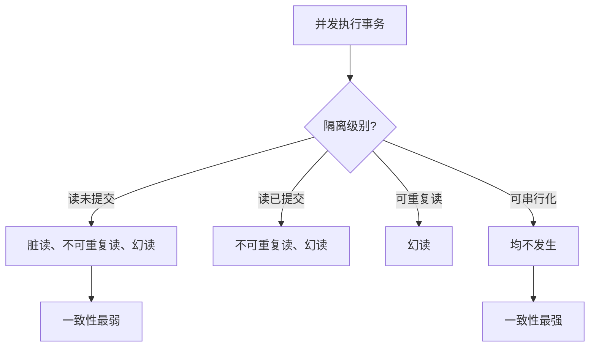

# 事务的隔离级别（读未提交、读已提交、可重复读、可串行化）

## 事务的隔离级别

数据库允许多个事务并发执行，但并发操作若不加控制，可能破坏数据一致性。事务隔离级别就是数据库在“并发效率”与“数据正确性”之间提供的分档选择。级别越高，一致性越强，系统代价也越高。

> [!IMPORTANT]
> 四类隔离级别由低到高依次是：==读未提交 → 读已提交 → 可重复读 → 可串行化==。级别越高，一致性越强，并发性能越低。

### 为什么需要隔离级别

并发执行的事务可能产生四类数据不一致性问题：

| 问题 | 含义 |
| --- | --- |
| 丢失修改 | 两个事务同时修改同一数据，后提交者覆盖先提交者的结果 |
| 脏读 | 事务 $T_1$ 读取了事务 $T_2$ 尚未提交的数据，随后 $T_2$ 回滚 |
| 不可重复读 | $T_1$ 两次读取同一数据期间，$T_2$ 对其做了更新并提交，导致两次结果不同 |
| 幻读 | $T_1$ 按条件查询期间，$T_2$ 插入了满足该条件的新记录，导致两次结果集不同 |

隔离级别就是回答一个问题：**一个事务到底能不能看到其他事务“做到一半”的数据？**

### 四种隔离级别

**读未提交（Read Uncommitted）**

最低级别，允许事务读取其他事务**尚未提交**的数据。好处是几乎不阻塞，代价是脏读、不可重复读、幻读都可能发生。

**读已提交（Read Committed）**

只允许读取其他事务**已提交**的数据。脏读被杜绝，但若事务 $T_1$ 两次读取同一数据，期间 $T_2$ 修改并提交，$T_1$ 仍会得到不同结果，即不可重复读依然存在。

**可重复读（Repeatable Read）**

事务开始读取数据后，其他事务**不能再对该数据执行 UPDATE 操作**，从而保证同一事务内多次读取结果一致。脏读和不可重复读被杜绝，但幻读仍可能发生——因为别的事务可以 INSERT 新记录。

**可串行化（Serializable）**

最高级别。事务的执行效果等价于某个串行执行顺序，丢失修改、脏读、不可重复读、幻读全部杜绝。

> [!NOTE]
> 数据库默认隔离级别：Oracle、SQL Server、KingBase 默认为**读已提交**；==MySQL 默认为可重复读==。南邮实验课用的 Oracle，默认级别即 **READ COMMITTED**。

### 与封锁协议的关系

隔离级别的实现依赖封锁机制。封锁协议与问题防治的对应关系如下：

| 封锁协议 | 防止丢失修改 | 防止脏读 | 防止不可重复读 |
| --- | :-: | :-: | :-: |
| 一级封锁协议 | ✓ | | |
| 二级封锁协议 | ✓ | ✓ | |
| 三级封锁协议 | ✓ | ✓ | ✓ |

关键区别在于 S 锁的释放时机：二级协议读完即释放 S 锁，因此无法防止不可重复读；三级协议将 S 锁保留到==事务结束==才释放，从而保证可重复读。

> [!WARNING]
> 不可重复读与幻读容易混淆：不可重复读针对**同一行数据被 UPDATE**，两次读到的**值**不同；幻读针对**其他事务 INSERT 新行**，两次读到的**行数**不同。可重复读锁住了已有行，但锁不住新插入的行，所以幻读仍可能发生。

### 一个判断例子

设事务 $T_1$ 先读 $A=2$、$B=2$，事务 $T_2$ 也读 $A=2$、$B=2$，然后 $T_1$ 改 $A=3$，$T_2$ 改 $B=3$，最终 $A=3$、$B=3$。这个并发调度等价于串行执行 $T_1$ 后 $T_2$（或反过来），因此是**可串行化调度**；在“可串行化”隔离级别下不会产生任何一致性问题，但在“读已提交”级别下可能因交叉读写顺序不同而导致脏读或不可重复读。

> [!TIP]
> 判断隔离级别题目的口诀：==“读未提交啥都读，读已提交不读脏；可重复读锁更新，串行化全免疫。”==
