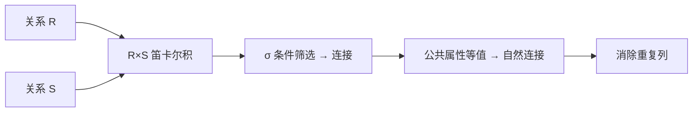
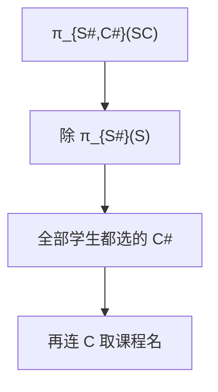

# 关系代数专门运算（选择、投影、连接、除）

## 它是什么

在关系模型里，查询要对“表”做加工。关系代数分两类运算符：集合运算符（并 $\cup$、差 $-$、交 $\cap$、笛卡尔积 $\times$）和**专门的关系运算符**。专门运算有四个：

- 选择 $\sigma$：按条件挑**行**（元组）
- 投影 $\pi$：挑**列**（属性），并去掉重复行
- 连接 $\bowtie$：把两个关系按条件拼起来（同时管行、列）
- 除 $\div$：用来回答“全部/所有”类查询

其中，并、差、笛卡尔积、选择、投影是==5 种基本操作==；连接、交、除都可由它们导出。

## 为什么需要

只会用 SQL 写 `SELECT ... WHERE ...` 还不够。考试要你会把自然语言查询写成关系代数表达式。特别是：

- 多表查询：先想能不能自然连接 $\bowtie$
- “所有”“全部”“包含”类：要用除 $\div$
- 优化语法树：知道 $\times + \sigma$ 可合并成连接，别直接写大笛卡尔积

## 怎么做

### 选择（σ）

$\sigma_F(R)$：从 $R$ 中取使逻辑表达式 $F$ 为真的元组。==从行的角度运算==。SQL 里对应 `WHERE`。

例如表 $R(A,B,C)$ 中 $\sigma_{B<5}(R)$，只留 $B$ 值小于 5 的行。

### 投影（π）

$\pi_{A_1,\dots,A_n}(R)$：取若干属性列组成新关系。==从列的角度运算==，且结果要删掉重复元组。

如上面复习题里 $\Pi_{3,2}(S)$ 表示取 $S$ 的第 3 列 $C$、第 2 列 $B$，重排成 $C,B$ 两列并去重。

### 连接（θ连接、等值连接、自然连接）

一般 $\theta$ 连接：$R \bowtie_{i\theta j} S = \sigma_{i\theta(r+j)}(R\times S)$，即从笛卡尔积里按比较条件选行。

- 等值连接：$\theta$ 为 `=`，结果保留两边的重复列
- 自然连接：==特殊等值连接，在公共属性上等值，并消去冗余列==
- 无公共属性时，自然连接退化成笛卡尔积

自然连接中被舍弃的元组叫**悬浮元组**；若保留它们并在空缺处填 Null，就是外连接（左外、右外）。

### 除（÷）与象集

先有概念：元组在属性 $X$ 上值 $x$ 的**象集** $Y_x$，是先选 $X=x$ 的行，再去掉 $X$ 列剩下的部分。

$R\div S$：结果里每个元组在 $R$ 中对应象集，要包含 $S$ 在相应属性上的全部投影。用于“全部学生都选修的课程”这类。

## 相近概念区别

| 运算 | 角度 | 记号 | 要点 |
|---|---|---|---|
| 选择 | 行 | $\sigma$ | 挑元组，对应 WHERE |
| 投影 | 列 | $\pi$ | 挑属性，去重 |
| 一般连接 | 行 | $\bowtie_\theta$ | 笛卡尔积+选 |
| 自然连接 | 行+列 | $\bowtie$ | 等值+去重复列 |
| 除 | 行+列 | $\div$ | “包含全部” |

## 常见坑

> [!WARNING]
> 写多表表达式时，能自然连接就别写 $S\times SC\times C$ 再堆条件；初始语法树若直接用笛卡尔积再 $\sigma$，优化时要下压选择、把 $\times+\sigma$ 换成 $\bowtie$。

> [!CAUTION]
> 自然连接必须“公共属性上等值”且消除重复列；两表无公共属性时它等于笛卡尔积，别误以为会得到空。

## 一个算对了的例子

复习提纲综合 2 第 7 问：检索全部学生都选修的课程号与课程名。

先取学生—课程对：$\pi_{S\#,C\#}(SC)$；全体学生：$\pi_{S\#}(S)$。用除：

$$\pi_{C\#,CNAME}\big(C \bowtie (\pi_{S\#,C\#}(SC) \div \pi_{S\#}(S))\big)$$

除的结果是所有学生都出现在其象集中的课程号，再和课程表 $C$ 连接，就拿到课程名。这里核心就是：==除用来表达“全部/所有”，连接负责补出名字==。
