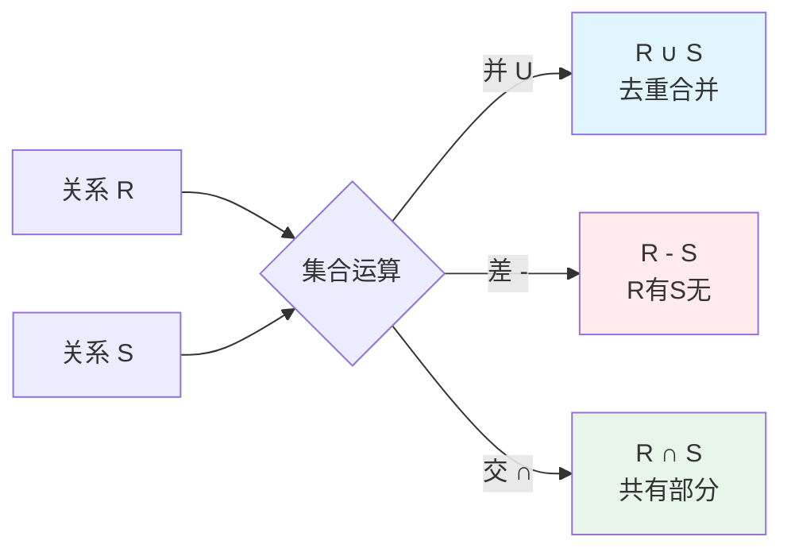

# 关系代数基础运算（并、差、交、笛卡尔积）

## 关系代数基础运算

在关系数据库中，数据以二维表（关系）的形式存储。如何从这些表中提取所需信息？关系代数提供了一套严谨的数学工具。其中，**并、差、交、笛卡尔积**属于传统的集合运算，它们是构建复杂查询的基石。

> [!IMPORTANT]
> ==核心定义==：关系是元组的集合。因此，传统集合运算可直接应用于关系，但必须满足**相容性条件**：两个关系 $R$ 和 $S$ 必须具有相同的目（属性个数），且对应属性的域相同。

### 集合运算：并、差、交

这三种运算直观地对应集合论中的概念，用于合并或筛选来自结构相同表的数据。

*   **并 ($R \cup S$)**：包含 $R$ 或 $S$ 中所有不重复的元组。
*   **差 ($R - S$)**：包含在 $R$ 中但不在 $S$ 中的元组。
*   **交 ($R \cap S$)**：同时存在于 $R$ 和 $S$ 中的元组。注意：交运算不是基本运算，可由差运算导出：$R \cap S = R - (R - S)$。

> [!TIP]
> **解题技巧**：做并、交、差运算前，先检查两表结构是否一致。若不一致（如属性名不同但含义相同），需先通过**投影 ($\pi$)** 和 **改名 ($\rho$)** 调整结构。

### 笛卡尔积：关系的“乘法”

笛卡尔积 ($R \times S$) 是将 $R$ 中的每个元组与 $S$ 中的每个元组进行拼接。若 $R$ 有 $n_1$ 个元组，$S$ 有 $n_2$ 个元组，则结果有 $n_1 \times n_2$ 个元组。

> [!WARNING]
> **常见误区**：直接对大表做笛卡尔积会产生海量无用数据（爆炸式增长）。在实际数据库系统中，应避免单独使用，通常将其与**选择 ($\sigma$)** 结合形成**连接 ($\bowtie$)** 操作。

笛卡尔积的结果列数为两关系列数之和。例如，$R(A,B)$ 与 $S(C,D)$ 的积为 $R \times S(A, B, C, D)$。

### 实例演示

设有关系 $R$ 和 $S$ 如下：

**R**:
| A | B | C |
|---|---|---|
| 3 | 6 | 7 |
| 7 | 2 | 3 |

**S**:
| A | B | C |
|---|---|---|
| 3 | 4 | 5 |
| 7 | 2 | 3 |

**1. 并运算 $R \cup S$**
合并所有元组并去重：
| A | B | C |
|---|---|---|
| 3 | 6 | 7 |
| 7 | 2 | 3 |
| 3 | 4 | 5 |

**2. 差运算 $R - S$**
保留仅在 $R$ 中出现的元组：
| A | B | C |
|---|---|---|
| 3 | 6 | 7 |
*(注：(7,2,3) 在 S 中也存在，故被减去)*

**3. 笛卡尔积 $R \times S$**
$R$ 有2行，$S$ 有2行，结果共4行，列数为6列（需区分同名属性，如 $R.A, S.A$）：

| R.A | R.B | R.C | S.A | S.B | S.C |
|-----|-----|-----|-----|-----|-----|
| 3   | 6   | 7   | 3   | 4   | 5   |
| 3   | 6   | 7   | 7   | 2   | 3   |
| 7   | 2   | 3   | 3   | 4   | 5   |
| 7   | 2   | 3   | 7   | 2   | 3   |

> [!NOTE]
> **运算优先级**：括号最高，其次是一元运算（$\sigma, \pi$），最后是二元运算（$\times, \bowtie, \cup, -, \cap$）。同级运算从左到右执行。
