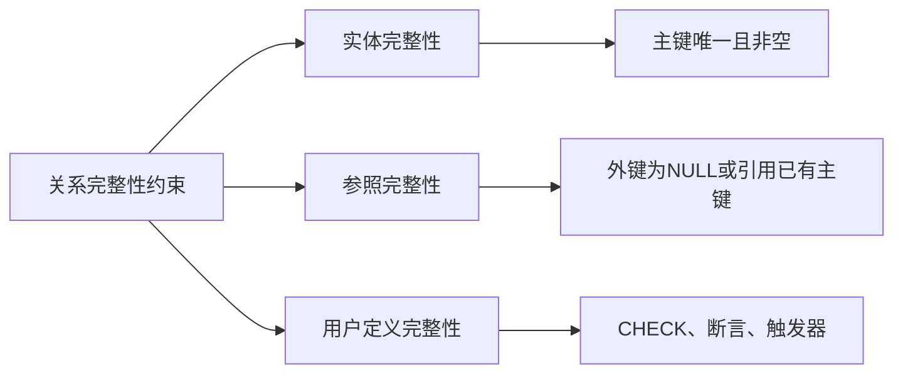

# 关系的三类完整性约束（实体完整性、参照完整性、用户定义的完整性）

## 三类完整性约束

关系模型用二维表表示数据，但表里的数据不能随便填。如果学号可以重复、成绩可以写“七百”，数据库就失去了可信度。完整性约束就是==在定义表的时候就写进数据库的强制规则==，由 DBMS 自动检查，不需要应用程序每次手动判断。

关系模型有三类完整性约束：**实体完整性**、**参照完整性**、**用户定义的完整性**。前两者是任何关系数据库都必须满足的，第三者由具体应用按需添加。


### 实体完整性：每行必须能被唯一找到

先想一个问题：如果一张学生表里，两条记录的学号都是 `B210101`，你能区分这两个学生吗？显然不能。要让每个实体可区分，就必须有一个**主键**来唯一标识每一行。

> [!IMPORTANT]
> **实体完整性规则**：若属性 A 是基本关系 R 的主属性，则 A 不能取空值（NULL）。换言之，==主键值必须唯一，且组成主键的各属性都不能为 NULL==。

为什么主属性不能为 NULL？如果主键为空，就说明存在一个“不可标识”的实体，即存在与其他实体不可区分的实体，这与“实体必须是可区分的”这一基本前提矛盾。

SQL 中的实现方式：

```sql
CREATE TABLE Student (
    Sno   CHAR(9) PRIMARY KEY,   -- 实体完整性
    Sname CHAR(20)
);
```

常见坑：主键**不是**“值不能重复”那么简单，它还要求**不能为空**。另外，复合主键中每个属性都不能为空，而不是整体不为空即可。


### 参照完整性：不能引用不存在的实体

关系与关系之间会互相引用。比如选课表 SC 里有 `Sno` 和 `Cno`，它们分别引用 Student 表的 `Sno` 和 Course 表的 `Cno`。如果 SC 里出现了一个 Student 表中根本不存在的 `Sno`，这条选课记录就成了“幽灵记录”——它引用了一个不存在的学生。

> [!IMPORTANT]
> **参照完整性规则**：若属性 F 是基本关系 R 的**外键**（对应基本关系 S 的主键 $K_s$），则 F 的取值只有两种可能：==要么为 NULL，要么等于 S 中某个元组的主键值==。

SQL 中的实现方式：

```sql
CREATE TABLE SC (
    Sno  CHAR(9),
    Cno  CHAR(4),
    FOREIGN KEY (Sno) REFERENCES Student(Sno),
    FOREIGN KEY (Cno) REFERENCES Course(Cno)
);
```

常见坑：外键可以为 NULL 表示“暂无引用对象”，但==一旦非空，就必须能查到对应主键==。删除被引用记录时的处理策略（如 `ON DELETE CASCADE` 级联删除）也属于参照完整性的延伸问题。


### 用户定义的完整性：具体业务的语义约束

实体完整性和参照完整性解决的是“可标识”和“引用有效”的问题，但具体业务还有自己的规则。比如“成绩必须在 0～100 之间”“性别只能是男或女”。

> [!NOTE]
> **用户定义的完整性**是针对某一具体应用的数据必须满足的语义约束，由用户在建表时显式声明，DBMS 负责检查。

SQL 中的常见实现：

```sql
CREATE TABLE SC (
    Sno   CHAR(9),
    Cno   CHAR(4),
    Grade SMALLINT CHECK (Grade >= 0 AND Grade <= 100),   -- 用户定义完整性
);
```

实现手段包括 `CHECK()` 约束、`ASSERTION`（断言）和触发器（Trigger）等。


### 三类完整性的对比

| 完整性类型 | 解决什么问题 | 实现手段 | 是否必须 |
| --- | --- | --- | --- |
| 实体完整性 | 元组可唯一区分 | `PRIMARY KEY` | 必须 |
| 参照完整性 | 引用必须指向存在的实体 | `FOREIGN KEY ... REFERENCES` | 必须 |
| 用户定义的完整性 | 业务语义约束 | `CHECK()`、断言、触发器 | 按需 |




### 一个综合的例子

以经典的教学数据库为例，建一张选课表 SC：

```sql
CREATE TABLE SC (
    Sno   CHAR(9)  NOT NULL,
    Cno   CHAR(4)  NOT NULL,
    Grade SMALLINT,
    PRIMARY KEY (Sno, Cno),                -- 实体完整性：联合主键非空且唯一
    FOREIGN KEY (Sno) REFERENCES Student(Sno),  -- 参照完整性
    FOREIGN KEY (Cno) REFERENCES Course(Cno),   -- 参照完整性
    CHECK (Grade BETWEEN 0 AND 100)        -- 用户定义完整性
);
```

- 插入 `('B210101', 'C01', 85)`：合法，主键非空唯一，外键能找到，成绩在范围内。
- 插入 `(NULL, 'C01', 85)`：违反实体完整性，主属性 `Sno` 为空。
- 插入 `('B210101', 'C01', 120)`：违反用户定义完整性，成绩越界。
- 若 Student 表中没有 `Sno='B210999'`，插入 `('B210999', 'C01', 70)`：违反参照完整性。

> [!WARNING]
> 考试中判断某条插入是否违规时，务必**按顺序检查**：先看主键是否唯一非空（实体完整性），再看外键是否有对应主键或为 NULL（参照完整性），最后看是否满足 `CHECK` 等业务约束（用户定义完整性）。三类约束彼此独立，一条插入可能同时违反多条。
