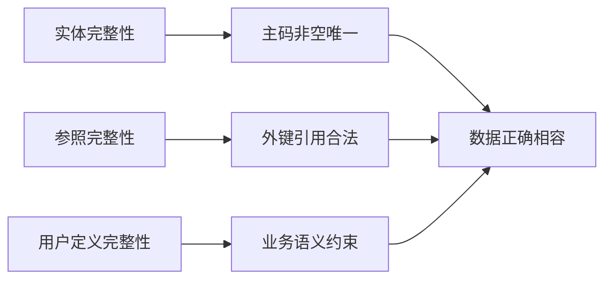

# 关系模型的数据结构、操作与完整性约束

关系模型是数据库系统的理论基石，它用==二维表==来抽象现实世界。但仅有表格还不够，一个完整的关系模型必须包含三个要素：**数据结构、数据操作、完整性约束**。这三者分别定义了数据的静态特征、动态行为以及必须遵守的语义规则。

## 数据结构：单一与统一

关系模型的数据结构非常单纯，无论是实体还是实体间的联系，都用**关系（Relation）** 即二维表来表示。这与层次或网状模型形成鲜明对比。在用户看来，数据就是一张张独立的表，底层的物理存储细节（如指针、索引）被完全屏蔽。这种高度的逻辑独立性，正是关系模型能够成为主流的关键。

## 数据操作：集合化的关系代数

> [!IMPORTANT]
> 关系操作的核心特征是==集合操作==，操作对象和结果都是关系（元组的集合），而非单条记录。

关系代数是操作的理论基础，五个基本运算构成了完备集：选择 $\sigma$、投影 $\Pi$、并 $\cup$、差 $-$、笛卡尔积 $\times$。它们与 SQL 有着严格的对应关系：

| 关系代数 | 符号 | SQL 对应子句 | 含义 |
| :--- | :--- | :--- | :--- |
| 选择 | $\sigma$ | `WHERE` | 按条件筛选行 |
| 投影 | $\Pi$ | `SELECT` | 选取指定列 |
| 笛卡尔积 | $\times$ | `FROM` (多表) | 表的无条件连接 |

[!TIP]
查询优化黄金法则：**尽早执行选择（$\sigma$）和投影（$\Pi$）**，以减小中间结果的规模，提升效率。

## 完整性约束：数据的“法律”

为什么需要完整性约束？因为数据库不仅要存数据，还要保证数据是==正确且相容==的。这区别于“安全性”——完整性防的是合法用户的误操作导致数据错误，而安全性防的是非法用户的恶意窃取。

关系模型有三类核心约束：

1.  **实体完整性**：主码属性不能为空（`NOT NULL`）且唯一。这是区分不同元组的底线。
2.  **参照完整性**：外键的值要么为空，要么必须等于被参照关系中某个主码的值。它维护了表间关联的正确性。
3.  **用户定义完整性**：针对具体应用的语义约束，通过 `CHECK`、触发器等机制实现。



[!WARNING]
**外键何时允许为空？** 当外键==不是==本关系主码的一部分时，允许为空（表示尚未建立关联）；若外键同时是主码属性，则绝不允许为空，否则违反实体完整性。

## 算对了的例子

以求“供应工程 J1 零件的供应商号码 SNO”为例，需先定位再提取：

$$ \Pi_{SNO}(\sigma_{JNO='J1'}(SPJ)) $$

对应的 SQL 实现为：

```sql
SELECT SNO FROM SPJ WHERE JNO = 'J1';
```

此例完美体现了关系代数的组合运用：先用 $\sigma$ 缩小范围，再用 $\Pi$ 获取目标属性，顺序不可颠倒。

[!CAUTION]
DML 操作（增删改）始终受完整性约束制约。例如插入新元组时，DBMS 会自动检查主码是否重复、外键是否合法、`CHECK` 条件是否满足，任一失败则拒绝执行。理解这一点，才能写出既正确又健壮的数据库应用。
