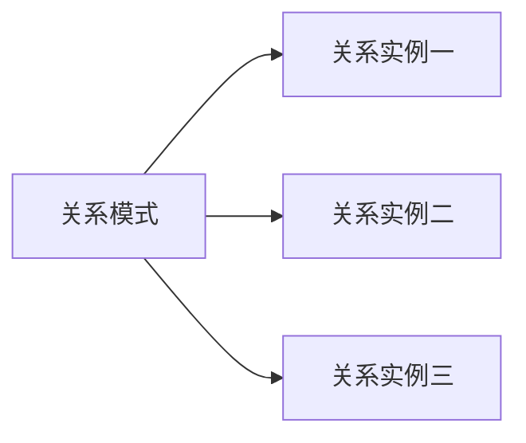

# 关系模式与关系数据库

## 什么是关系模式

**关系模式（Relation Schema）是对关系的结构描述，也就是关系的“型”；关系（Relation）是该结构在某一时刻的具体数据，也就是关系的“值”。**

设关系模式为：

$$
R(U_1,U_2,\ldots,U_n)
$$

其中，$R$ 是关系名，$U_i$ 是属性名，属性应满足相应语义并具有确定的值域。例如：

$$
Student(Sno,Sname,Ssex,Sbirthdate,Smajor)
$$

表示学生关系包含学号、姓名、性别、出生日期和主修专业五个属性。

> [!IMPORTANT]
> ==关系模式是静态、稳定的结构定义；关系实例是动态、随时间变化的数据集合。==

例如，关系模式 `Student(Sno, Sname, Ssex, Sbirthdate, Smajor)` 可以对应今天、明天或任意时刻的学生表。即使暂时没有学生，关系模式仍然存在。

## 关系模式与关系实例

假设学生关系模式为：

$$
Student(Sno,Sname,Ssex,Sbirthdate,Smajor)
$$

某个时刻的数据为：

| Sno | Sname | Ssex | Sbirthdate | Smajor |
|---|---|---|---|---|
| 001 | 张华 | 男 | 2006-03-12 | 计算机 |
| 002 | 李明 | 女 | 2005-08-20 | 通信 |

右表是关系模式的一个**关系实例**。插入、删除或修改学生记录，会改变实例，但不会改变关系模式中的属性结构。

> [!NOTE]
> 实际讨论中常把关系模式和关系实例都简称为“关系”，因此答题时要注意语境。

## 什么是关系数据库

**关系数据库是某一时刻所有关系模式所对应的关系实例的集合。**

“学生选课数据库”通常包含三个关系模式：

- `Student(Sno, Sname, Ssex, Sbirthdate, Smajor)`
- `Course(Cno, Cname, Ccredit, Cpno)`
- `SC(Sno, Cno, Grade, Semester, Teachingclass)`

其中，`SC` 表示学生选课关系，记录学生学了什么课程以及成绩等。关系数据库中的数据由这些关系实例共同组成。

关系模式还可带有完整性约束。例如，`SC.Sno` 是引用 `Student.Sno` 的外键；删除或修改学生记录时，数据库管理系统需要按照参照完整性规则处理相关选课记录。

## 候选码与全码

若一组属性能够唯一标识关系中的每个元组，则该属性集称为候选码。若关系模式的**所有属性共同构成唯一的候选码**，就称为全码（All-key）。

例如，教师授课关系：

$$
Teaching(T\#,C\#)
$$

由于一门课程可能由多名教师讲授，一名教师也可能讲授多门课程，仅凭 `T#` 或 `C#` 都不能唯一确定一条授课记录，因此：

$$
(T\#,C\#)
$$

是候选码，同时也是全码。

> [!WARNING]
> “候选码”不一定是单属性；“所有属性都是候选码”也不等于“每个属性单独都是候选码”。全码强调的是整个属性集共同标识元组。

## 与相邻概念的区别

| 概念 | 含义 | 是否随数据操作改变 |
|---|---|---|
| 属性 | 关系中的一列，如 `Sno` | 否 |
| 关系模式 | 关系名、属性名及其约束的描述 | 否 |
| 关系实例 | 某一时刻的具体数据 | 是 |
| 关系数据库 | 某一时刻全部关系实例的集合 | 是 |
| 数据库模式 | 全局逻辑结构，通常由多个关系模式构成 | 通常相对稳定 |

## 常见坑

1. **把模式与实例混淆**：表结构不变，但表中的行可以不断变化。
2. **忽略关系模式中的约束**：模式不仅描述属性，还包括值域、函数依赖、外键等语义约束。
3. **误认为每个关系都要单独建一个物理文件**：文件的组织与存储通常由 DBMS 负责，可能由操作系统管理，也可能由 DBMS 自行划分空间。
4. **候选码判断错误**：应计算属性集的属性闭包，确认其能否推出关系模式中的全部属性。

例如：

$$
F=\{A\to B,B\to C,C\to D\}
$$

由于 $A$ 出现在函数依赖左侧而未出现在右侧，所以 $A$ 必须属于候选码；计算得：

$$
(A)^+=ABCD
$$

因此候选码为 $A$。这一结论描述的是关系模式中的函数依赖，而不是某个具体数据表当前是否恰好没有重复学号。
