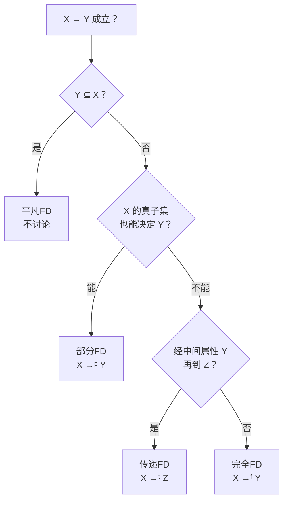

# 函数依赖（平凡/非平凡、完全/部分、传递函数依赖）

## 它是什么

函数依赖（Functional Dependency，FD）是关系模式 $R(U)$ 上的一种语义约束：对 $X, Y \subseteq U$，若任意合法关系实例 $r$ 中，**不存在两个元组在 $X$ 上取值相等而在 $Y$ 上取值不等**，则称 $X$ 函数确定 $Y$，记作 $X \to Y$。$X$ 称为决定因素（Determinant）。

> [!IMPORTANT]
> 函数依赖是**语义范畴**的概念，只能根据数据语义确定，且要求 $R$ 的**所有**关系实例都满足——不是看某张具体表"碰巧"成立，而是看业务规则"必然"成立。例如只有规定"学生不允许重名"时，才有 $Sname \to Sno$。

## 为什么要学

关系模式设计不当会导致数据冗余、插入异常、删除异常、更新异常。函数依赖是规范化理论的基石：通过分析属性间的依赖类型，逐步消除"不合适"的依赖，把模式分解到 2NF、3NF、BCNF。

## 四种类型怎么区分

| 类型 | 条件 | 记号 | 例子（S-C 模式） |
|---|---|---|---|
| 平凡 FD | $Y \subseteq X$ | $X \to Y$ | $(Sno,Cno)\to Sno$ |
| 非平凡 FD | $Y \not\subseteq X$ | $X \to Y$ | $(Sno,Cno)\to Grade$ |
| 完全 FD | $X\to Y$，且任意真子集 $X'$ 都有 $X' \nrightarrow Y$ | $X \xrightarrow{F} Y$ | $(Sno,Cno)\xrightarrow{F} Grade$ |
| 部分 FD | $X\to Y$，但某个真子集 $X'\to Y$ | $X \xrightarrow{P} Y$ | $(Sno,Cno)\xrightarrow{P} Sdept$（因 $Sno\to Sdept$）|
| 传递 FD | $X\to Y,\ Y\not\subseteq X,\ Y\to Z$ | $X \xrightarrow{传递} Z$ | $Sno\to Sdept,\ Sdept\to Sloc \Rightarrow Sno\xrightarrow{传递} Sloc$ |

> [!TIP]
> 判断口诀：**先看平凡**（$Y$ 是否含于 $X$），**再看完全**（拿掉 $X$ 中一个属性，依赖还成立吗），**最后看传递**（中间是否隔了一层）。==平凡 FD 必然成立、不反映新语义，考试默认讨论非平凡 FD==。

> [!WARNING]
> 常见误区：
> - 把"当前表里没有重复值"当成 FD 成立的依据——FD 是**所有可能实例**都要满足的约束；
> - 部分依赖的判断对象是**候选码**：非主属性只依赖码的一部分，就是部分依赖，是 2NF 要消除的目标；
> - 传递依赖要求中间属性 $Y$ **不是** $X$ 的子集且 $Y \nrightarrow X$，否则可能退化为直接依赖。

## 一个完整的例子

设 $R(\text{职工编号}, \text{日期}, \text{日营业额}, \text{部门名}, \text{部门经理})$，语义给出：

$$F = \{(\text{职工编号},\text{日期})\to\text{日营业额},\ \text{职工编号}\to\text{部门名},\ \text{部门名}\to\text{部门经理}\}$$

- 候选码：$(\text{职工编号},\text{日期})$（"日期"不出现在任何 FD 右部，必入码）。
- 依赖类型分析：
  - $(\text{职工编号},\text{日期})\xrightarrow{F}\text{日营业额}$ —— 完全依赖；
  - $(\text{职工编号},\text{日期})\xrightarrow{P}\text{部门名}$ —— 部分依赖（仅职工编号即可决定）；
  - $\text{职工编号}\xrightarrow{传递}\text{部门经理}$ —— 传递依赖（经"部门名"中转）。

由此 $R$ 只达 1NF。按依赖类型投影分解：

$$\rho = \{R_1(\text{职工编号},\text{日期},\text{日营业额}),\ R_2(\text{职工编号},\text{部门名}),\ R_3(\text{部门名},\text{部门经理})\}$$

分解后每个模式内部既无部分依赖也无传递依赖，均达 3NF（进一步检查亦满足 BCNF）。

> [!NOTE]
> 函数依赖的投影基于 $F^+$ 进行：$F_i = \{X\to Y \in F^+ \mid XY \subseteq U_i\}$。判断分解是否保持函数依赖，即验证 $(F_1\cup\cdots\cup F_n)^+ = F^+$。
