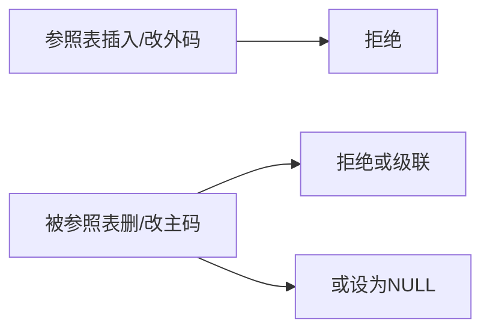

# 参照完整性的定义与违约处理（级联操作）

## 参照完整性在管什么

先想一对熟悉的表：`Student(Sno, Sname, …)` 和 `SC(Sno, Cno, Grade)`。`SC` 里的 `Sno` 是外码（Foreign Key），它必须“指向”被参照表 `Student` 里真实存在的某个主码值，或者在某些情况下允许为空。

> [!IMPORTANT]
> 参照完整性的要求只有一句：==不能引用不存在的实体==，也就是外码值要么为空，要么必须等于被参照表中某个元组的主码值。

那外键什么时候能为空？如果外码不是本关系主属性（不是主键的一部分），比如 `SC` 的主键是 `(Sno, Cno)`，`Sno` 已经是主属性了；但假设有个表 `Emp(职工号, 工厂编号)`，`工厂编号` 不是主键，就允许为空。反之，若外码本身是主属性，则 ==不允许为空==，因为主属性不能空。

## 可能破坏参照完整性的四种情况

课件里用表5.1总结了操作与违约处理。我们把它简化成一张流程表：

| 操作位置 | 动作 | 是否可能破坏 | 违约处理 |
|---|---|---|---|
| 参照表 SC | 插入元组 | 是 | 拒绝 |
| 参照表 SC | 修改外码值 | 是 | 拒绝 |
| 被参照表 Student | 删除元组 | 是 | 拒绝/级联删除/设为空 |
| 被参照表 Student | 修改主码值 | 是 | 拒绝/级联修改/设为空 |



注意：前两种情况只对参照表做动作，系统直接拒绝就行；后两种是被参照表“动了源头”，才需要选择级联或置空策略。

## 违约处理里的级联操作

所谓级联（CASCADE），就是被参照表删或改了主码，参照表里跟着删或跟着改，保持引用不断裂。

> [!TIP]
> 外键定义语法：`FOREIGN KEY (列) REFERENCES 表(列) ON DELETE ... ON UPDATE ...`，可选项有 `NO ACTION / RESTRICT / CASCADE / SET NULL`。

看一道考过的题里的 SQL：

```sql
CREATE TABLE SPJ (
    SNO CHAR(2), PNO CHAR(2), JNO CHAR(2), QTY INT,
    PRIMARY KEY (SNO, PNO, JNO),
    FOREIGN KEY (SNO) REFERENCES S(SNO) ON UPDATE CASCADE,
    FOREIGN KEY (PNO) REFERENCES P(PNO) ON DELETE NO ACTION,
    FOREIGN KEY (JNO) REFERENCES J(JNO)
);
```

题目要求是：“有供应记录的零件基本信息不允许删除；当更新供应商信息时，相应供应记录也跟随更新。” 所以 `SNO` 用 `ON UPDATE CASCADE`（级联修改），`PNO` 用 `ON DELETE NO ACTION`（拒绝删除，保护已有供应记录）。这就把级联和拒绝用对了地方。

## 它和实体完整性、用户定义完整性有什么不同

| 类型 | 定义方法 | 检查时机 | 违约处理 |
|---|---|---|---|
| 实体完整性 | `CREATE TABLE` 主键 | 插入、修改 | 拒绝执行 |
| 参照完整性 | `CREATE TABLE` 外键 | 参照表插/改；被参照表删/改 | 拒绝/级联/设为空 |
| 用户定义完整性 | `CREATE TABLE` 的 `CHECK` 等 | 插入、修改 | 拒绝执行 |

> [!WARNING]
> 常见坑：写 `FOREIGN KEY` 时漏掉 `REFERENCES` 后面的被参照列名，或者把级联方向搞反——级联是被参照表“牵动”参照表，不是反过来。另外，`NO ACTION` 和 `RESTRICT` 都表示禁止删改源头，别和 `CASCADE` 混写。

再补一句相近概念：数据库完整性防的是==合法用户用合法操作加入不正确数据==；安全性防的是非法用户非法存取正确数据。两者不是一个层面。

## 一个算对了的完整例子

还是上面那个 `SC` 与 `Student`：

- 往 `SC` 插一条 `Sno='20260000'` 的学生成绩，但 `Student` 里没有这个学号 → 拒绝（插入破坏参照完整性）。
- 把 `Student` 中学号 `20260001` 改成 `20260009`，且 `SC.Sno` 定义为 `ON UPDATE CASCADE` → `SC` 里所有相关元组的外码一起变成 `20260009`。
- 删除 `Student` 某元组，`SC` 外键设为 `ON DELETE SET NULL` 且外码非主属性 → 子表里对应外码变空。

这样，外码要么为空、要么必存在于被参照表主码中，级联与拒绝策略也就用对了。
