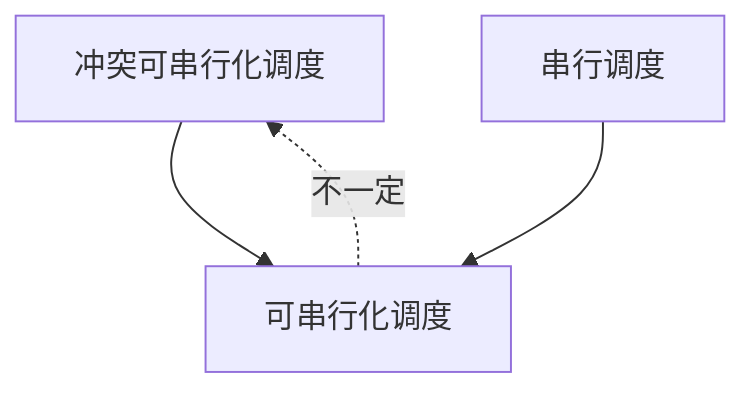

# 并发调度的可串行性（可串行化调度、冲突可串行化）

## 并发调度的可串行性

数据库系统中，多个事务的并发执行在单处理机下实际上是**轮流交叉执行**的。交叉方式不同，调度的结果也可能不同。那么，什么样的并发调度才算“正确”？

并发控制的直觉标准是：==如果并发调度的执行结果等价于某个串行调度的执行结果，则该并发调度是正确的==，称为**可串行化调度**。

[!IMPORTANT]
> 可串行化是并发事务正确执行的唯一准则。注意区分两个术语：**串行调度**指事务一个接一个执行，没有并发；**可串行化调度**指并发交叉执行，但效果上等价于某种串行顺序。

### 一个例子：正确与错误的交叉

考虑两个转账事务，初始时 $A=1000,\ B=2000$：

- $T_1$：$A \leftarrow A - 100$；$B \leftarrow B + 100$
- $T_2$：$A \leftarrow A \times 1.05$；$B \leftarrow B \times 1.05$

串行执行 $T_1, T_2$ 或 $T_2, T_1$，最终 $A+B$ 都应变为 $3150$。若交叉执行打乱读写次序，可能得到 $A+B \neq 3150$ 的错误结果。这表明：**并非所有交错都安全**。

### 冲突可串行化

判断一个调度是否可串行化，常用的充分条件是**冲突可串行化**。

**冲突操作**指不同事务对同一数据项的操作，且其中至少一个是写操作：

| 操作对 | 是否冲突 |
| --- | --- |
| 读—读 | 不冲突 |
| 读—写 | 冲突 |
| 写—读 | 冲突 |
| 写—写 | 冲突 |

[!TIP]
> 记法：只要两个操作里有**写**，就是冲突操作。两个读之间随便换，不冲突。

**冲突可串行化的定义**：在不改变任意冲突操作先后次序的前提下，通过交换相邻的**不冲突操作**，若能把并发调度变换为一个串行调度，则称该调度是**冲突可串行化的**。

[!WARNING]
> 冲突可串行化是**可串行化的充分条件，不是必要条件**。存在满足可串行化但不满足冲突可串行化的调度。

例如调度 $L_2 = W_1(Y)W_2(Y)W_2(X)W_1(X)W_3(X)$：无法通过交换不冲突操作变成串行，但它可能是可串行化的。这说明可串行化判定比冲突可串行化更宽泛。

### 可串行化调度与冲突可串行化调度的关系

- 串行调度天然是冲突可串行化的（无需交换或已无并发交叉可言）。
- 冲突可串行化 ⇒ 可串行化；可串行化 ⇏ 冲突可串行化。

### 怎么用它解题

判断冲突可串行化的步骤：

1. **找出冲突对**：列出所有（读-写、写-读、写-写）操作对。
2. **构造优先图**：每个事务是一个节点；若 $T_i$ 与 $T_j$ 的冲突操作中 $T_i$ 先执行，则画一条有向边 $T_i \to T_j$。
3. **判环**：若优先图无环，则调度冲突可串行化；任意拓扑序就是一个等价串行调度。若有环，则一定不可串行化。

[!TIP]
> **易踩坑**：交换两个操作时，只能交换**不冲突的相邻操作**。直接调整冲突操作的次序会改变调度语义，得到的“串行调度”不能作为判定依据。

例如调度 $Sc_1$：$R_1(A)W_1(A)R_2(A)W_2(A)$ 中，冲突对为 $W_1(A)-R_2(A)$ 和 $W_1(A)-W_2(A)$，优先图只有一条边 $T_1 \to T_2$，无环，故冲突可串行化，等价于串行顺序 $T_1, T_2$。

### 与两段锁协议的联系

数据库管理系统普遍采用**两段锁协议（2PL）** 实现并发调度的可串行化。遵守两段锁协议的调度一定是可串行化的，但反过来不一定成立——两段锁协议是==可串行化的充分条件，而非必要条件==。

清晰区分三个层次：

| 条件 | 与可串行化的关系 |
| --- | --- |
| 串行调度 | 天然可串行化 |
| 冲突可串行化 | 充分条件 |
| 遵守两段锁协议 | 充分条件 |

实际操作中，我们更常用**冲突可串行化**作为判断手段，因为它的判据（优先图无环）可以机械化地执行。
