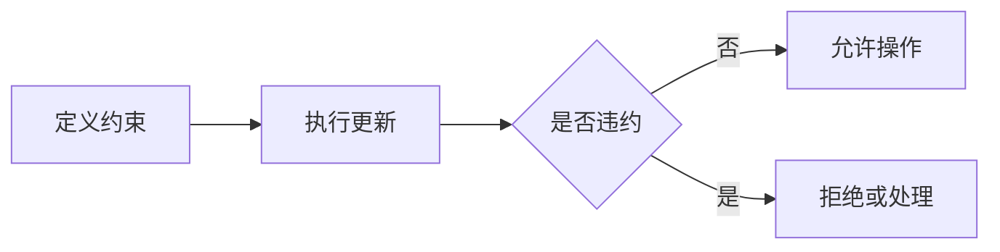

# 数据库完整性概述

## 什么是数据库完整性

数据库完整性指数据的==正确性、有效性和相容性==，目标是防止错误数据进入数据库。例如，学生年龄不能为负数，成绩通常应在 $0\sim100$ 之间，选课记录中的学号必须对应一个真实存在的学生。

> [!IMPORTANT]
> 完整性与安全性不同：==完整性防止合法用户通过合法操作写入不正确的数据==；安全性防止非法用户通过非法操作存取、泄露或破坏正确数据。

| 对比项 | 数据库完整性 | 数据库安全性 |
|---|---|---|
| 主要问题 | 数据是否正确、合理 | 数据是否被合法使用 |
| 典型对象 | 合法用户的合法操作 | 非法用户或非法操作 |
| 典型措施 | 约束、断言、触发器 | 身份认证、授权、审计 |

## 为什么需要完整性控制

如果数据库只保存数据而不检查约束，就可能出现“不存在的教师开课”“删除学生后仍保留其选课记录”等矛盾。完整性控制由 DBMS 自动执行，避免每个应用程序重复检查，也防止某些程序漏检。

完整性约束机制具有三项功能：

1. **定义**：说明数据应满足什么条件。
2. **检查**：在插入、删除、修改等操作时判断是否违约。
3. **保护**：发现违约后拒绝操作，或按指定动作处理。

## 完整性规则与 SQL 实现

一条完整性规则可以概括为三个问题：

| 组成 | 含义 | 一般形式 |
|---|---|---|
| 何时检查 | 触发检查的事件 | `WHENEVER <事件>` |
| 检查什么错误 | 判断是否违约的条件 | `IF <条件>` |
| 检出错误怎么办 | 违约后的处理动作 | `THEN <动作>` |

SQL 中常见的完整性约束定义方法包括：

- **域约束**：限制属性的数据类型、取值范围等。
- **基表约束**：在基本表中定义主码、外码、`UNIQUE`、`NOT NULL` 等约束。
- **检查约束**：用 `CHECK` 指定属性或元组应满足的条件。
- **断言**：用 `CREATE ASSERTION` 定义涉及多个表或聚集操作的复杂约束。
- **触发器**：在指定事件发生时自动检查并执行处理动作。

其中，实体完整性通常由 `PRIMARY KEY` 保证；参照完整性由 `FOREIGN KEY` 保证；用户自定义完整性可使用 `CHECK`、断言或触发器实现。



## 一个完整的例子

设选课表 `SC(Sno,Cno,Grade)` 中的学号参照学生表，成绩必须在 $0\sim100$ 之间：

```sql
CREATE TABLE SC (
    Sno CHAR(9),
    Cno CHAR(4),
    Grade INT CHECK (Grade BETWEEN 0 AND 100),
    PRIMARY KEY (Sno, Cno),
    FOREIGN KEY (Sno) REFERENCES Student(Sno)
        ON DELETE CASCADE
        ON UPDATE CASCADE
);
```

插入 `('202301001','C01',85)` 且该学生确实存在时，操作合法；插入成绩 `120` 会违反 `CHECK`；插入不存在的学生学号会违反参照完整性。删除学生时，`ON DELETE CASCADE` 会级联删除其选课记录，避免留下无主的选课数据。

外码的参照动作还可写为：

```sql
ON DELETE/UPDATE [NO ACTION | CASCADE | SET NULL]
```

分别表示不允许违约操作、级联处理、将外码置空。

> [!WARNING]
> `SET NULL` 并非总能使用：若外码属性被定义为 `NOT NULL`，置空会产生新的约束冲突。另外，主码约束实体完整性，外码约束参照完整性，二者不要混淆。

> [!TIP]
> 简答题可按“==三组成：何时检查、检查什么、如何处理；五方法：域、基表、检查、断言、触发器==”组织答案。断言适合跨表或聚集约束，但部分实际数据库产品并不直接支持 `CREATE ASSERTION`，常用触发器等机制替代。
