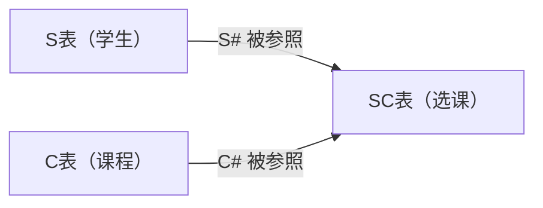

# 完整性约束命名子句与修改完整性限制

## 完整性约束命名子句

当你用 `CREATE TABLE` 定义主键、外键、CHECK 约束时，DBMS 会为每个约束自动生成一个系统名，形如 `SYS_C0012345`。一旦后续需要删除或修改某条约束，你不得不先查出这个晦涩的名字，维护起来十分麻烦。

完整性约束命名子句解决的就是这个问题——**让你自己给约束起一个有意义的名字**。

### 命名子句的语法

在约束定义前加上 `CONSTRAINT 约束名`：

```sql
CONSTRAINT <约束名> <约束定义>
```

以一道课堂练习中的建表语句为例：

```sql
CREATE TABLE 生产
( 工厂编号 CHAR(10),
  产品号   CHAR(8),
  数量     INT,
  CONSTRAINT PK_生产 PRIMARY KEY(工厂编号, 产品号),
  CONSTRAINT FK_生产_工厂 FOREIGN KEY(工厂编号) REFERENCES 工厂,
  CONSTRAINT FK_生产_产品 FOREIGN KEY(产品号)   REFERENCES 产品,
  CONSTRAINT CK_数量下限 CHECK(数量 >= 300)
);
```

> [!TIP]
> 推荐采用“类型缩写_表名_列名”的命名习惯，例如 `PK_生产`、`FK_SC_S#`、`CK_年龄范围`，一看便知约束的类型和作用对象。

### 修改完整性限制

有了命名，修改约束就变得直接。基本流程是：**先删除旧约束，再添加新约束**。

```sql
ALTER TABLE 表名 DROP CONSTRAINT 约束名;
ALTER TABLE 表名 ADD CONSTRAINT 约束名 新约束定义;
```

> [!IMPORTANT]
> 核心操作只有两步：`DROP CONSTRAINT` 删除，`ADD CONSTRAINT` 添加。你无法直接“修改”一条已存在的约束，只能删了重建。

下面用一个完整例子串联命名与修改。

### 考题还原：SC 表的完整约束

题目要求对选课表 SC 施加五条约束，并在后续维护中调整其中一条。

**场景**：S 表（学生）与 SC 表（选课）已存在，现需在 SC 表上定义约束，并在业务规则变更后把“限制删除”改为“级联删除”。



**第一步：建表时用命名子句定义全部约束**

```sql
CREATE TABLE SC
( S#    CHAR(8),
  C#    CHAR(8),
  GRADE SMALLINT,
  CONSTRAINT PK_SC PRIMARY KEY(S#, C#),
  CONSTRAINT FK_SC_S FOREIGN KEY(S#) REFERENCES S(S#)
      ON DELETE RESTRICT
      ON UPDATE CASCADE,
  CONSTRAINT FK_SC_C FOREIGN KEY(C#) REFERENCES C(C#),
  CONSTRAINT NN_SC_S CHECK(S# IS NOT NULL),   -- 等价于 NOT NULL 但可命名
  CONSTRAINT NN_SC_C CHECK(C# IS NOT NULL),
  CONSTRAINT CK_AGE CHECK(AGE BETWEEN 16 AND 25)
);
```

**第二步：业务变更——把 S# 的删除策略从 RESTRICT 改为 CASCADE**

```sql
ALTER TABLE SC DROP CONSTRAINT FK_SC_S;

ALTER TABLE SC ADD CONSTRAINT FK_SC_S FOREIGN KEY(S#)
    REFERENCES S(S#)
    ON DELETE CASCADE
    ON UPDATE CASCADE;
```

> [!WARNING]
> 删除约束时，引用它的其他对象（如视图、触发器）可能受到影响。删除前应确认依赖关系。另外，`NOT NULL` 本质上也是一种约束，若想命名它，可用 `CHECK(列名 IS NOT NULL)` 代替。

### 常见误区

| 错误做法 | 为什么不对 |
|---|---|
| 不命名约束，后期靠系统名维护 | 系统名不可读，跨环境迁移时名称还会变化，排错成本极高 |
| 试图用 `ALTER ... MODIFY CONSTRAINT` | SQL 标准不支持直接修改约束，必须删了重建 |
| 混淆 `RESTRICT` 与 `NO ACTION` | 两者都阻止违规操作，但 `NO ACTION` 在有些 DBMS 中可推迟检查，`RESTRICT` 则立即拒绝 |

> [!NOTE]
> 代码里同时出现 `ON DELETE RESTRICT` 和 `ON UPDATE CASCADE` 是常见组合，分别控制**删除父表记录**和**更新父表主键**时的行为，两者独立，互不影响。

---
*本题对应课件 5.5 节“完整性约束命名子句”，在历年综合题中高频出现，核心考察命名约束的写法与通过 `ALTER TABLE` 修改约束的两步流程。*
