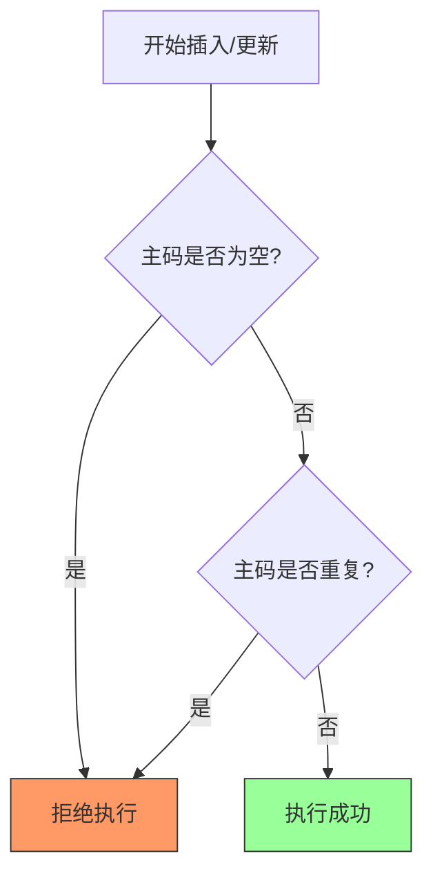

# 实体完整性的定义与违约处理
==实体完整性==（Entity Integrity）是关系模型中最基本的完整性约束。若属性 $A$ 是基本关系 $R$ 的主属性，则 $A$ 不能取空值（NULL）。这一规则保证了每个元组在关系中是可唯一标识的，即“行”必须存在且唯一。

> [!IMPORTANT]
> **核心结论**：主码（Primary Key）的所有属性均不可为空，且取值必须唯一。这是数据库能够区分不同记录的基础。

### 为什么需要实体完整性？

试想一下，如果学生表中的“学号”允许为空或重复，系统将无法确定某条成绩记录究竟属于哪位学生，导致数据混乱甚至丢失。实体完整性强制要求主码非空且唯一，从物理存储层面确保了数据的可识别性。

### 检查时机与违约处理

当用户执行 `INSERT` 或 `UPDATE` 操作时，DBMS 会自动进行实体完整性检查。



对于实体完整性，违约处理策略非常单一：**拒绝执行**（NO ACTION / RESTRICT）。因为主码的唯一性和非空性是关系成立的底线，不存在“级联修改”或“置空”的余地——你不能通过删除其他记录来让当前记录的主码变得合法。

### 与参照完整性的区别

很多同学容易混淆实体完整性与参照完整性，二者在违约处理上有显著差异：

| 特性 | 实体完整性 | 参照完整性 |
| :--- | :--- | :--- |
| **约束对象** | 主码 (Primary Key) | 外码 (Foreign Key) |
| **检查时机** | 插入、修改主码时 | 插入/修改外码；删除/修改被参照表主码时 |
| **违约处理** | **仅拒绝执行** | 拒绝 / 级联 (CASCADE) / 置空 (SET NULL) |

> [!WARNING]
> **常见坑**：在 SQL 中定义主码时，`NOT NULL` 是隐含的，无需显式写出。但若将某属性设为 `UNIQUE` 而非 `PRIMARY KEY`，则该属性允许为 NULL（取决于具体 DBMS 实现，标准 SQL 允许），此时它不具备实体完整性的强制非空约束。

### 算对了的例子

回顾南邮考题综合 28 的第 (2) 问：如何在 SC 表中保证 S# 和 C# 不为空？

SC 表的主码通常是 `(S#, C#)` 的组合。根据实体完整性定义，组成主码的属性都不能取空值。

```sql
CREATE TABLE SC (
    S# CHAR(10) NOT NULL,  -- 主属性，隐含非空
    C# CHAR(10) NOT NULL,  -- 主属性，隐含非空
    GRADE INT,
    PRIMARY KEY (S#, C#)   -- 定义组合主码，自动强制执行实体完整性
);
```

在此定义下，若尝试执行 `INSERT INTO SC VALUES (NULL, 'C01', 90)`，DBMS 将直接**拒绝执行**并报错，因为违反了实体完整性中“主属性不能为空”的规则。
