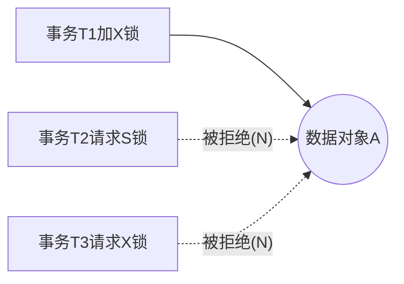

# 封锁（排它锁X、共享锁S、锁相容矩阵）

如果两个事务同时修改同一条记录，数据库怎么保证结果不乱？答案是：在操作之前先“占座”——这就是==封锁（Locking）==。

## 基本封锁类型

封锁就是事务 $T$ 在对某个数据对象（例如表、记录等）操作之前，先向系统发出请求，对其加锁。基本封锁类型有两种：

- **排它锁（X锁/写锁）**：若事务 $T$ 对数据对象 $A$ 加 X 锁，则只允许 $T$ 读取和修改 $A$，其他任何事务都==不能再对 $A$ 加任何类型的锁==，直到 $T$ 释放 X 锁。
- **共享锁（S锁/读锁）**：若事务 $T$ 对数据对象 $A$ 加 S 锁，则 $T$ 可以读 $A$ 但不能修改 $A$；其他事务只能再对 $A$ 加 S 锁，==不能加 X 锁==，直到 $T$ 释放 S 锁。

> [!TIP]
> 记忆口诀：“X 锁独占读写，S 锁共享只读”。X 是 eXclusive，S 是 Shared。

## 锁相容矩阵

当多个事务对同一数据对象请求加锁时，系统如何判断能否批准？这取决于**锁相容矩阵**。

| 已加锁 \ 请求锁 | X 锁 | S 锁 | 无锁 |
| :---: | :---: | :---: | :---: |
| **X 锁** | N | N | Y |
| **S 锁** | N | Y | Y |
| **无锁** | Y | Y | Y |

*注：Y=Yes（相容），N=No（不相容）。行表示数据对象上已有的锁，列表示新事务请求的锁。*

如上图，一旦数据对象被加了 X 锁，其他事务无论申请什么锁都会被拒绝并排队等待。

## 三级封锁协议

有了 X 锁和 S 锁，具体什么时候加、什么时候放？这就需要约定规则，即==封锁协议==。不同级别的封锁协议解决不同的并发问题：

| 封锁协议 | X 锁持锁时间 | S 锁持锁时间 | 防止丢失修改 | 防止读脏数据 | 防止不可重复读 |
| :--- | :--- | :--- | :---: | :---: | :---: |
| 一级 | 事务结束释放 | 不加 S 锁 | √ | × | × |
| 二级 | 事务结束释放 | 操作结束释放 | √ | √ | × |
| 三级 | 事务结束释放 | 事务结束释放 | √ | √ | √ |

> [!IMPORTANT]
> 核心结论：级别越高，一致性保证越强，但并发度越低。三级封锁协议能同时解决丢失修改、读“脏”数据和不可重复读三个问题。

## 与实验现象的结合

回顾课件中实验二的场景：U1 执行 `update 图书 set 库存量=库存量+10;` 后，U2 紧接着执行 `update 图书 set 库存量=库存量-10;` 会发生什么？

由于 U1 执行更新操作，ORACLE 会自动对该数据对象加 ==X 锁==。此时 U2 也尝试更新（需要申请 X 锁），查相容矩阵可知 X 与 X 不相容（N），因此 U2 的操作会被阻塞，处于等待状态。只有当 U1 执行 `commit;` 或 `rollback;` 释放了 X 锁后，U2 才能继续执行。

## 常见易错点

> [!WARNING]
> 不要把“锁的类型”和“封锁协议”混淆。X 锁和 S 锁是工具，而三级封锁协议是使用这些工具的说明书（规定了何时申请、何时释放）。

> [!CAUTION]
> 二级封锁协议中，S 锁是“读完即释放”，所以防不住不可重复读；三级封锁协议中，S 锁必须“事务结束才释放”，这才保证了可重复读。考试中常考这两者的区别。
