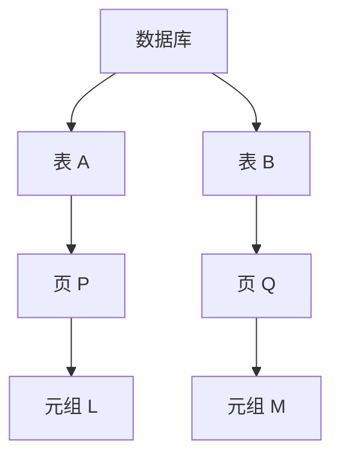

# 封锁粒度（多粒度封锁、意向锁）

## 什么是封锁粒度

==封锁粒度（Granularity）==是事务加锁时所针对数据对象的大小。常见粒度从大到小包括数据库、表、页（或块）、元组。

数据库常按“页”组织。若元组 $L_1$ 和 $L_2$ 位于同一数据页 $A$，当系统只支持页级封锁时：

- $T_1$ 修改 $L_1$，必须锁住整个 $A$；
- $T_2$ 修改 $L_2$，即使操作的是不同元组，也必须等待 $T_1$ 释放 $A$。

若支持元组级封锁，$T_1$ 与 $T_2$ 可分别锁定 $L_1$、$L_2$，无需互相等待。

> [!IMPORTANT]
> ==封锁粒度越大，并发度越低、控制开销越小；封锁粒度越小，并发度越高、控制开销越大。==

| 粒度 | 并发度 | 锁管理开销 | 典型代价 |
|---|---|---|---|
| 数据库、表 | 低 | 小 | 无关事务也互相阻塞 |
| 页 | 较高 | 中等 | 同页元组不能并行修改 |
| 元组 | 高 | 大 | 锁数量多，需维护更多锁状态 |

## 多粒度封锁

单一粒度难以兼顾并发性能和锁开销。例如，事务只修改一条元组时锁整表过于粗糙；事务要扫描整表时，逐条锁定所有元组又会产生大量锁。

==多粒度封锁（Multiple Granularity Locking）==是指在同一系统中同时提供多种封锁粒度，由事务根据访问范围选择。粒度层次通常组织成树：

树的根节点范围最大，叶子节点范围最小。对某节点加锁时，事务会与该节点及其子树中其他事务持有的冲突锁发生冲突。

例如，$T_1$ 已锁定元组 $L$，随后 $T_2$ 请求锁定表 $A$，即使 $T_1$ 只访问 $L$，$T_2$ 也必须等待。

## 意向锁

若只检查节点本身是否被锁，很难发现其下层节点上已有的锁。因此，多粒度封锁引入==意向锁（intention lock）==，把“下层存在锁”的信息向上层传播。

基本规则是：

> [!IMPORTANT]
> ==对任一结点加锁前，必须先在其所有上层结点加意向锁。==

例如，对元组 $L$ 加锁前，要先对 $L$ 所在的页、表和数据库加意向锁。意向锁本身不阻止其他事务访问下层的不同对象，主要用于检查锁冲突。

常用意向锁包括：

- **IS（意向共享锁）**：事务打算在某些下层对象上加 S 锁；
- **IX（意向排他锁）**：事务打算在某些下层对象上加 X 锁；
- **SIX（共享兼意向排他锁）**：事务既要在当前对象上加 S 锁，又要在某些下层对象上加 X 锁。

## 相容性与锁升级

意向锁可理解为层次化的“预定标记”。典型相容关系如下：

| 锁类型 | S | X | IS | IX | SIX |
|---|---:|---:|---:|---:|---:|
| S | ✓ | × | ✓ | × | × |
| X | × | × | × | × | × |
| IS | ✓ | × | ✓ | ✓ | ✓ |
| IX | × | × | ✓ | ✓ | ✓ |
| SIX | × | × | ✓ | ✓ | × |

> [!TIP]
> 记忆规律：S 与 S、IS 相容；X 与所有锁都不相容；IS、IX、SIX 彼此相容，但 SIX 与 X、SIX 冲突。

## 常见误区

> [!WARNING]
> 意向锁不会提高实际并发度，它只是让上层封锁能够发现下层冲突。

- 意向锁不是普通数据锁，不能直接替代对目标元组的 S 锁或 X 锁。
- “加锁前先加意向锁”不等于“必须先锁定父节点”；父节点通常加的是 IS 或 IX。
- 锁粒度越小不代表事务操作越少；扫描全表时逐元组加锁，反而可能产生大量锁并增加死锁风险。

## 完整示例

数据库中依次包含表、页和元组。$T_1$ 要修改元组 $L_1$：

1. 在数据库、相关表及页上依次加 IX 锁；
2. 在元组 $L_1$ 上加 X 锁；
3. 提交后按“子节点到父节点”的顺序释放锁。

若 $T_2$ 只修改同页的 $L_2$，它可以在各层加 IX 锁并锁定 $L_2$。由于二者的 IX 锁相容，$T_1$ 与 $T_2$ 可以并发执行。若 $T_2$ 要锁定整个表，则会与相关节点上的 X 锁或 SIX 锁冲突，需要等待 $T_1$ 结束。

这体现了多粒度封锁的取舍：==访问范围越精确，并发度越高；需要覆盖的范围越大，锁开销越集中、等待越明显。==
