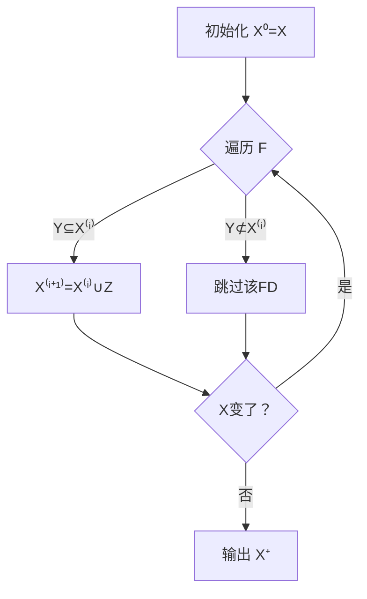

# 求属性集X关于F的闭包X_F^+

> [!IMPORTANT]
> 属性集 $X$ 关于函数依赖集 $F$ 的闭包 $X_F^+$，是指由 $X$ 出发，根据 $F$ 中的函数依赖能推导出的所有属性的集合。

## 为什么需要它

在关系模式设计中，你无法仅凭肉眼看出“$A$ 能不能决定 $E$”。求闭包正是解决这个问题的核心工具：

- **求候选键**：若 $X_F^+$ 包含全部属性 $U$，则 $X$ 是超键；再验证其真子集的闭包不含 $U$，即为候选键。
- **判断无损分解**：定理指出，分解 $\rho=\{R_1, R_2\}$ 无损的充要条件是 $(R_1 \cap R_2)_F^+ \supseteq (R_1 - R_2)$ 或 $(R_1 \cap R_2)_F^+ \supseteq (R_2 - R_1)$。
- **判断函数依赖是否成立**：检验 $X \to Y$ 是否在 $F^+$ 中，只需看 $Y \subseteq X_F^+$ 是否成立。

## 算法步骤

求 $X_F^+$ 是一个不断“吸收”新属性的迭代过程：

1. 令 $X^{(0)} = X$，$i = 0$；
2. 扫描 $F$ 中每个 FD $Y \to Z$，若 $Y \subseteq X^{(i)}$，则令 $X^{(i+1)} = X^{(i)} \cup Z$；
3. 若 $X^{(i+1)} \neq X^{(i)}$，用 $i+1$ 代替 $i$，转②；
4. 若 $X^{(i+1)} = X^{(i)}$，算法终止，==此时的 $X^{(i)}$ 就是 $X_F^+$==。

> [!TIP]
> 记忆口诀：**“左边被包含，右边就并入；直到不增长，结果就是它。”**

## 实战演练

以南邮考题为例：$R(A,B,C,D,E)$，$F=\{A \to B,\ C \to D,\ AC \to E\}$，判断分解 $\rho=\{R_1(ACE),\ R_2(ABCD)\}$ 是否无损。

按定理需计算交集属性 $(R_1 \cap R_2) = \{A, C\}$ 的闭包 $(AC)_F^+$：

| 轮次 | 当前集合 $X^{(i)}$ | 匹配的 FD | 更新后 $X^{(i+1)}$ |
| :---: | :---: | :---: | :---: |
| 0 | $\{A, C\}$ | $A \to B$, $C \to D$, $AC \to E$ | $\{A, B, C, D, E\}$ |
| 1 | $\{A, B, C, D, E\}$ | 无新属性可加 | $\{A, B, C, D, E\}$ |

因为 $X^{(1)} = X^{(0)}$，算法终止，$(AC)_F^+ = \{A, B, C, D, E\} = U$。

由于 $(AC)_F^+$ 包含了 $R_1 - R_2 = \{E\}$（也包含 $R_2 - R_1 = \{B, D\}$），故该分解是==无损分解==。

再看另一题：$R(A,B,C)$，$F=\{B \to C,\ C \to A\}$，判断 $\rho=\{AB, AC\}$ 是否无损。
计算交集 $A$ 的闭包：

| 轮次 | 当前集合 | 匹配的 FD | 更新后 |
| :---: | :---: | :---: | :---: |
| 0 | $\{A\}$ | 无（$B,C$ 均不在 $\{A\}$ 中） | $\{A\}$ |

$(A)_F^+ = \{A\}$。它既不包含 $R_1 - R_2 = \{B\}$，也不包含 $R_2 - R_1 = \{C\}$，因此是有损分解。

## 易错点辨析

> [!WARNING]
> 每轮必须**重新扫描整个 $F$**。上一轮刚加入的属性，可能恰好满足了另一个 FD 的左部，漏扫会导致闭包算小。

> [!CAUTION]
> 不要混淆 $X_F^+$ 与 $F^+$！
> - $X_F^+$：一个**属性集合**，表示从 $X$ 能推出的所有属性。
> - $F^+$：一个**函数依赖集合**，表示 $F$ 逻辑蕴含的所有 FD。

> [!NOTE]
> 若某属性根本不出现在 $F$ 的任何 FD 中，它在求闭包时不会被自动带入。但在求候选键时，这类“孤立属性”必须手动并入候选键中。
