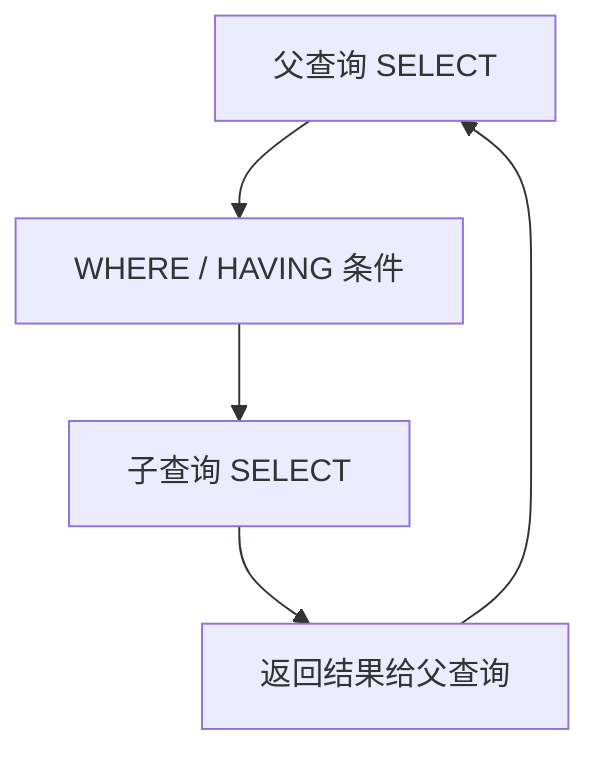

# 嵌套查询（IN、比较运算符、ANY/ALL、EXISTS）

## 嵌套查询是什么

一个 SELECT 查询块嵌套在另一个查询块的 WHERE 子句或 HAVING 短语中，就构成**嵌套查询**。外层叫父查询，内层叫子查询。



> [!IMPORTANT]
> 子查询的 SELECT 语句**不能**包含 ORDER BY 子句（ORDER BY 只能对最终查询结果排序，不能对中间子查询结果排序）。

## 为什么需要嵌套查询

有些查询条件本身就需要先查一次才知道。比如"查询和刘晨同专业的所有学生"——你得先查出刘晨的专业是什么，才能去查同专业的学生。用嵌套查询，一步就能写出来，层次清楚、易于构造，这正是结构化程序设计的优点。

## 四种形式

### 带有 IN 谓词的子查询

IN 是最常用的嵌套形式，表示"属于子查询返回的集合"。

```sql
SELECT Sname, Ssex
FROM Student
WHERE Smajor IN ('计算机科学与技术', '信息安全');
```

如果条件涉及另一张表，就用子查询：

```sql
-- 检索 WANG 同学不学的课程号
SELECT C#
FROM C
WHERE C# NOT IN (
    SELECT C#
    FROM S, SC
    WHERE S.S# = SC.S# AND SNAME = 'WANG'
);
```

> [!TIP]
> IN 实际上是多个 OR 的缩写：`Smajor IN ('A', 'B')` 等价于 `Smajor = 'A' OR Smajor = 'B'`。

### 带有比较运算符的子查询

当能**确切知道**内层查询返回**单值**时，可以直接用 `=`、`>`、`<` 等比较运算符代替 IN。

```sql
-- 检索年龄大于女同学平均年龄的男同学
SELECT SNAME, AGE
FROM S
WHERE SEX = 'M' AND AGE > (
    SELECT AVG(AGE) FROM S WHERE SEX = 'F'
);
```

> [!WARNING]
> 如果子查询返回多值，却直接写 `=`，会报错。这时必须改用 IN，或者加上 ANY / ALL。

### 带有 ANY / ALL 谓词的子查询

子查询返回多值时，在比较运算符后加 ANY 或 ALL：

| 谓词 | 含义 | 等价转换 |
|------|------|----------|
| `> ANY` | 大于某个值 | `> MIN(...)` |
| `> ALL` | 大于所有值 | `> MAX(...)` |
| `< ANY` | 小于某个值 | `< MAX(...)` |
| `< ALL` | 小于所有值 | `< MIN(...)` |
| `= ANY` | 等于某个值 | `IN` |
| `<> ALL` | 不等于所有值 | `NOT IN` |

```sql
-- 检索学号比 WANG 大、年龄比他小的学生
SELECT SNAME FROM S
WHERE S# > ALL (SELECT S# FROM S WHERE SNAME = 'WANG')
  AND AGE < ALL (SELECT AGE FROM S WHERE SNAME = 'WANG');
```

> [!IMPORTANT]
> ==`<> ALL` 等价于 `NOT IN`，但 `NOT IN` 遇到 NULL 会出问题（返回空结果），实际开发中要小心。==

### 带有 EXISTS 谓词的子查询

EXISTS 不返回具体数据，只返回逻辑真值 true 或 false，表示"是否存在满足条件的记录"。因此其目标列通常写 `*`，给出列名无实际意义。

```sql
-- 查询没有选修 81001 号课程的学生姓名
SELECT Sname FROM Student
WHERE NOT EXISTS (
    SELECT * FROM SC
    WHERE SC.Sno = Student.Sno AND Cno = '81001'
);
```

> [!IMPORTANT]
> ==所有带 IN、比较运算符、ANY/ALL 的子查询都能用 EXISTS 等价替换，但反过来不一定成立。== 特别是涉及"全称量词"（所有、全部）时，只能用双 NOT EXISTS 实现。

用双 NOT EXISTS 实现"检索全部学生都选修的课程"：

```sql
SELECT C#, CNAME FROM C
WHERE NOT EXISTS (
    SELECT * FROM S
    WHERE NOT EXISTS (
        SELECT * FROM SC
        WHERE C.C# = SC.C# AND SC.S# = S.S#
    )
);
```

内层含义：不存在一个学生，他没有选这门课——即所有学生都选了。

## 不相关子查询与相关子查询

| 类型 | 特征 | 求解顺序 |
|------|------|----------|
| 不相关子查询 | 子查询条件不依赖父查询 | 由里向外，逐层处理 |
| 相关子查询 | 子查询条件引用父查询的表（如 `Student.Sno`） | 由外向里，逐行处理 |

前面 IN 的例子都是不相关子查询；EXISTS 的例子中子查询引用了父查询的 `Student.Sno`，属于相关子查询。

## 嵌套查询 vs 连接查询

| 对比项 | 嵌套查询 | 连接查询 |
|--------|----------|----------|
| 思路 | 逐步求解、层次分明 | 一次性多表关联 |
| 可读性 | 易于构造和理解 | 表多时 WHERE 条件冗长 |
| 实际性能 | 一般 | 商用 DBMS 中通常更优 |

> [!TIP]
> 有些嵌套查询可以用连接运算替代，有些不能。考试写嵌套查询更清晰；实际应用中，能连接就尽量用连接。

> [!CAUTION]
> 聚合函数（COUNT、AVG 等）**不能直接出现在 WHERE 子句中**，但可以用在 SELECT 和 HAVING 中。如果 WHERE 里需要聚合结果，应改用子查询或 HAVING。
