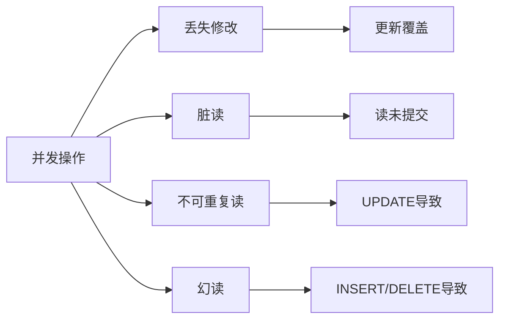

# 并发控制概述（丢失修改、脏读、不可重复读、幻读）

> [!IMPORTANT]
> 并发控制的核心目的，是防止多个事务交叉执行时破坏数据库的==一致性==。

想象一下：你和室友同时修改同一个共享文档，你刚改完还没保存，他就覆盖了你的内容——数据库中的事务并发也会遇到类似问题。如果不对并发操作加以调度，就会产生数据不一致性。

## 四种数据不一致现象

当两个事务 $T_1$、$T_2$ 并发访问同一数据时，可能出现以下四类问题：

- **丢失修改**：$T_1$ 和 $T_2$ 都读取了数据 $A$ 并各自修改，后提交的事务覆盖了先提交的事务的结果，导致前者的修改“丢失”。
- **脏读（dirty read）**：$T_1$ 修改了数据但尚未 `COMMIT`，$T_2$ 就读取了这个未提交的值；若 $T_1$ 随后 `ROLLBACK`，$T_2$ 读到的就是根本不存在的“脏”数据。
- **不可重复读**：$T_1$ 读取数据后，$T_2$ 执行了==更新（UPDATE）==操作并提交，$T_1$ 再次读取时发现值变了，无法再现前一次结果。
- **幻读（phantom row）**：$T_1$ 按条件读取一批数据后，$T_2$ 执行了==插入或删除==操作并提交，$T_1$ 用相同条件再查，发现多出了“幻影”行或少了行。

> [!WARNING]
> 不可重复读 vs 幻读：前者是 $T_2$ ==改了已有数据==的值，后者是 $T_2$ ==增删了记录==导致结果集行数变化。这是考试高频易混点！

## 隔离级别与封锁协议如何解决

解决这些问题的思路有两条线：**事务隔离级别**和**封锁协议**。

| 事务隔离级别 | 丢失修改 | 脏读 | 不可重复读 | 幻读 |
| :--- | :---: | :---: | :---: | :---: |
| 读未提交 | 否 | 是 | 是 | 是 |
| 读已提交 | 否 | 否 | 是 | 是 |
| 可重复读 | 否 | 否 | 否 | 是 |
| 可串行化 | 否 | 否 | 否 | 否 |

> [!NOTE]
> Oracle 默认隔离级别为“读已提交”（级别3对应三级封锁），MySQL InnoDB 默认为“可重复读”。

封锁协议则通过加 X锁（排他锁）和 S锁（共享锁）来控制：

| 封锁协议 | X锁释放时机 | S锁释放时机 | 解决的问题 |
| :--- | :--- | :--- | :--- |
| 一级 | 事务结束 | 不加S锁 | 防止丢失修改 |
| 二级 | 事务结束 | 操作结束 | +防止读脏数据 |
| 三级 | 事务结束 | 事务结束 | +防止不可重复读 |

> [!TIP]
> 记忆口诀：“一防丢，二防脏，三防不可重复读”。X锁都是事务结束才释放；S锁从二级开始加，到三级才延迟至事务结束释放。

## 算对了的例子：用一级封锁协议防止丢失修改

设 $A=16$，$T_1$ 执行 $A \leftarrow A-1$，$T_2$ 执行 $A \leftarrow A-3$。若不控制，可能得到错误结果。使用一级封锁协议的调度如下：

| 步骤 | $T_1$ | $T_2$ |
| :--- | :--- | :--- |
| 1 | `Xlock A` | |
| 2 | `R(A)=16` | |
| 3 | | `Xlock A`（等待） |
| 4 | `A←A-1`, `W(A)=15` | 等待 |
| 5 | `Commit`, `Unlock A` | 等待 |
| 6 | | 获得 `Xlock A` |
| 7 | | `R(A)=15` |
| 8 | | `A←A-3`, `W(A)=12` |
| 9 | | `Commit`, `Unlock A` |

最终 $A=12$，两次修改均正确生效，没有发生丢失修改。

> [!CAUTION]
> 一级封锁协议只要求修改前加 X 锁，不要求读操作加 S 锁。因此它只能防丢失修改，==无法防止脏读和不可重复读==。若要全面防护，必须升级至三级封锁协议或采用“可串行化”隔离级别。
