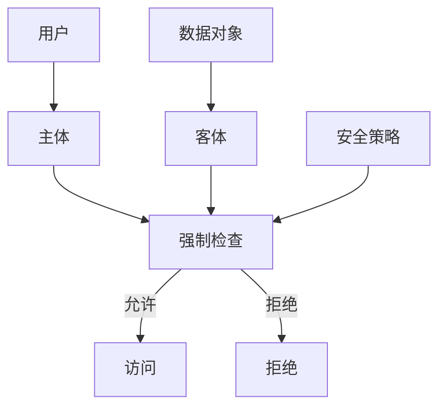

# 强制存取控制方法

## 什么是强制存取控制

强制存取控制（Mandatory Access Control，==MAC==）是数据库安全性中的一种存取控制方法。系统依据预先规定的安全策略，对主体访问客体进行==强制检查==，不允许用户通过自主授权绕过限制。

这里的“强制”体现在：即使某个用户拥有数据库对象的某些权限，只要其安全级别或访问规则不满足要求，数据库仍会拒绝该操作。

> [!IMPORTANT]
> MAC 的核心是“系统按安全策略强制执行”，其安全程度通常高于自主存取控制（DAC）。

## 为什么需要 MAC

自主存取控制（DAC）由数据所有者决定“谁能访问什么”。但在军队、政府、医疗等场景中，还需要限制信息的流动方向，例如：

- 机密文件不能被低密级用户读取；
- 高密级用户修改低密级数据时，可能造成“降密”；
- 普通用户不能通过复制、转发等方式把受控信息泄露出去。

DAC 侧重“所有者的权限”，MAC 侧重“整个系统的安全规则”。

## 基本做法：主体、客体与安全级别

MAC 通常给主体和客体标记安全级别，并以格模型描述访问关系。常见内容包括：

- **主体**：用户、进程或用户组；
- **客体**：表、视图、行、属性等数据库对象；
- **安全级别**：如绝密、机密、秘密、公共；
- **访问规则**：规定什么级别的主体可以读、写或执行客体。

典型规则是“单向信息流”：

- 高密级主体可以读取低密级客体；
- 低密级主体不能读取高密级客体；
- 一般情况下，高密级主体不能随意修改低密级客体。

例如，系统把“财务工资表”标记为“秘密”，把“普通通知表”标记为“公共”。机密级用户可以读取普通通知，但普通用户不能读取工资表。

## 与 DAC、RBAC 的区别

| 方法 | 权限依据 | 主要管理者 | 灵活性与安全性 |
|---|---|---|---|
| DAC 自主存取控制 | 数据所有者授权 | 对象所有者 | 灵活，安全约束较弱 |
| MAC 强制存取控制 | 固定安全策略 | 系统安全机构 | 约束强，适合高安全环境 |
| RBAC 基于角色的访问控制 | 角色分配权限 | 管理员 | 管理方便，适合一般组织系统 |

三者并非完全互斥，实际系统可能同时使用。例如，RBAC 先确定用户角色和操作权限，MAC 再根据安全级别检查其是否允许访问。

## 常见坑

> [!WARNING]
> MAC 不是“用户拥有权限就一定能访问”；用户还必须满足安全级别、格模型等强制规则。

1. **把“读权限”和“强制级别”混为一谈**：有 SQL 权限不等于通过 MAC 检查。
2. **认为高密级用户能任意修改低密级数据**：写操作还可能受到“向下写”或“向上写”规则限制。
3. **只记单向流动而忽略完整规则**：不同格模型对读取、修改、删除等操作可能有不同限制。
4. **把 MAC 与数据库完整性混在一起**：MAC 解决“能不能访问”，完整性约束解决“数据是否满足业务规则”。

## 一道名词题怎么答

题目：**MAC 是什么？**

可答：

> 强制存取控制方法。系统为保证更高程度的安全性，按照 TCSEC 标准中安全策略的要求，强制进行存取检查的手段。

> [!TIP]
> 记忆关键词：**系统强制、策略控制、TCSEC、更高安全级别**。
