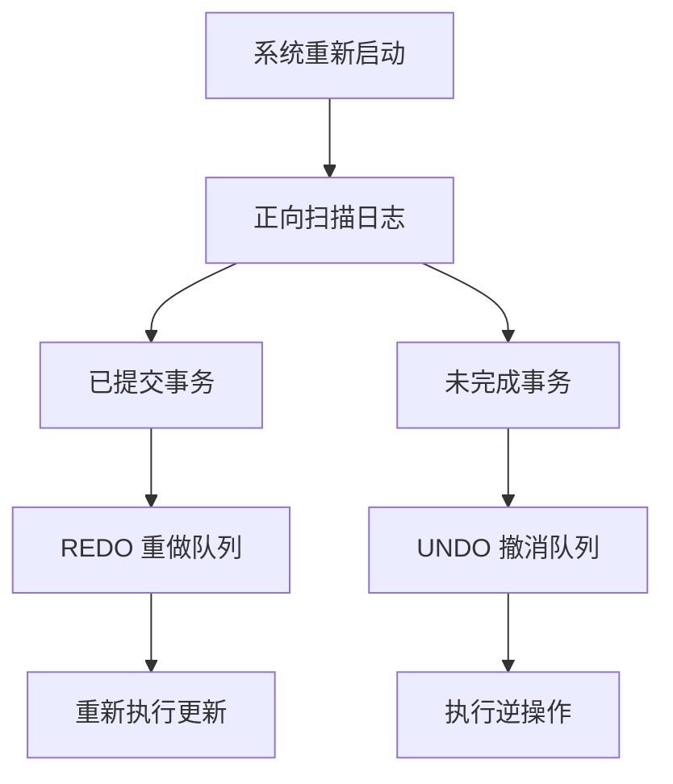
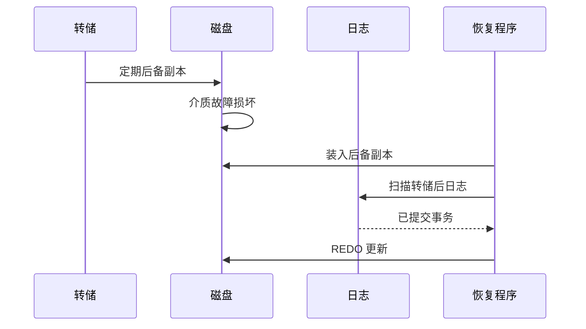

# 恢复策略（事务故障恢复、系统故障恢复、介质故障恢复）

## 恢复策略：三类故障各怎么救

数据库运行中难免出事：程序写错、机器断电、磁盘损坏……恢复策略要回答的核心问题是：**故障发生后，哪些事务要撤销（UNDO），哪些要重做（REDO）？**

先想一个朴素的事实：日志文件里记录了每个事务的 `<BEGIN>`、更新操作、`<COMMIT>` 标记。故障恢复时，只要扫描日志，就能知道每个事务"做完了没有"——做完了但数据可能没来得及写盘，就要 REDO；没做完就死了，就要 UNDO。

> [!IMPORTANT]
> ==恢复的基本原理是"建立冗余数据"：利用日志文件（以及后备副本）中的冗余信息，重建数据库的正确状态。==
> 三类故障的恢复策略可概括为：**事务故障——UNDO；系统故障——UNDO + REDO；介质故障——REDO（借助后备副本）**。

## 事务故障恢复：只撤不做

事务内部故障（运算溢出、死锁被选中撤消、违反完整性约束等）使事务未运行到正常终点就被迫终止。此时该事务可能已把部分更新结果写入数据库，==必须 UNDO 该事务已做的所有更新，把数据库恢复到该事务开始前的状态==。

做法：反向扫描日志文件，找到该事务的更新操作，逐条执行逆操作（插入→删除、删除→插入、修改→改回原值），直到读到该事务的 `<BEGIN>` 标记为止。课件原话："如此处理下去，直至读到此事务的开始标记，事务故障恢复就完成了。"

## 系统故障恢复：先撤后做

系统故障（OS 崩溃、DBMS 错误、突然断电等）造成内存数据丢失，但==磁盘上的数据库未被破坏==。麻烦在于：有些事务未完成就被迫中断（要 UNDO），有些事务已提交但更新结果还留在内存缓冲区、没来得及写盘（要 REDO）。

恢复子系统的两步走：

- **UNDO 队列**：正向扫描日志，把故障发生前**未提交**的事务加入撤消队列，逐个反向执行其更新操作的逆操作；
- **REDO 队列**：把**已提交**的事务加入重做队列，逐个重新执行其更新操作。

## 介质故障恢复：副本 + REDO

介质故障（磁盘损坏）是最严重的一种——==数据库本身已被破坏，无法只凭日志修复==。恢复步骤分两步：

1. **装入后备副本**：利用之前的数据转储，将数据库恢复到转储时的一致状态；
2. **REDO 已完成事务**：从转储时刻起扫描日志，把此后所有已提交的事务重新执行一遍，把数据库更新到故障前的一致状态。

> [!WARNING]
> ==介质故障恢复比较费时==：既要复制大量数据，又要 REDO 大量事务。所以数据转储是基本技术，但"不能频繁进行"。

## 三类策略对比

| 故障类型 | 数据库是否破坏 | 恢复动作 | 依赖 |
|---|---|---|---|
| 事务故障 | 未破坏 | UNDO 未完成事务 | 日志文件 |
| 系统故障 | 未破坏 | UNDO 未完成 + REDO 已提交 | 日志文件 |
| 介质故障 | 已破坏 | 装后备副本 + REDO 已提交 | 后备副本 + 日志 |

> [!TIP]
> 记忆口诀："==事务只撤、系统撤加做、介质副本重做=="——故障越严重，恢复动作越多、越慢。

> [!NOTE]
> 无论哪种故障，事务故障恢复和系统故障恢复**必须用日志文件**；检查点机制通过定期把已提交事务的更新写盘并登记 `<checkpoint>`，使恢复时只需处理最近检查点之后的事务，从而改善恢复效率。
