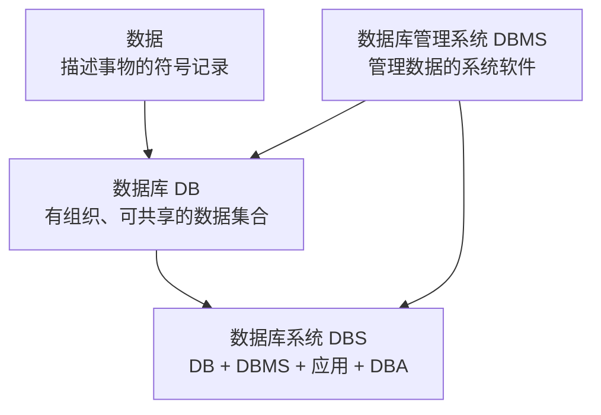
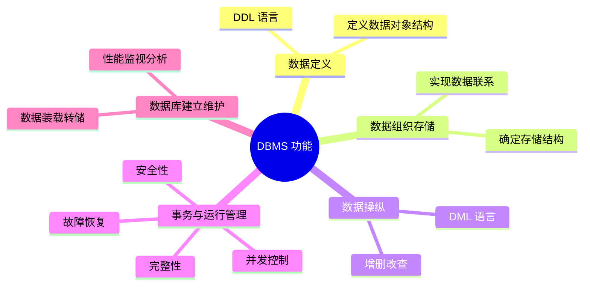

# 数据与数据库的基本概念

## 数据与数据库的基本概念

先从一个问题开始：为什么“93”这个数字，在不同地方看到，意思可能完全不同？

如果它出现在某张学生表里，可能是成绩；如果出现在快递单上，可能是包裹数量。==数据与其语义是不可分的==——离开具体语境的数据没有明确含义。

### 四个基本概念的关系

数据库课程一开篇就要求分清四个概念：**数据（Data）**、**数据库（DB）**、**数据库管理系统（DBMS）**、**数据库系统（DBS）**。

| 概念 | 是什么 | 类比 |
| :--- | :--- | :--- |
| 数据 | 描述事物的符号记录，含语义 | 书上的文字 |
| 数据库 | 长期存储、有组织、可共享的大量数据集合 | 图书馆的书库 |
| DBMS | 位于用户与操作系统之间的一层数据管理软件 | 图书馆管理系统 |
| 数据库系统 | 引入数据库后的整个计算机系统 | 图书馆 + 管理系统 + 管理员 |

> [!IMPORTANT]
> DBMS 是**系统软件**，DBS 是**系统整体**。不引起混淆时，“数据库”常被用来泛指数据库系统。

### 数据管理技术的三个发展阶段

数据库不是一开始就有的。数据管理经历了三个阶段：

| 比较项 | 人工管理阶段 | 文件系统阶段 | 数据库系统阶段 |
| :--- | :--- | :--- | :--- |
| 数据的管理者 | 用户（程序员） | 文件系统 | ==DBMS== |
| 数据面向的对象 | 某一应用程序 | 某一应用 | 现实世界（整个组织） |
| 共享程度 | 无共享，冗余极大 | 共享性差，冗余大 | ==共享性高，冗余小== |
| 独立性 | 完全依赖程序 | 独立性差 | 物理独立 + 逻辑独立 |
| 结构化 | 无结构 | 记录内有结构，整体无结构 | ==整体结构化== |
| 数据控制 | 应用程序自己控制 | 应用程序自己控制 | ==DBMS 统一控制== |

> [!WARNING]
> 文件系统阶段已经能长期保存数据，但它的问题在于“记录内有结构，整体无结构”——每个文件各自定义格式，文件之间无法表达关联。数据库系统阶段的核心突破是**整体数据的结构化**，而不仅是存储时间变长。

### 数据库管理系统的主要功能

DBMS 是数据管理技术进入数据库阶段的关键软件，其功能可以概括为五个方面：

> [!TIP]
> 记忆口诀：**“定义、存储、操纵、管理、维护”**。其中“管理”这一项是考试高频点——安全、完整、并发、恢复四个词缺一不可。

### 一个容易混淆的坑

**“数据库”≠“数据库管理系统”**。日常说“装了数据库”，实际上装的是 DBMS（如 MySQL、Oracle、达梦）。DBMS 只是 DBS 的组成部分之一。

另一个易错点：**数据独立性不是指数据与程序没有关系，而是指数据存储或逻辑结构变化时，应用程序尽量不受影响**。数据库系统阶段具有“高度的物理独立性和一定的逻辑独立性”，这靠的是三级模式结构和两级映像（在后续知识点展开）。

### 一个算对了的例子

**题目**：某高校教务系统的学生信息（学号、姓名、课程号、成绩）需要在多个部门共享，并且要求修改存储方式时不影响教务处程序。该场景对应数据管理的哪个阶段？由谁管理数据？

**分析**：

- 数据面向整个组织，而非某个应用 → 排除人工管理阶段和文件系统阶段；
- 要求共享性高、独立性好 → 对应数据库系统阶段；
- 数据的管理者应为 ==DBMS==，由它提供安全、完整、并发和恢复等统一控制。

**答案**：该场景对应**数据库系统阶段**，数据由**数据库管理系统（DBMS）** 管理。
