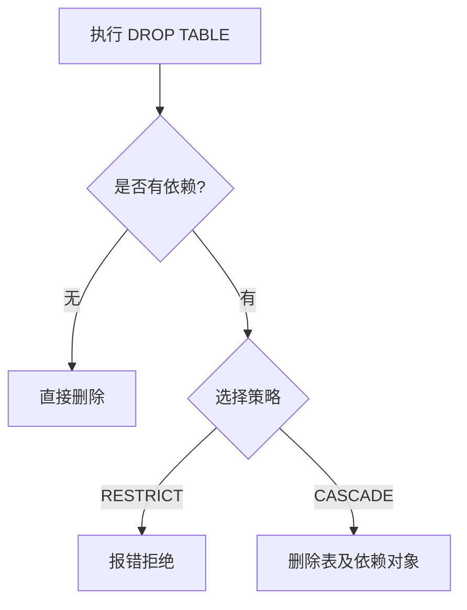

# 数据定义（CREATE、ALTER、DROP：SCHEMA、TABLE、INDEX）

# 数据定义（CREATE、ALTER、DROP）

SQL 集 DDL、DML、DCL 于一体，其中 ==数据定义语言 (DDL)== 负责定义数据库的“骨架”，即模式、表、视图和索引。RDBMS 执行 DDL 时，实质是在更新==数据字典==。

## 核心操作对象与动词

| 操作对象 | 创建 (Create) | 删除 (Drop) | 修改 (Alter) |
| :--- | :--- | :--- | :--- |
| **模式 (Schema)** | `CREATE SCHEMA` | `DROP SCHEMA` | - |
| **基本表 (Table)** | `CREATE TABLE` | `DROP TABLE` | `ALTER TABLE` |
| **视图 (View)** | `CREATE VIEW` | `DROP VIEW` | - |
| **索引 (Index)** | `CREATE INDEX` | `DROP INDEX` | `ALTER INDEX` |

> [!IMPORTANT]
> DDL 操作的是**结构**而非数据。执行 `CREATE TABLE` 并不插入元组，而是注册表的元数据。

## 基本表的定义与维护

### 1. 创建表 (CREATE TABLE)
需指定列名、数据类型及完整性约束。
```sql
CREATE TABLE Student (
    Sno CHAR(9) PRIMARY KEY,      -- 列级主键
    Sname VARCHAR(20) NOT NULL,
    Sage SMALLINT,
    Ssex CHAR(2) CHECK(Ssex IN ('男','女'))
);
```
> [!TIP]
> 主键也可定义为表级约束：`PRIMARY KEY (Sno)`。若为多属性主键（如 SPJ 表），必须使用表级约束。

### 2. 修改表 (ALTER TABLE)
用于动态调整表结构，常见操作如下：
*   **加列**：`ALTER TABLE Student ADD Semail VARCHAR(30);`
*   **改类型**：`ALTER TABLE Student ALTER COLUMN Sbirthdate TYPE VARCHAR(20);`
*   **加约束**：`ALTER TABLE Course ADD UNIQUE(Cname);`

### 3. 删除表 (DROP TABLE)
删除时需处理依赖关系，有两个关键选项：
*   `RESTRICT`：若该表被其他对象（如视图、外键）引用，则拒绝删除。
*   `CASCADE`：==级联删除==，自动删除所有依赖该表的对象。



> [!WARNING]
> 生产环境中慎用 `CASCADE`，可能导致意外删除大量关联数据或视图。

## 索引的定义 (INDEX)

索引用于加速查询，但会增加维护开销。
*   **唯一索引**：`CREATE UNIQUE INDEX Idx_StuSname ON Student(Sname);` 确保列值唯一。
*   **复合索引**：`CREATE INDEX Idx_SC ON SC(Sno ASC, Cno DESC);` 注意排序方向。
*   **重命名**：`ALTER INDEX Idx_SC RENAME TO Idx_SC_New;`

## 常见坑与辨析

1.  **DROP vs DELETE**：
    *   `DROP TABLE` 是 DDL，删除表结构+数据，不可回滚（视事务隔离级别而定）。
    *   `DELETE FROM` 是 DML，仅删除数据，保留结构，可回滚。
2.  **视图的本质**：
    *   `CREATE VIEW` 仅将定义存入数据字典，==不存储实际数据==。查询视图时，系统会实时执行其定义的 SELECT 语句。
3.  **外键约束动作**：
    *   在创建表时，`ON DELETE CASCADE` 表示父表记录删除时，子表对应记录也删除；`ON DELETE RESTRICT` (或 NO ACTION) 则禁止删除。

> [!NOTE]
> **例题回顾**：在创建 `WORKS` 表时，若要求删除供应商时级联删除供应记录，应写：
> `FOREIGN KEY (E#) REFERENCES EMP(E#) ON DELETE CASCADE`

掌握 DDL 是构建数据库的第一步，务必分清“结构定义”与“数据操纵”的边界。
