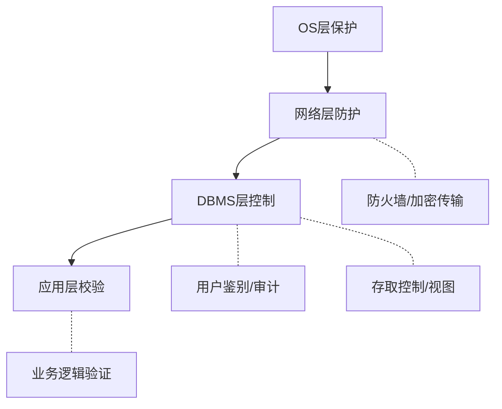

# 数据库不安全因素与安全性控制层次

数据库面临的不安全因素主要包括非授权用户窃取或篡改数据、合法用户越权操作、系统漏洞攻击以及物理介质损坏等。既然威胁来自内外多个层面，仅靠单一手段能否真正保障数据安全？显然不能，因此必须建立多层防御体系。

## 安全性控制层次模型

数据库安全性控制并非单点防护，而是从操作系统到应用层的==纵深防御体系==。南邮课程中强调以下四个核心层次：



> [!IMPORTANT]
> DBMS 层是安全性控制的==核心枢纽==，包含用户身份鉴别、自主存取控制（DAC）、视图机制、审计与数据加密五大机制。

其中，自主存取控制通过 `GRANT` / `REVOKE` 语句实现权限的授予与回收，而==数据库角色==则是简化批量授权的关键抽象。

## 安全性与完整性的本质区别

复习时极易混淆这两个概念，务必明确其防范对象的根本差异：

| 维度 | 数据库安全性 | 数据库完整性 |
| :--- | :--- | :--- |
| 防范对象 | ==非法用户/非法操作== | 合法用户/不正确的数据 |
| 核心目标 | 防止数据被窃取或恶意篡改 | 保证数据的正确性与相容性 |
| 典型措施 | 身份鉴别、存取控制、加密 | 实体/参照/用户自定义完整性约束 |

> [!NOTE]
> 安全性解决“谁能访问”的问题，完整性解决“数据对不对”的问题。两者相辅相成，但考查方向截然不同。

## 角色授权与传播机制

当需要将一组权限赋予多个用户时，逐个授权效率极低。引入角色后，如何将角色及其转授能力赋予用户？以真题为例：将角色 R1 授予用户 U1，且允许 U1 继续授权给他人。

```sql
GRANT R1 TO U1 WITH ADMIN OPTION;
```

> [!WARNING]
> `WITH ADMIN OPTION` 是==权限传播==的关键子句。缺少它，U1 仅能使用 R1 的权限，无权将其转授给其他用户。此选项仅用于角色或系统权限授予，对象级权限传播应使用 `WITH GRANT OPTION`，二者不可混用。

[!TIP]
> 记忆口诀：“Admin 管角色，Grant 管对象；带 Option 才能传，缺了只能自己用。”

## 常见误区警示

> [!CAUTION]
> 误认为视图等同于安全性控制。视图仅提供==逻辑隔离==，若未配合存取控制，用户仍可通过基表直接访问受限数据。视图是安全辅助手段，而非独立安全机制。

此外，实验二中涉及的 DCL 语句必须亲手验证。仅背诵语法无法体会 `REVOKE` 的级联回收行为，也无法理解 `WITH ADMIN OPTION` 在实际授权链中的传递效果。建议结合职工-部门关系模式，构造多用户场景进行权限授予、转授与回收的完整测试，观察权限变更对查询结果的实际影响，这才是应对简答题与综合题的根本保障。
