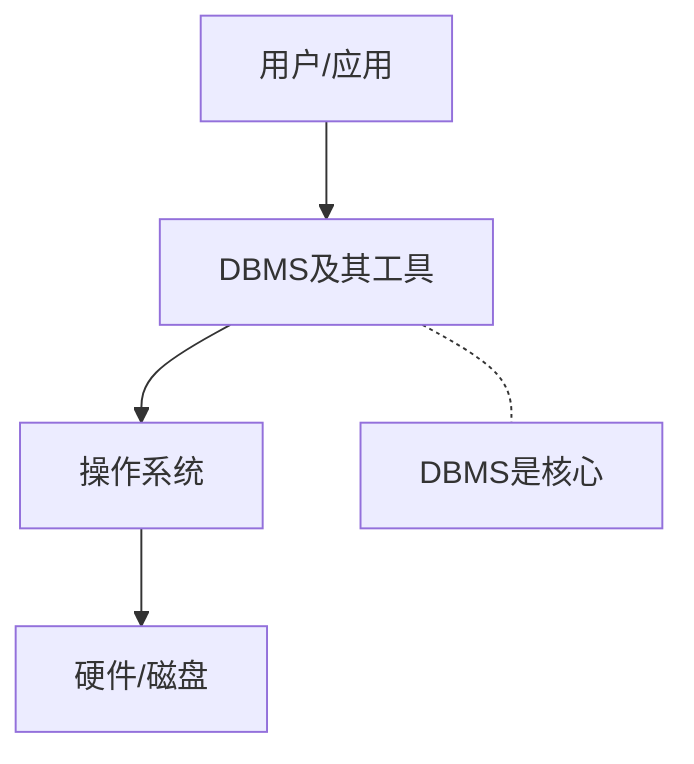

# 数据库管理系统（DBMS）的主要功能

数据库管理系统（DBMS）是位于用户应用与操作系统之间的一层数据管理软件，是整个数据库系统的核心。

思考一个问题：如果没有 DBMS，多个应用程序同时读写同一个文件会发生什么？数据可能会互相覆盖、格式混乱、毫无安全可言。这正是文件系统阶段的痛点。DBMS 的出现，就是为了==统一管理和控制数据==，解决共享性差、冗余度大、缺乏独立性和保护能力的问题。

## DBMS 在系统中的位置

从课件给出的对比表可以看出，到了数据库系统阶段，软件背景变成了“有数据库管理系统”，数据的控制权也从“应用程序自己控制”交给了 DBMS。

> [!NOTE]
> 数据库系统（DBS）由数据库、DBMS、用户和 DBA 组成。DBA 借助 DBMS 完成职责，所有操作都在 DBMS 控制下实现。

## 五大基本功能

根据复习提纲，DBMS 的基本功能可以归纳为以下五项：

| 功能模块 | 具体做什么 | 对应的语言或机制 |
| :--- | :--- | :--- |
| **数据库的定义** | 定义三级模式结构 | 模式 DDL、外模式 DDL、内模式 DDL |
| **数据库的操纵** | 增删改查数据 | DML（如 SQL 的 `SELECT` 等） |
| **数据库保护** | 保证数据安全正确 | 安全性、完整性、并发控制、恢复 |
| **数据库的维护** | 运行期的日常管理 | 备份、重组、性能监控 |
| **数据字典** | 存放元数据 | 由 DBMS 自动创建和管理 |

### 数据库的定义
DBMS 提供数据定义语言（DDL），用来定义数据的逻辑结构。例如用 `CREATE TABLE` 定义基表（对应概念模式），用 `CREATE VIEW` 定义视图（对应外模式）。内模式通常不需要专门定义，可由 DBMS 自动完成物理存储管理。

### 数据库的保护（核心考点）
这是考试中最常展开的部分，包含四大控制能力：

- **安全性控制**：防范非法用户。机制包括用户身份鉴别、存取控制（`GRANT`/`REVOKE`）、视图、审计、数据加密。
- **完整性控制**：保证数据正确，如实体完整性、参照完整性、用户定义的完整性。
- **并发控制**：多事务同时执行时防止冲突，主要依靠封锁技术（S 锁、X 锁）。
- **数据库恢复**：故障后将数据库恢复到一致状态，依赖后备副本和日志（REDO/UNDO）。

> [!IMPORTANT]
> 数据独立性（物理独立性、逻辑独立性）是由 DBMS 内部的==二级映像功能==来保证的，这也是 DBMS 统一管理的重要体现。

### 数据字典
数据字典是 DBMS 中存放“关于数据的数据”的地方。它由 DBMS 创建和管理，里面存放着数据库的模式定义、安全性定义、完整性定义等。

## 与相近概念的区别

初学者极易混淆 DB、DBMS 和 DBS，可以通过下表区分：

| 概念 | 本质 | 举例 |
| :--- | :--- | :--- |
| **DB（数据库）** | 数据的集合 | 存在磁盘上的学生信息表 |
| **DBMS（数据库管理系统）** | 管理数据的系统软件 | MySQL, Oracle, SQL Server |
| **DBS（数据库系统）** | 引入 DB 后的完整计算机系统 | 硬件+OS+DBMS+DB+应用+人员 |

## 常见易错坑点

> [!WARNING]
> 1. **内模式的定义者**：很多题目会问内模式由谁定义。虽然 DBMS 提供了内模式 DDL，但实际应用中一个数据库只有一个内模式，且通常由 DBMS 自动完成物理存储管理，一般对用户屏蔽。
> 2. **概念模型与 DBMS 的关系**：概念模型（如 E-R 模型）面向客观世界，==与 DBMS 无关==；而逻辑模型依赖于具体的 DBMS。不要把所有数据模型都当成与 DBMS 绑定。
> 3. **事务的概念**：事务是 DBMS 执行的工作单位，是一组不可分割的操作序列。不要把“事务”和“应用程序”混为一谈。

## 典型考题演练

**题目**：简述 DBMS 的基本功能，并说明数据字典的作用。

**解答思路**：
直接默写提纲中的五个短语即可拿满分。
1. 基本功能：数据库的定义、数据库的操纵、数据库保护、数据库的维护、数据字典。
2. 数据字典作用：由 DBMS 创建、管理，存放数据库的模式、安全性、完整性的定义等。

> [!TIP]
> 记忆口诀：“定操保维典”（定义、操纵、保护、维护、字典）。答题时先列出这五个词，再根据分值决定是否展开解释“保护”里的四个子项（安全、完整、并发、恢复）。
