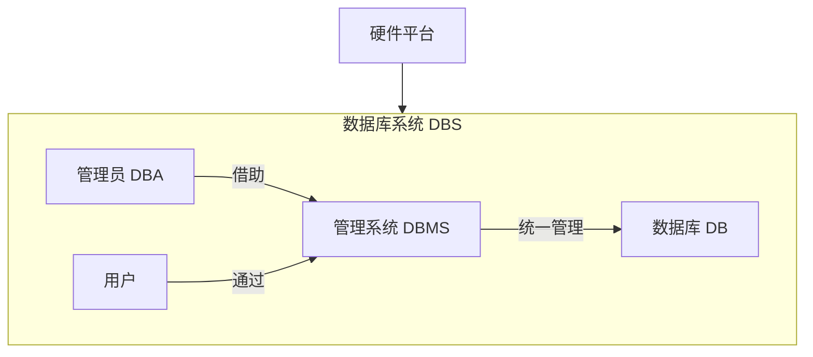
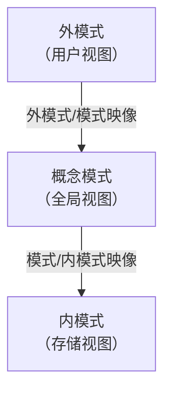

# 数据库系统（DBS）的组成与特点

## 是什么：DBS 的定义与组成

**数据库系统（Database System，DBS）** 是指在计算机系统中引入数据库后的系统构成。在不引起混淆的情况下，常把数据库系统简称为"数据库"。

> [!IMPORTANT]
> ==DBMS 是数据库系统的核心==。数据库存放数据，DBA 借助 DBMS 完成其职责，DBA 实施的各种操作都是在 DBMS 的控制下实现的。

**四个组成部分缺一不可**：
- **数据库（DB）**：长期存储在计算机内、有组织、可共享的大量数据集合
- **DBMS**：位于用户与操作系统之间的一层数据管理软件
- **用户**：最终用户、应用程序员
- **DBA**：负责数据库系统的运维、性能调优、备份恢复策略

## 为什么需要：与人工管理、文件系统的对比

为什么有了文件系统还需要数据库系统？关键在于==数据共享性、独立性和结构化程度==的质变：

| 对比维度 | 人工管理阶段 | 文件系统阶段 | 数据库系统阶段 |
|---------|------------|------------|-------------|
| 数据管理者 | 用户（程序员） | 文件系统 | DBMS |
| 数据面向对象 | 某一应用程序 | 某一应用 | 现实世界（企业级） |
| 共享程度 | 无共享，冗余极大 | 共享性差，冗余大 | 共享性高，冗余小，易扩充 |
| 数据独立性 | 不独立 | 独立性差 | ==高度物理独立性 + 一定逻辑独立性== |
| 数据结构化 | 无结构 | 记录内有结构，整体无结构 | ==整体结构化，用数据模型描述== |
| 数据控制 | 应用程序自己控制 | 应用程序自己控制 | DBMS 提供安全性、完整性、并发控制、恢复 |

> [!TIP]
> 记忆要点：数据库系统阶段的数据管理==采用数据模型表示复杂的数据结构==，这是与前两个阶段的本质区别。

## 怎么做：DBS 内部体系结构

从 DBMS 角度看，数据库系统采用==三级模式结构==（外部级、概念级、内部级），配合两级映像实现数据独立性：

> [!NOTE]
> 三级模式在 SQL 中的体现：外模式→视图（view），概念模式→基表（table），内模式→索引（index）等。模式是三级结构的中心。

## 常见的坑

> [!WARNING]
> **组成 vs 开发人员别混淆**
> - DBS 的组成：数据库、DBMS、用户、DBA（4个）
> - 开发 DBS 的人员：DBA、系统分析员、程序设计员、用户（4类角色）

> [!CAUTION]
> 数据字典（DD）由 **DBMS** 创建和管理，存放数据库的模式、安全性、完整性定义等——它不是 DBA 手工维护的文档，而是 DBMS 自动维护的系统表。

## 一个算对的例子

**题目**：判断下列说法是否正确——"数据库系统就是数据库管理系统的简称"。

**解答**：**错误**。DBS 是包含 DB、DBMS、用户、DBA 在内的完整系统，DBMS 只是 DBS 的核心组成部分。二者是整体与部分的关系，不能等同。正确定义：DBS 是实现有组织地、动态地存储大量关联数据、方便多用户访问的计算机软、硬件和数据资源组成的系统。
