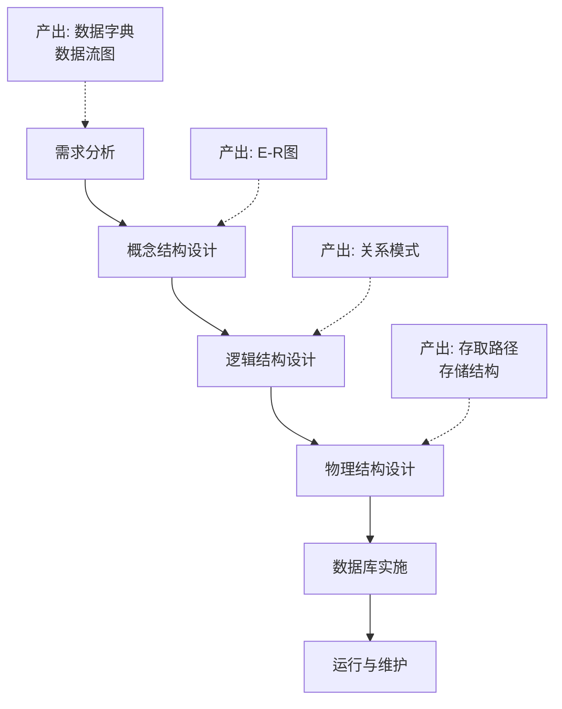

# 数据库设计的特点、方法与基本步骤

## 数据库设计的特点与方法

数据库设计不仅仅是画几张表，它是==结构设计与行为设计的结合==。早期设计常忽视行为对结构的影响，导致系统难以维护。现代设计强调运用软件工程原理，其中**新奥尔良（New Orleans）方法**是典型的工程化规程。此外，逻辑阶段常用 **3NF 设计法**保证数据一致性，而面向对象开发则采用 **UML/ODL** 方法。无论采用何种方法，核心目标都是构建既满足功能需求又符合规范化理论的数据模型。

## 六个基本步骤与产出

如果让你从零构建一个教务系统，你会直接建表吗？显然不行。数据库设计必须遵循严格的六步流程，每一步都有明确的“交付物”：

> [!IMPORTANT]
> 各阶段核心产出是考试填空与简答题的高频考点：
> -   **需求分析**：全系统数据项、数据结构、数据流、数据存储的描述（数据字典）。
> -   **概念设计**：E-R 图 + 数据字典。
> -   **逻辑设计**：某种数据模型（如关系模式）。
> -   **物理设计**：存储安排、分区、存取方法（索引/聚簇/HASH）。

## E-R 图绘制与转换实战

概念设计阶段的核心是 E-R 图。绘图时需严格遵循规范：==实体用矩形、联系用菱形、属性用椭圆==，主键属性名加下划线，连线上必须标明联系类型（$1:1, 1:n, m:n$）。

当进入逻辑设计阶段，如何将 E-R 图转换为关系模式？请牢记以下转换规则：

| 联系类型 | 转换策略 | 主键确定 |
| :--- | :--- | :--- |
| $m:n$ | ==独立建表== | 两端实体主键组合 |
| $1:n$ | 归入 $n$ 端 | $n$ 端原主键 |
| $1:1$ | 归入任一端或独立 | 视查询频率而定 |

> [!WARNING]
> **命名陷阱**：若题目需求描述使用中文（如“学生”、“选课”），E-R 图和关系模式中==必须使用中文==，擅自改为英文（Student/Course）会被扣分！

## 常见误区与避坑指南

在设计过程中，最容易出错的地方往往不是画图本身，而是集成与优化：

-   **冲突解决**：在自底向上集成局部 E-R 图时，需解决属性冲突（域/取值单位不同）、命名冲突（同名异义/异名同义）及结构冲突。解决方法是将同一对象的属性取==各子图属性的并集==，再调整次序。
-   **冗余消除**：不要凭感觉删减关系。必须以==数据字典和数据流图==为依据，通过分析数据项间的逻辑关系来消除冗余，而非简单合并表。
-   **范式判断**：从函数依赖集出发，先找候选键，再分析依赖类型。$1NF \to 2NF$ 消除非主属性对键的部分依赖；$2NF \to 3NF$ 消除传递依赖；$3NF \to BCNF$ 消除主属性对键的部分和传递依赖。

> [!TIP]
> 做设计大题时，建议按“需求 $\to$ E-R $\to$ 关系模式 $\to$ 范式验证”的顺序检查。若题目要求“无损分解且保持函数依赖”，务必验证分解后的模式集是否同时满足这两个条件，这是区分高分卷的关键点。
