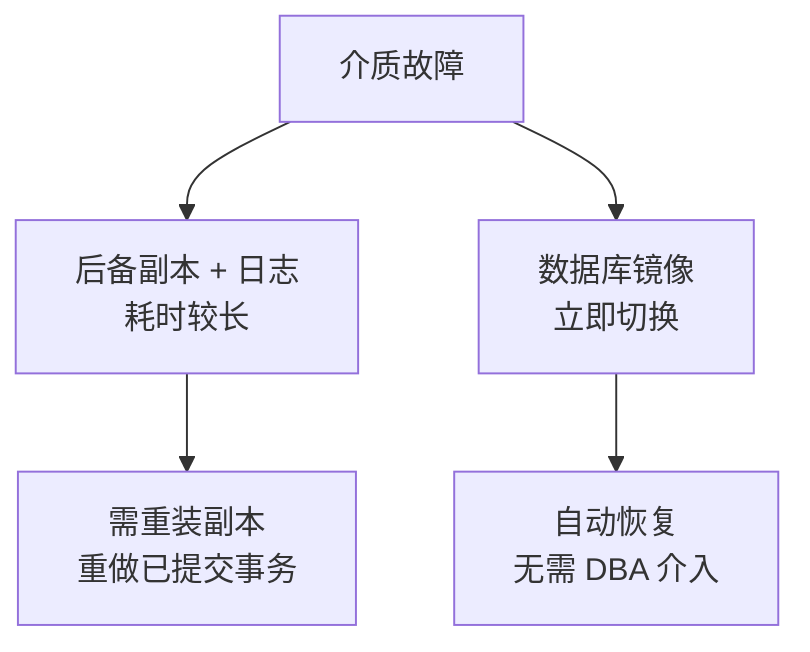
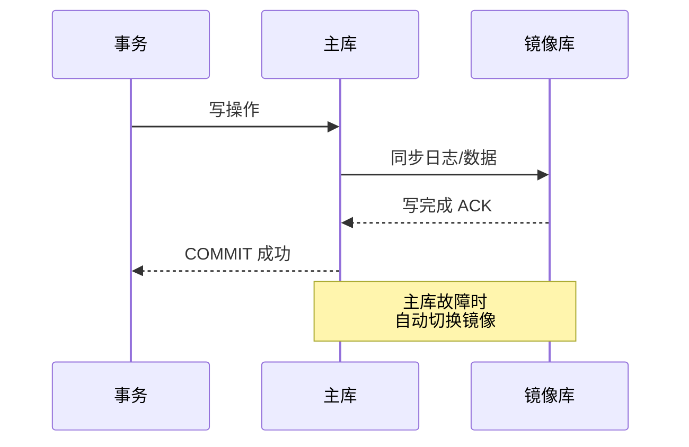

# 数据库镜像

## 数据库镜像是什么

数据库镜像（Mirror）是指==DBMS 自动把整个数据库（或其中的关键数据）复制到另一个磁盘/服务器上==，形成一份始终与主库保持同步的镜像副本。它是 11.7 节“介质故障恢复”中除**后备副本 + 日志文件**之外的第三条冗余路线，三者关系如下：

> [!IMPORTANT]
> 教材原话：利用存储在**后备副本、日志文件和数据库镜像**中的冗余数据来重建数据库。镜像不是替代前两者，而是为关键库再加一层保险。

## 为什么需要它

普通恢复要“重装后备副本 → 利用日志重做”，动辄数小时。若银行、证券等系统停机数小时，损失远超多买一块磁盘。镜像把 RTO（恢复时间目标）压缩到分钟甚至秒级，同时镜像副本还能==分担读负载==（报表查询打到镜像上）。

## 怎么做（运行机制）

- **同步镜像（Synchronous）**：主库提交事务前，必须等镜像也写完，数据零丢失，但写延迟增大。
- **异步镜像（Asynchronous）**：主库先返回，后台再同步，性能高但故障瞬间可能丢少量数据。

## 与相近概念的区别

| 概念 | 冗余粒度 | 同步程度 | 用途 |
|---|---|---|---|
| 后备副本 | 整个数据库 | 定期（小时/天级） | 介质故障后重装 |
| 日志文件 | 操作记录 | 实时 | 事务/系统故障重做回滚 |
| ==数据库镜像== | 整个数据库 | ==实时/准实时== | ==介质故障即时切换 + 分担读== |

> [!WARNING]
> 易混点：镜像 ≠ 日志。日志记“做了什么”，镜像存“数据本身”；镜像 ≠ 后备副本，后备副本是“昨天的快照”，镜像是“此刻的影子”。

## 常见坑

> [!CAUTION]
> ① 镜像只防**介质故障**，逻辑错误（误 DELETE）会立刻同步到镜像，仍需日志/备份做时间点恢复；② 同步镜像会拖慢写事务，考试若问“性能影响最大”的恢复技术，答案通常是它；③ 镜像副本平时别闲置，可承担读操作，但写必须落在主库。

## 算对了的例子

设某库 $200\ \mathrm{GB}$，介质故障后：

- 方案一：后备副本恢复 + 日志重做，共需 $4\ \mathrm{h}$；
- 方案二：启用镜像切换，仅切换与一致性检查需 $5\ \mathrm{min}$。

则镜像把停机时间缩短为

$$
\frac{5\ \mathrm{min}}{4\times60\ \mathrm{min}}\approx 2.1\%
$$

即恢复时间约为传统方式的 $\frac{1}{48}$。若该业务每小时损失 $50$ 万元，镜像少损失约 $50\times(240-5)/60\approx 195.8$ 万元——这正是企业愿意为镜像多付磁盘与带宽成本的原因。
