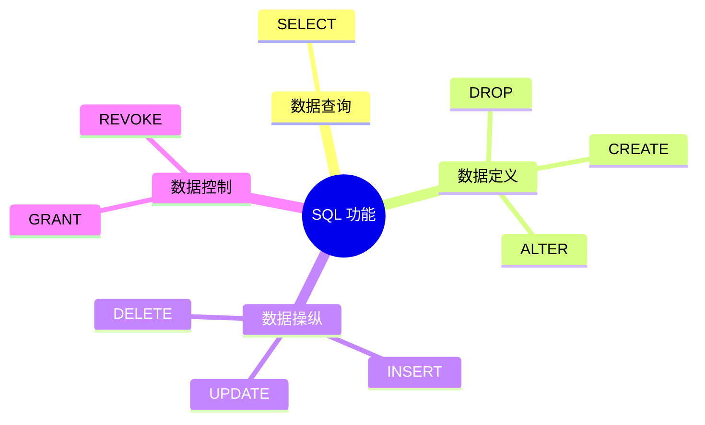
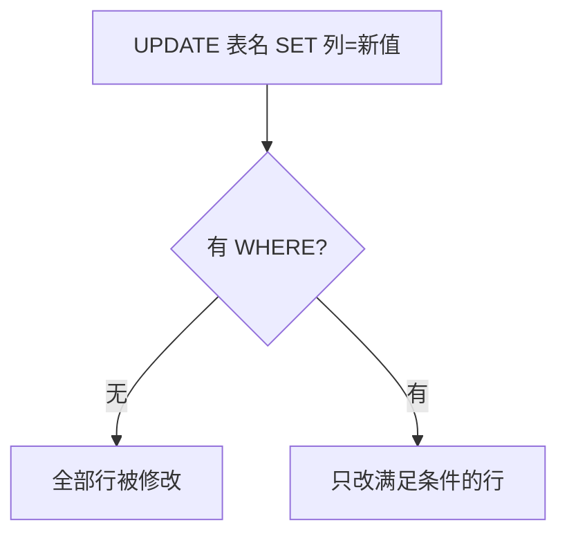

# 数据更新（INSERT、UPDATE、DELETE）

# 数据更新（INSERT、UPDATE、DELETE）

数据查询（SELECT）从数据库中“读”数据，而数据更新负责“写”——往表里加新行、改已有行的某些列、把不要的行删掉。SQL 中对应三个动词：`INSERT`、`UPDATE`、`DELETE`，统称**数据操纵语言（DML）**。



> [!IMPORTANT]
> 数据更新的==三条语句都只能一次操作一个表==。如果一条业务操作涉及多个表，要用多条语句分别执行。

---

## INSERT：插入元组

### 基本语法

```sql
INSERT INTO <表名> [(列名表)] VALUES <(数据项集)>;
```

### 两种写法

| 写法 | 示例 | 特点 |
|---|---|---|
| 指定列名 | `INSERT INTO Student(Sno, Sname, Ssex) VALUES('20180010', '贾明', '男');` | 未列出的列自动取 `NULL` 或默认值 |
| 省略列名 | `INSERT INTO Student VALUES('20180010', '贾明', '男', NULL, '信息管理与信息系统', NULL);` | 必须按表定义顺序给出==全部列==的值 |

### 常见坑

[!WARNING]
**省略列名表时，必须为每一列都提供值**，即使某列允许为空，也要写上 `NULL` 占位。只写了三列数据却省略列名表，会直接报错。

看一个例子：

```sql
INSERT INTO SC(Sno, Cno, Grade, Semester, Teachingclass)
VALUES('20180006', '81004', NULL, '20211', NULL);
```

这里 `Grade` 和 `Teachingclass` 暂时不知道，但列名已列全，给 `NULL` 就是合法的。如果省略 `Grade` 而不写，也能插入，效果一样——该列自动为 `NULL`，前提是表定义中该列允许为空。

---

## UPDATE：修改元组

### 基本语法

```sql
UPDATE [表创建者.]<表名>
SET <列名> = <值表达式> [, <列名> = <值表达式> ...]
[WHERE <条件表达式>];
```

### 关键点：WHERE 决定改谁



> [!IMPORTANT]
> ==不带 WHERE 的 UPDATE 会修改全表所有行==。忘记写 WHERE 是最常见的事故，几乎没有之一。

### 例子：把全部红色零件改成蓝色

```sql
UPDATE P
SET COLOR = '蓝'
WHERE COLOR = '红';
```

`WHERE` 限定只有 `COLOR='红'` 的行被修改。若去掉 `WHERE`，则所有零件的颜色都变成蓝色。

### 子查询嵌套

`UPDATE` 中也能套子查询构造修改条件。当需要“把满足某个查询结果条件的行改掉”时使用，例如：

```sql
UPDATE SC
SET Grade = 0
WHERE Sno IN (SELECT Sno FROM Student WHERE Smajor = '计算机科学与技术');
```

先把“计算机科学与技术专业的所有学号”查出来，再把 SC 表中这些学生的成绩置 0。

---

## DELETE：删除元组

### 基本语法

```sql
DELETE FROM [表创建者.]<表名> [WHERE <条件表达式>];
```

### 关键点

[!CAUTION]
**没有 WHERE 的 DELETE 会清空整个表**，但表定义（表结构）还在，不同于 `DROP TABLE`。`DROP` 是删除整张表，`DELETE` 只是删数据行。

| 语句 | 效果 |
|---|---|
| `DELETE FROM SC;` | 删光 SC 的所有元组，SC 变成空表，表结构保留 |
| `DROP TABLE SC;` | 整张表连结构一起删除，数据库里不再有 SC |

### 例子

把供应商 S2 从供应关系表和供应商表中都删掉：

```sql
DELETE FROM SPJ WHERE SNO = 'S2';
DELETE FROM S WHERE SNO = 'S2';
```

这是两条独立语句，先删“从表”（引用者），再删“主表”（被引用者），避免违反参照完整性。

---

## 数据更新与完整性约束

数据更新不能破坏数据库的完整性约束。一道综合题正好覆盖了五种情形：

| 约束要求 | SQL 实现 | 要点 |
|---|---|---|
| 年龄 16～25 | `CHECK (AGE BETWEEN 16 AND 25)` | 插入/更新时自动检查 |
| S#、C# 不为空 | `S# ... NOT NULL, C# ... NOT NULL` | 插入时必须给值 |
| SC 参照 S 和 C | `FOREIGN KEY (S#) REFERENCES S` | 外键约束 |
| 删除 S 时限制 | `... ON DELETE RESTRICT` | 若有 SC 引用该 S 行，则==拒绝删除== |
| 更新 S 时级联 | `... ON UPDATE CASCADE` | 更新 S# 时，SC 中引用它的行==自动跟随修改== |

> [!TIP]
> 记忆口令：**RESTRICT 拖后腿，CASCADE 带全家**。RESTRICT 拒绝操作，CASCADE 联动把引用数据一起改或删。

---

## 通过视图更新数据

视图不是存储的数据本身，所以对视图做 `INSERT`、`UPDATE`、`DELETE` 有额外限制。

> [!IMPORTANT]
> 一般只允许对**行列子集视图**进行更新。更新后的结果必须==满足视图定义中的谓词条件==，否则会被拒绝，尤其在视图定义带有 `WITH CHECK OPTION` 时。

```sql
CREATE VIEW IS_Student1 AS
SELECT Sno, Sname, Ssex, Sbirthdate
FROM Student
WHERE Smajor = '信息管理与信息系统'
WITH CHECK OPTION;
```

```sql
-- 插入成功：专业是“信息管理与信息系统”，符合视图谓词
INSERT INTO IS_Student1
VALUES('20180010', '贾明', '男', '2001-11-1', '信息管理与信息系统');

-- 插入失败：专业是“计算机科学与技术”，违反 WITH CHECK OPTION
INSERT INTO IS_Student1
VALUES('20180011', '王伟', '男', '2003-11-1', '计算机科学与技术');
```

第一条插入的行满足视图定义的 `WHERE Smajor='信息管理与信息系统'`，成功；第二条违反谓词，失败。==不带 WITH CHECK OPTION 的视图，DBMS 未必拒绝“插不进去也没报错”的情形==，但南邮考试中重点考的是带该子句的行为。

---

## 算对了的例子

把供应商 S5 供给工程 J4 的零件 P6 改成由 S3 供应：

```sql
UPDATE SPJ
SET SNO = 'S3'
WHERE SNO = 'S5' AND JNO = 'J4' AND PNO = 'P6';
```

三个条件用 `AND` 连接，精确锁定那一行——只有当“供应商=S5、工程=J4、零件=P6”同时满足时才改，不会误伤其他行。执行后，这一行从 (S5, J4, P6) 变为 (S3, J4, P6)。
