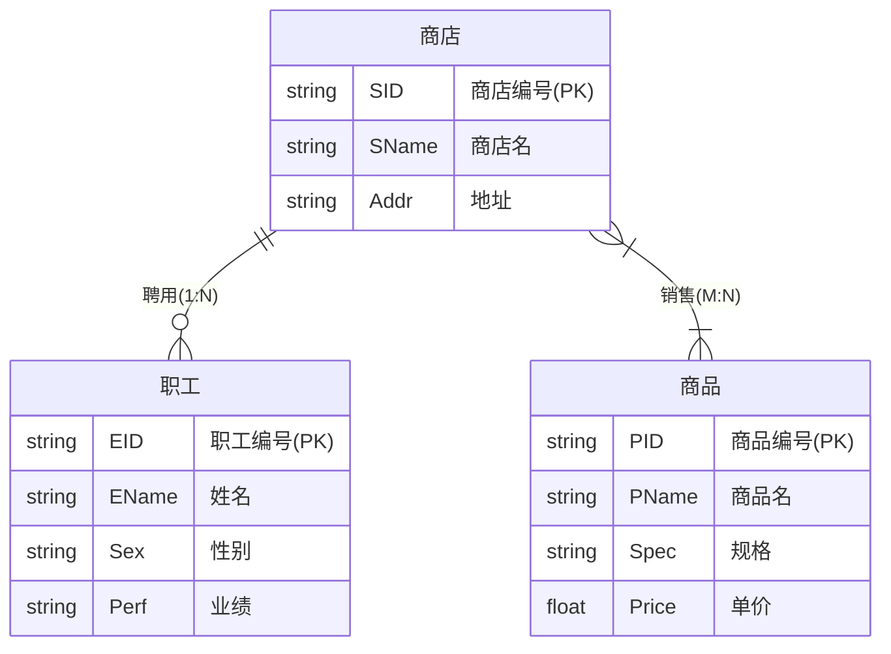

# 数据模型（概念模型与逻辑模型）

现实世界的数据千差万别，计算机怎么“看懂”它们？我们需要一套规则把现实事物翻译成计算机能处理的形式，这套规则就是==数据模型==。

数据库技术的发展正是沿着数据模型的主线推进的。与人工管理阶段（无结构）和文件系统阶段（记录内有结构、整体无结构）不同，数据库系统阶段的核心特点是：==整体结构化，用数据模型描述==。

## 数据的两次抽象

从现实世界到计算机存储，数据要经历三次转换：

- **概念模型**：按==用户观点==对数据和信息建模，独立于计算机系统，与 DBMS 无关。典型代表是 E-R 模型。
- **逻辑模型**：按==计算机系统观点==对数据建模，反映数据的逻辑结构，与具体的 DBMS 有关。传统三大逻辑模型为关系模型、网状模型、层次模型。
- **物理模型**：最低层抽象，反映数据在磁盘上的存储结构（物理块、指针、索引等），由 DBMS 完成，对用户屏蔽。

> [!IMPORTANT]
> 概念模型面向客观世界和用户；逻辑模型既面向用户又面向实现；物理模型面向底层硬件。考试常考三者的区别与对应的设计阶段。

## 逻辑模型的三要素

任何一个逻辑数据模型都由三部分组成：

1. **数据结构**：描述数据库的组成对象及对象间的联系（通常用数据结构的类型来命名数据模型，如“关系”模型）。
2. **数据操作**：对数据库中各种对象实例允许执行的操作集合（如查询、更新）。
3. **完整性约束**：给定数据模型中数据及其联系所具有的制约和依存规则，用以限定符合数据模型的数据库状态及状态变化，保证数据的正确、有效和相容。

## 概念模型怎么做：E-R 图

概念模型最常用的表示方法是实体-联系模型（E-R 模型）。画 E-R 图需要明确三个基本成分：

| 符号 | 含义 | 举例 |
| :---: | :--- | :--- |
| 矩形 | 实体集 | 商店、商品、职工 |
| 椭圆 | 属性（键加下划线） | **商店编号**（主键）、商店名 |
| 菱形 | 联系（标明基数比） | 销售（M:N）、聘用（1:N） |

> [!TIP]
> 画 E-R 图口诀：找准实体画方框，属性挂上椭圆旁，主键底下划横线，联系菱形标数量。

### 一个完整的例子

以课件中的商业集团为例：商店、商品、职工三个实体集，存在“销售”和“聘用”两个联系。

- “每个商店可销售多种商品，每种商品也可放在多个商店销售” $\Rightarrow$ 商店与商品之间是 **M:N** 联系。
- “月销售量”依附于谁？它既不单属于商店，也不单属于商品，而是发生在“销售”这个动作中，因此是==联系的属性==。
- “每个商店有许多职工，每个职工只能在一个商店工作” $\Rightarrow$ 商店与职工之间是 **1:N** 联系。

正确的 E-R 图如下：

> [!WARNING]
> 常见坑：把联系的属性（如“月销售量”“聘期”“月薪”）错画成某个实体的属性。记住：==联系产生的数据，必须挂在菱形上==。

> [!NOTE]
> 逻辑设计中，需将 E-R 图转换为具体 DBMS 支持的关系模型（二维表），这就是从概念模型向逻辑模型的跨越。关系模型与其他两种传统模型的最大差别在于：用关键码而不是指针导航数据。
