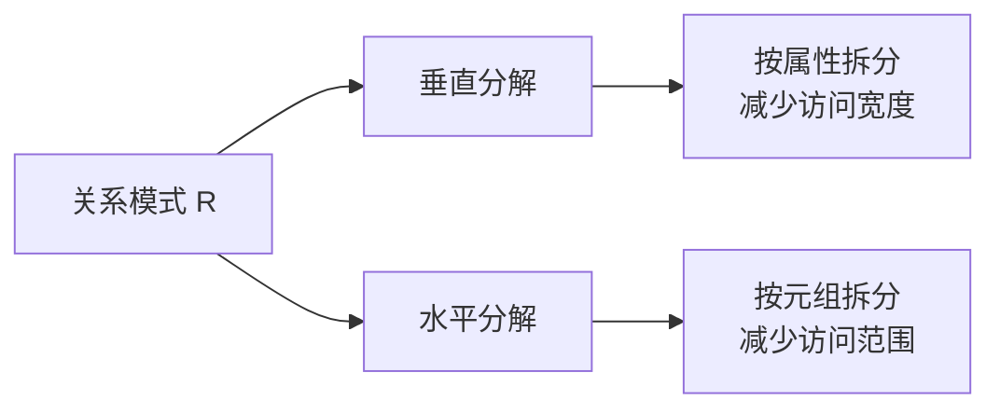

# 数据模型的优化与用户外模式设计

## 数据模型的优化与用户外模式设计

拿到初步的数据库逻辑结构之后，设计工作并没有结束。同一个需求，可以画出好几种 E-R 图、转换出好几种关系模式，但它们运行起来的性能可能差很多。==数据模型的优化，就是对初步得到的关系模式进行修改和调整，以提高数据库应用系统的性能==。这一步通常以**规范化理论**为指导。

[!IMPORTANT]
> 优化的核心手段是：对关系模式进行**垂直分解**（把一个大表按属性拆开）和**水平分解**（把一个大表按元组拆开），在规范化和查询效率之间做出权衡。规范化程度不是越高越好。

### 为什么要优化

先看一个直觉问题：一个表里塞了太多属性会怎样？

假设有一个关系模式：

$$
R(\underline{学号}, 姓名, 系名, 系主任, 课程号, 课程名, 成绩)
$$

它至少存在这些毛病：

- **插入异常**：新来的学生还没选课，课程号为空，主键不完整，插不进去。
- **删除异常**：某学生退掉最后一门课，他的姓名、系别信息也跟着丢了。
- **冗余大**：同一个系的所有学生都要重复存“系主任”，一门课被多少学生选，“课程名”就要重复多少遍。

规范化的思路就是把这些“混杂在一起”的信息拆开，比如拆成：

$$
学生(学号, 姓名, 系号) \quad 系(系号, 系名, 系主任) \quad 选课(学号, 课程号, 成绩)
$$

这样插入、删除、更新异常基本消除。这就是**以规范化理论为指导**所做的优化。

### 规范化到第几范式

课件和考试里经常问的一个点是：==一般要求达到 **3NF**，有时需要到 **BCNF**==。

- **3NF** 消除了非主属性对候选码的传递函数依赖和部分函数依赖，已经能解决大部分实际问题中的冗余和异常。
- **BCNF** 更进一步，要求每一个决定因素都包含码。但实际设计中，不是所有关系都必须强行分解到 BCNF——分解得太细，查询时要做大量连接，反而拖慢性能。

> [!WARNING]
> 考试中判断范式等级时，不要只背定义。第一步先找**候选码**，第二步再看**非主属性**有没有部分依赖、传递依赖。很多同学栽在不找候选码就直接凭感觉判断。

### 规范化的代价与反规范化

规范化减少冗余，但也带来一个新问题：**查询变慢**。原来一条 SQL 从一个大表里就能查完的数据，现在可能要连接三四张表。

所以数据模型优化还有一个反向操作——**适当反规范化**：

- 把经常一起查询、又很少修改的属性合在一张表里；
- 增加冗余列或派生列，以减少连接；
- 对**历史数据、统计报表**这类很少更新的场景，容忍冗余。

优化的真正原则是：==在高频查询路径上减少连接，在写入频繁的表上保持高规范化==。这不是“要么规范化、要么反规范化”，而是按使用频率分别处理。

### 水平分解与垂直分解

除了规范化拆分，优化还有两种物理意义更强的分解方式：

**垂直分解**：把一张宽表中不常用的属性移出去。例如学生表里的 `照片`、`个人简介` 很少参与查询，单独放一张子表，主表保持窄小，扫描更快。

**水平分解**：把一张大表中的元组按条件分片。例如按年份把选课记录拆成 `选课_2023`、`选课_2024`，查询某一年时只需要扫描对应分片。

### 用户外模式设计

模型优化完成后，还要为不同类型的用户定义**外模式**，也就是视图。

为什么要做外模式设计？两个直接原因：

1. **安全**：财务人员只能看到工资相关字段，不能看到医疗信息；学生只能查成绩，不能查别人的家庭住址。视图可以把敏感列挡在外面。
2. **简化**：用户不需要理解底层 3NF 拆分的多张表，给他一个视图，把经常用到的连接提前做好。

> [!TIP]
> 外模式就是“给每个用户配一副合适的眼镜”。底层逻辑模式只有一套，但不同用户看到的是不同的外模式。考试中如果问“外模式的作用”，抓住**安全保护**和**用户友好/简化接口**两条基本就够。

### 一个算对了的例子

设关系模式：

$$
R(A, B, C, D)
$$

函数依赖集 $F = \{ A \to B, B \to C \}$，候选码为 $AD$。

判断它属于第几范式：

1. 候选码 $AD$，非主属性是 $B$ 和 $C$。
2. $A \to B$ 中，$A$ 不是候选码 $AD$ 的真子集吗？是，所以 $B$ 部分依赖于候选码。
3. 有非主属性部分依赖，直接判定：$R$ **连 2NF 都达不到**，属于 1NF。

如果把 $R$ 分解为：

$$
R_1(A, B),\quad R_2(B, C),\quad R_3(A, D)
$$

再检查：$R_1$ 中 $A$ 是码，$B$ 完全依赖 $A$；$R_2$ 中 $B$ 是码；$R_3$ 中 $AD$ 是码。此时各关系模式均达到 BCNF，插入、删除异常消除。这就是一个完整的“规范化优化”过程。

> [!NOTE]
> 判断范式等级时，每次都要从“找候选码 → 找非主属性 → 检查部分依赖/传递依赖”三步走。直接背答案很容易在复合函数依赖的题里出错。
