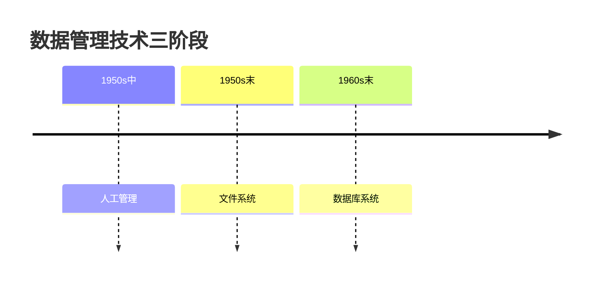

# 数据管理技术的产生和发展（人工管理、文件系统、数据库系统）

数据管理技术的发展经历了三个阶段：==人工管理、文件系统、数据库系统==。它们并非平级概念，而是随着硬件和软件的进步，对数据"怎么存、谁来管、谁能用"这个问题的三次回答。

## 为什么会有这三次演变

早期计算机只为科学计算服务，数据用完即弃；随着应用从计算扩展到数据管理，数据量和共享需求暴涨，旧方式撑不住，于是管理技术不断换代。可以用一张时间线快速把握：

## 人工管理阶段（20 世纪 50 年代中之前）

背景：无直接存取存储设备，没有操作系统，更没有管理数据的专门软件，处理方式是批处理。

- 数据的管理者是==用户（程序员）==，数据不保存，用完就撤。
- 数据面向某一个应用程序，无结构。
- ==无共享，冗余度极大==，数据完全依赖于程序，不独立。

应用程序与数据一一绑定，程序变则数据变。

## 文件系统阶段（20 世纪 50 年代末—60 年代中）

背景：出现磁盘、磁鼓，有了文件系统，支持联机实时处理和批处理。

- 数据的管理者变成文件系统，数据可长期保存。
- 记录内部有结构，但==整体无结构==；数据面向某一应用。
- 共享性差、冗余度大，独立性差——一个文件常被多个程序重复维护，改一处要改多处。

## 数据库系统阶段（20 世纪 60 年代末—现在）

背景：大容量磁盘、磁盘阵列，出现数据库管理系统（DBMS），支持联机实时处理、分布处理和批处理。

数据库系统（Database System，DBS）指在计算机系统中引入数据库后的系统构成；不引起混淆时简称"数据库"。它的管理特点是：

- ==数据整体结构化==，用数据模型描述，面向现实世界（一个企业、跨国公司）。
- 共享性高、冗余度小、易扩充。
- 具有高度的物理独立性和一定的逻辑独立性。
- 数据由 DBMS 统一管理和控制：安全性保护、完整性保护、并发控制、数据库恢复。

## 三阶段对比速记

| 对比项 | 人工管理 | 文件系统 | 数据库系统 |
| --- | --- | --- | --- |
| 应用背景 | 科学计算 | 科学计算、数据管理 | 大规模数据管理 |
| 硬件背景 | 无直接存取设备 | 磁盘、磁鼓 | 大容量磁盘、磁盘阵列 |
| 软件背景 | 无 OS、无专门软件 | 文件系统 | DBMS |
| 处理方式 | 批处理 | 联机实时、批处理 | 联机实时、分布、批处理 |
| 数据管理者 | 用户（程序员） | 文件系统 | DBMS |
| 面向对象 | 某一应用程序 | 某一应用 | 现实世界 |
| 共享/冗余 | 无共享，冗余极大 | 共享差，冗余大 | 共享高，冗余小 |
| 独立性 | 不独立 | 差 | 物理高度独立+一定逻辑独立 |
| 结构化 | 无结构 | 记录内有，整体无 | ==整体结构化== |
| 控制能力 | 应用自己控制 | 应用自己控制 | DBMS 提供四类控制 |

> [!TIP]
> 记忆锚点：三个"管理者"依次是 ==用户 → 文件系统 → DBMS==；结构化程度依次是 无结构 → 记录内有结构 → 整体结构化。

> [!WARNING]
> 常见坑：把"文件系统阶段"说成"数据不能长期保存"是错的——能长期保存是文件系统相对于人工管理的进步；真正的问题在于==整体无结构、共享性差==。另一个坑是把"数据独立性高"归到文件系统，那是数据库系统的特点。

## 一个考过的例子

题目问"数据库系统的特点"，正确作答要点：数据的整体结构化是数据库的主要特征之一；数据共享性高、冗余度低且易扩充；数据独立性高；数据由 DBMS 统一管理和控制，具体包括安全性保护、完整性保护、并发控制和数据库恢复。注意四点缺一不可，尤其别漏掉"并发控制"和"数据库恢复"。
