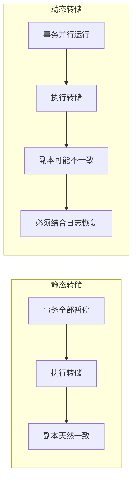

# 数据转储（静态/动态、海量/增量）

## 数据转储是什么

数据库运行中，==数据转储（Dump）== 就是 DBA 定期将整个数据库或部分数据复制到磁带、磁盘等存储介质上保存起来。这些保存的副本称为**后备副本**或**备份副本**。

> [!IMPORTANT]
> 数据转储是数据库恢复的基本技术。没有后备副本，数据库一旦遭到破坏就无法恢复。但转储不能太频繁——它既占用时间，也消耗系统资源。

当数据库发生故障时，DBA 用后备副本将数据库恢复到转储时刻的状态，再借助日志文件，把转储之后已提交的事务重做（REDO），把未提交的事务撤销（UNDO），最终让数据库回到故障前的一致性状态。

---

## 两种分类方式交叉组合

转储可以从两个维度来划分，课件中出现的四种转储方式，都是这两个维度的组合：

| 转储方式 | 动态转储 | 静态转储 |
|---------|---------|---------|
| **海量转储** | 动态海量转储 | 静态海量转储 |
| **增量转储** | 动态增量转储 | 静态增量转储 |

下面分别展开这两个维度。

---

## 按事务能否并行执行：静态转储与动态转储

静态转储与动态转储的核心区别在于：==转储期间是否允许其他事务运行，是否允许对数据库进行存取或修改。==

### 静态转储

==静态转储==：在系统中**无运行事务**时进行转储。转储开始时，所有事务必须处于已结束或未开始状态，转储期间数据库不允许任何事务访问。

- 优点：转储得到的是一个**事务一致性副本**——装入后数据库直接处于一致性状态，恢复简单。
- 缺点：转储期间整个数据库对外不可用，可能严重影响业务。

### 动态转储

==动态转储==：转储期间**允许事务对数据库进行存取或修改**。

- 优点：转储过程不影响正常业务运行。
- 缺点：后备副本不能保证事务一致性（转储期间可能有事务正在修改数据），装入后数据库不一定处于一致性状态。

> [!CAUTION]
> 动态转储得到的副本，必须配合==转储期间的日志文件==一起使用。恢复时先装入后备副本，再重演日志（REDO + UNDO），才能将数据库恢复到一致性状态。静态转储虽然也可以建立日志，但不强制依赖日志来恢复。

下图对比了两种方式：

---

## 按转储内容多少：海量转储与增量转储

### 海量转储

==海量转储==：每次转储**整个数据库**的全部数据。

- 优点：恢复方便，只有一个副本，装入即可。
- 缺点：耗时长，占用空间大，不适合大型数据库频繁操作。

### 增量转储

==增量转储==：只转储**上次转储以来更新过的数据**。

- 优点：节省时间和空间，适合大型数据库和事务繁忙的场景。
- 缺点：恢复过程更复杂，需要按顺序装入海量副本和历次增量副本，再结合日志。

> [!TIP]
> 记忆：数据库很大、事务频繁 → 增量更实用；数据库不大或者恢复简单优先 → 海量更省事。

---

## 恢复过程为何必须依赖日志

无论哪种转储方式，漏洞始终存在：==转储时刻到故障发生时刻之间，数据库是“裸露”的。==

静态转储：副本装入后数据库处于转储时刻一致性状态 → 但转储之后的修改全部丢失。
动态转储：副本装入后可能根本不一致 → 连一致性状态都没有。

所以恢复时：
- **静态转储副本** + 日志文件 → 重做转储后提交的事务，撤销未提交的事务。
- **动态转储副本** + 转储期间的日志 + 转储后的日志 → 先装副本，再重演日志，才能恢复到一致性状态。

---

## 常见考题与易错点

### 例题回顾

> **题干：** 关于数据库转储的描述，下列哪项正确？
> - A. 静态转储指在系统中无运行事务时进行的转储操作。
> - B. 动态转储指在转储期间允许对数据库进行存取或修改。

**分析：**

静态转储定义的核心就是“无运行事务”，所以 A 正确。  
动态转储定义的核心是“允许对数据库存取或修改”，所以 B 也正确。

### 常见坑点

> [!WARNING]
> 1. **混淆关系模式与关系实例**：关系模式是静态的、稳定的；关系（实例）是动态的、随时间变化的。静态转储的“静态”是事务调度层面的概念，跟关系的动静无关，不要混为一谈。
> 2. **认为动态转储副本可以直接恢复**：这是常考陷阱。动态转储副本本身不一定一致，==必须同步记录并回放日志==。
> 3. **转储频率误区**：转储是核心恢复技术，但不能频繁转储，要综合考虑性能开销和数据安全。
