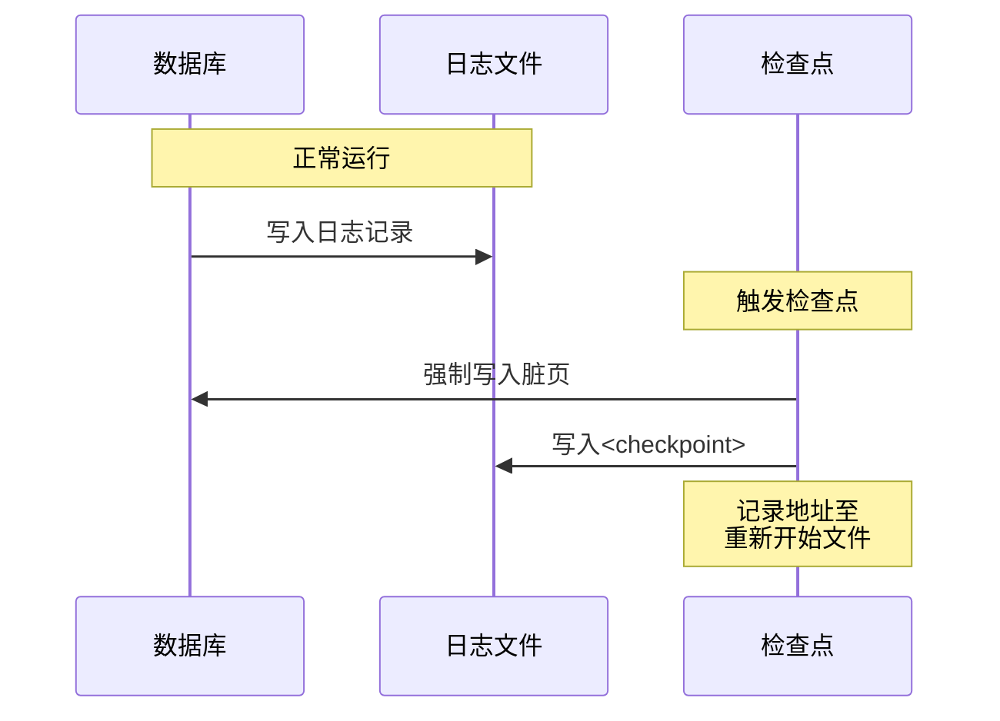

# 日志文件（格式、内容、作用、登记规则）

## 什么是日志文件

日志文件（Log File）是数据库恢复技术的核心冗余数据。它用来==记录事务对数据库的更新操作==。你可以把它想象成数据库的“黑匣子”或“记账本”，无论数据库内部如何变化，所有修改的历史轨迹都被完整保留。

> [!IMPORTANT]
> 日志文件是实现事务**原子性**（Atomicity）和**持久性**（Durability）的关键技术支撑。

## 为什么需要日志文件

如果没有日志，当系统发生崩溃（如断电、硬件故障）时，内存中未写入磁盘的数据将永久丢失，已写入但事务未提交的数据会导致数据库处于不一致状态。

日志文件的主要作用包括：
1. **事务故障恢复**：撤销（UNDO）未完成事务的影响。
2. **系统故障恢复**：重做（REDO）已提交但未落盘的事务，撤销未提交事务。
3. **介质故障恢复**：结合后备副本，将数据库恢复到某一时刻的正确状态。

## 日志文件的格式与内容

不同系统采用的格式略有差异，主要分为两类：

| 格式类型 | 记录单位 | 典型内容要素 |
| :--- | :--- | :--- |
| **以记录为单位** | 事务更新操作 | 事务标识、操作类型、更新前值(BI)、更新后值(AI) |
| **以数据块为单位** | 物理数据块 | 事务标识、被修改数据块的地址、更新前映像、更新后映像 |

*   **前像 (Before Image, BI)**：更新前的旧值，用于 **UNDO**。
*   **后像 (After Image, AI)**：更新后的新值，用于 **REDO**。

## 登记日志文件的原则

这是考试中最常考的易错点。为保证数据库可恢复，必须严格遵循以下两条原则：

1. **次序严格**：登记的次序必须严格按并发事务执行的时间次序。
2. **先写日志，后写数据库**（Write-Ahead Logging, WAL）。

> [!WARNING]
> **为什么要“先写日志”？**
> *   若先写数据库，后写日志：若写库成功后系统崩溃，日志中无记录，无法恢复该修改，破坏持久性。
> *   若先写日志，后写数据库：若写日志成功后系统崩溃，恢复时只需对该事务执行不必要的 UNDO，不会破坏数据库正确性。

## 检查点机制 (Checkpoint)

全量扫描日志效率极低，因此引入检查点机制。

**检查点时刻的操作：**
1. 将日志缓冲区内容写入磁盘日志文件。
2. 将当前所有已修改的数据块（脏页）写入磁盘。
3. 在日志文件中写入一个 `<checkpoint>` 记录。
4. 将检查点记录地址写入“重新开始文件”。

**恢复时的优势：** 只需从**最近一个检查点**开始扫描日志，无需从头扫描。

## 常见坑与解题技巧

*   **坑1**：混淆 UNDO 和 REDO 的对象。
    *   **UNDO**：针对故障发生时**未提交**的事务（包括已开始但未结束，或已回滚的事务）。
    *   **REDO**：针对故障发生时**已提交**的事务。
*   **坑2**：忽略检查点。在分析日志恢复题时，先找到最后一个 `<checkpoint>`，之前的已提交事务通常无需处理（视具体算法而定，南邮考题通常关注检查点后的状态）。

## 实例分析

假设 A, B, C 初值为 0，日志如下：

| 序号 | 日志内容 | 说明 |
| :--- | :--- | :--- |
| 1 | $T_1$: Start | |
| 2 | $T_1$: Write A, A=5 | |
| 6 | $T_1$: Commit | $T_1$ 已提交，需 **REDO** |
| 9 | Checkpoint | 检查点 |
| 11 | $T_2$: Rollback | $T_2$ 已回滚，需 **UNDO** |
| 14 | $T_3$: Commit | $T_3$ 已提交，需 **REDO** |

**恢复策略：**
1.  **$T_1$**：在检查点前已提交。若采用静态转储+日志，可能需 REDO；若动态维护，取决于检查点实现。但在典型考题中，检查点后故障，主要关注检查点后的活跃事务。
2.  **$T_2$**：明确回滚，执行 **UNDO**，将 B 恢复为旧值。
3.  **$T_3$**：已提交，执行 **REDO**，确保 C=16, B=15 写入数据库。

> [!TIP]
> **记忆口诀**：未做完的要撤消（UNDO），做完没存盘的要重做（REDO），先记帐后改库。
