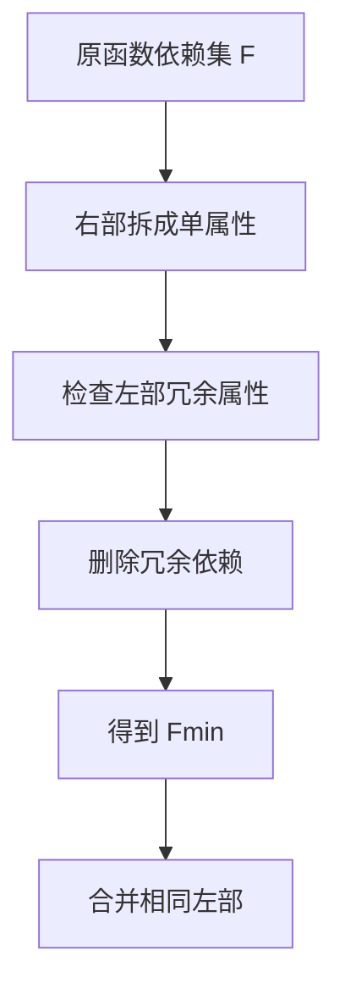

# 最小依赖集与函数依赖集等价

> [!IMPORTANT]
> **函数依赖集等价**：设 $F$ 和 $G$ 是函数依赖集，若 $F^+=G^+$，则称 $F$ 和 $G$ 等价，记为 $F=G$。注意，比较的是**闭包**，不是逐个比较依赖是否相同。

## 为什么需要最小依赖集

同一个 $F^+$ 可以由不同的函数依赖集推出。例如 $F=\{A\to B,\ B\to C,\ A\to C\}$ 中，$A\to C$ 可由前两条推出，保留它并不增加闭包。这样的冗余会增加 3NF 分解得到的模式数量，也使候选键、投影依赖等计算更繁琐。因此，需要在**不改变 $F^+$** 的前提下，得到一个右部单一、没有冗余依赖、左部没有冗余属性的函数依赖集。

最小函数依赖集 $F_{\min}$ 满足：

1. $F_{\min}^+=F^+$；
2. 每个函数依赖的右部都是单个属性；
3. 无冗余 FD，即不存在 $X\to Y$，使 $F-\{X\to Y\}$ 与 $F$ 等价；
4. 每个 FD 的左部无冗余属性，即不能把左部属性删去后仍保持等价。

> [!NOTE]
> 最小依赖集是满足上述条件的一种等价表示，**不一定唯一**。不同处理顺序可能得到不同的 $F_{\min}$，但它们的闭包都等于 $F^+$。

## 怎样求最小依赖集

### 右部单一化

利用分解规则，将

$$X\to A_1A_2\cdots A_k$$

拆成 $X\to A_1,\ldots,X\to A_k$。例如 $A\to BC$ 拆成 $A\to B$、$A\to C$。

### 去掉左部冗余属性

设当前依赖为 $X\to A$，取 $Z\subset X$。若用 $Z$ 替换 $X$ 后仍能推出原来的依赖，即

$$A\in Z_F^+,$$

则 $X$ 中多出的属性是冗余的，可用 $Z\to A$ 替换。

例如已有 $A\to B$ 和 $AB\to C$。因为

$$A_F^+\supseteq\{A,B,C\},$$

所以 $A\to C$ 已能推出，$AB\to C$ 左部的 $B$ 冗余，应改为 $A\to C$。

### 删除冗余依赖

对当前依赖集中的 $X\to A$，暂时删去它，得到 $G$。若

$$A\in X_G^+,$$

说明即使不写这条依赖，也能由其余依赖推出，因此可以删除；否则必须保留。

> [!TIP]
> 判断“能否删”时，==闭包计算必须排除正在检查的这条依赖==。若仍用完整的 $F$ 求 $X_F^+$，几乎总会得到 $A\in X_F^+$，从而误删必要依赖。

## 一个算对了的例子

设

$$F=\{A\to B,\ B\to C,\ A\to C,\ AB\to D\}.$$

各依赖右部已经是单属性。

先检查 $AB\to D$：去掉左部的 $B$ 后，$A_F^+=\{A,B,C,D\}$，包含 $D$，所以可替换为 $A\to D$。此时得到

$$G=\{A\to B,\ B\to C,\ A\to C,\ A\to D\}.$$

再检查 $A\to C$。暂时删除它，令

$$H=\{A\to B,\ B\to C,\ A\to D\},$$

则

$$A_H^+=\{A,B,C,D\}.$$

因为 $C\in A_H^+$，所以 $A\to C$ 冗余，可以删除。其余依赖均不能由剩余依赖推出，故一个最小依赖集为

$$\boxed{F_{\min}=\{A\to B,\ B\to C,\ A\to D\}}.$$

验证：$A_{F_{\min}}^+=\{A,B,C,D\}$，仍能推出原集中的全部依赖，因此 $F_{\min}^+=F^+$。

用于 3NF 合成时，再把左部相同的依赖合并，可写成 $\{A\to BD,\ B\to C\}$；==合并只是书写变化，求最小依赖集时仍须保持右部单属性==。

## 相近概念与常见坑

| 概念或操作 | 核心判断 | 常见误区 |
|---|---|---|
| 函数依赖集等价 | $F^+=G^+$ | 要求 $F$、$G$ 写法完全相同 |
| 最小依赖集 | 等价、右部单属性、无两类冗余 | 认为结果必然唯一 |
| 属性集闭包 $X_F^+$ | 属性能否由 $X$ 推出 | 与函数依赖集闭包 $F^+$ 混淆 |
| 冗余依赖检查 | 删除后用剩余依赖求闭包 | 仍用原 $F$ 求闭包 |
| 3NF 合成前合并 | 合并左部相同的 FD | 合并后又继续当作单右部形式处理 |

> [!WARNING]
> 求最小依赖集、求候选键、判断分解是否保持依赖是不同任务。最小依赖集用于消除冗余；候选键仍要根据属性集闭包是否等于全集，以及其真子集是否不能决定全集来判断，不能直接把某个最小依赖集的左部当成候选键。
